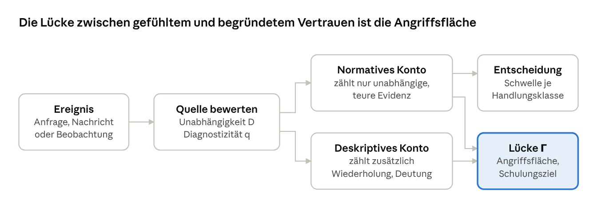

# Trust is Engineered

> **ENTWURF (DRAFT).** Arbeitsstand, nicht begutachtet und nicht empirisch validiert. Inhalte, Kapitelnummern und Literaturangaben können sich ändern; Literatur ist teils noch nicht am Original geprüft (Vermerke in Kapitel 16).

Ein dynamisches, kontextsensitives Modell für Vertrauen, Misstrauen und Entscheidungen unter Unsicherheit.

**Status:** Forschungskonzept und mathematische Modellhypothese, Version 0.6 (Stand 12. Oktober 2026). Das Modell ist nicht empirisch validiert.

➡️ **[Zum Dokument: docs/trust-is-engineered.md](docs/trust-is-engineered.md)**

## Worum es geht

Das Modell ist ein theoretischer Rahmen für zwei praktische Probleme:

1. **Menschen schulen.** Wie lernen Menschen, Vertrauensmissbrauch wie Phishing und Social Engineering mit geringem Aufwand zu erkennen, ohne legitime Anfragen pauschal abzulehnen?
2. **Maschinen einbinden.** Wie lässt sich Vertrauen zwischen Mensch und Agent sowie zwischen Maschinen etablieren und wiederkehrend verifizieren?

Beide Probleme haben dieselbe Struktur: Eine Entität muss entscheiden, welche Handlung sie einer anderen bei unvollständiger Evidenz erlaubt.



## Kernideen

- Vertrauen wird als gerichteter, kontextabhängiger Graph geführt. Jede Kante trägt Vertrauen, Misstrauen und Unsicherheit getrennt.
- Evidenz altert. Ohne neue Evidenz kehrt Vertrauen zur Basisrate zurück, und die Unsicherheit wächst.
- Gruppen wirken weniger auf die Bewertung als auf die Prüfung: Wer glaubt, dass andere oder die IT prüfen, prüft selbst nicht. Prüfung braucht eine benannte Rolle und eine sichtbare Norm.
- Zwei Konten laufen parallel: ein normatives (evidenzgerecht) und ein deskriptives (wie Menschen tatsächlich urteilen). Ihre Differenz ist die Kalibrierungslücke und damit die Angriffsfläche für Social Engineering.
- Berechtigungen hängen an der Handlung und ihrer Schadenshöhe, nicht am Vertrauen in die Person.

## Inhalt des Dokuments

| Kapitel | Thema |
| --- | --- |
| 0 | Änderungen gegenüber der Vorversion |
| 1–3 | Zielsetzung, Begriffe, Graphmodell |
| 4–6 | Evidenzmodell, psychologische Einflussgrößen, Entscheidungsschicht |
| 7 | Gruppen und Organisation: Verantwortungsdiffusion, Schutzdelegation, Normen |
| 8 | Angriffe als Operationen auf Modellgrößen |
| 9 | Anwendung A: Vertrauensmissbrauch aufwandsarm erkennen |
| 10 | Anwendung B: Mensch-Agent- und Maschine-Maschine-Vertrauen |
| 11 | Grundannahmen und Hypothesen mit Evidenzstatus |
| 12 | Ableitbare Vorhersagen |
| 13 | Vertrauensdimensionen und Schutzziele der Informationssicherheit |
| 14 | Praktische Aussagen zur Informationssicherheit |
| 15–16 | Forschungsplan, Grenzen, Ethik und Recht, Literatur |

## Begleitpapiere

| Papier | Thema |
| --- | --- |
| [Fallstudie 1](docs/fallstudie-01-populistische-techniken.md) | Populistische Argumentationstechniken als Kalibrierungsangriffe auf der Makroebene |

## Hinweise zur Einordnung

- Die Vorhersagen (Kapitel 12), die Sicherheitsregeln (Kapitel 14) und die Rechenbeispiele sind Ableitungen aus dem Modell und empirisch ungeprüft. Zahlenwerte in den Abbildungen sind illustrativ.
- Die Literaturangaben sind überwiegend nicht am Volltext verifiziert. Einträge mit dem Vermerk „prüfen“ sind vor einer Veröffentlichung am Original gegenzuprüfen.
- Das Modell dient der Selbstreflexion, der Schulung, der Simulation und der Bewertung technischer Systeme. Es dient nicht der Bewertung von Personen für Entscheidungen Dritter.

## Aufbau des Repositories

```
docs/trust-is-engineered.md                     das Arbeitspapier (v0.6)
docs/fallstudie-01-populistische-techniken.md   Begleitpapier: Fallstudie 1
docs/figures/                                   Abbildungen 1 bis 10
LICENSE                                         Lizenztext CC BY 4.0
CITATION.cff                                    Zitierangaben (maschinenlesbar)
```

## Lizenz und Zitieren

Text und Abbildungen stehen unter der Lizenz [Creative Commons Namensnennung 4.0 International (CC BY 4.0)](LICENSE). Sie dürfen das Material nutzen, weitergeben, übersetzen und bearbeiten, auch kommerziell. Bedingung ist, dass Sie den Urheber nennen, auf die Lizenz verweisen und angeben, ob Sie Änderungen vorgenommen haben.

Zitate und Inhalte aus der zitierten Literatur fallen nicht unter diese Lizenz; für sie gelten die Rechte der jeweiligen Urheber.

**Zitiervorschlag:**

> Rumpf, J. (2026). *Trust is Engineered* (Arbeitspapier, Version 0.6, Entwurf). https://github.com/JoeRu/trust-is-engineered

Die Angaben stehen maschinenlesbar in [`CITATION.cff`](CITATION.cff); GitHub zeigt sie unter „Cite this repository“ an.
