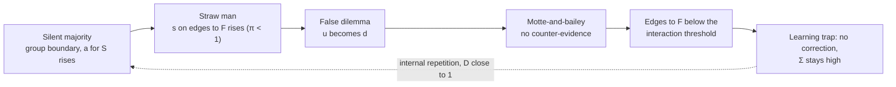

## Case Study 1: Populist Argumentation Techniques as an Attack on the Macro Level

> **DRAFT.** Work in progress, not peer reviewed and not empirically validated. Content, chapter numbers and references may change; some references have not yet been checked against the original (status notes in Chapter 16).

*Companion paper to “Trust is Engineered” v0.6 (paper as of 12 October 2026) · Case study as of 12 October 2026 · Derived from the model, not yet empirically tested · Section references refer to v0.6 · English translation of the German original, 18 October 2026 (German original: [de/fallstudie-01-populistische-techniken.md](de/fallstudie-01-populistische-techniken.md))*

**Short answer.** The four techniques are attacks in the sense of the model, but not abuse of trust in the sense of Section 8.2. They do not exploit a granted scope of action P; they attack the assessment itself. **Their target is the calibration gap Γ at the level of a population, and in both directions at once:** Γ > 0 towards the speaker and the group he claims to speak for, Γ < 0 towards institutions, media and opponents. Each technique acts on a different model quantity: the silent majority on source dependence and group edges, the false dilemma on the triple (b, d, u) and on the action space, the straw man on the attribution of evidence, motte-and-bailey on the object of agreement. They work on the macro level because, for most people, edges to institutions and out-groups carry little evidence of their own. By ΔE = u·Δa (12.4), a shift there takes almost full effect. The comparison also reveals four gaps in the model (F1.6).

### F1.1 Subject and scope

Following Mudde (2004), populism is understood here as a thin-centred ideology that divides society into a homogeneous people and a corrupt elite and understands politics as the expression of a unified will of the people. Müller (2016) names the moral claim to exclusive representation as its core: whoever disagrees does not belong to the real people.

The four techniques examined are not a populist invention. They occur in advertising, negotiations, talk shows and commentary from all political directions. Populist communication, however, uses them in combination and within a framing that amplifies their effect. **This paper analyzes techniques, not actors or positions.** Whether a criticism of elites or institutions is justified is not a question the model answers. It describes which quantities a technique changes and whether that change is covered by evidence.

Following Section 1.1, the macro level means the public sphere, institutions and information quality; the meso level (teams and organizations) is treated in Chapter 7 of the working paper. In the model, the macro level corresponds to the following quantities:

| Macro phenomenon | Model quantity | Section |
| --- | --- | --- |
| Trust in categories (media, authorities, “those at the top”) | base rate a, group prior G | 4.2, 12.4 |
| Groups and belonging | group nodes, membership edges | 3.3 |
| Shared beliefs | beliefs B, prior strength W, anchoring after Friedkin-Johnsen | 3.4, 5.3 |
| Source structure of the public sphere | dependence D, repetition R | 4.7 |
| Propagation of trust and distrust | discounting, G2 | 4.6 |

### F1.2 What “attack” means on the macro level

Social engineering on the micro level targets a single action with a large loss, such as a payment. It needs the calibration gap only briefly and on one edge. The four techniques target something else. **They shift the slow layers of the model: base rates, group boundaries and beliefs.** According to the table of levels in Chapter 5, these quantities change slowly. The effect therefore persists even when the individual message has long been forgotten.

On the macro level, the actions x are not payments but agreement, sharing, mobilization and turning away from sources. Turning away has the most consequences. Whoever no longer listens to a source falls below the interaction threshold from 5.4. No correcting evidence reaches them any more, and the distrust stabilizes itself (H11, V4).

Three attack surfaces can be distinguished:

1. **Base rates of categories.** A statement about “the media” shifts a for all edges of this category. For most people, edges to institutions and out-groups carry little evidence of their own. u is high, and the shift takes almost full effect.
2. **Graph structure.** The techniques draw group boundaries, create membership edges and claim representation.
3. **Assessment apparatus.** They distort the quantities the normative account computes with: number of sources, attribution, context.

The third surface is the genuinely new one. In 8.4 the last row is manipulation of the model itself, and rule S9 declares the evidence account an object of protection. **On the macro level, the shared evidence account of a public is the object of protection.** The four techniques attack it.

From this, a quantity for the macro effect can be derived, the calibration spread:

```math
\Sigma_{A} = \Gamma_{A\to S} - \Gamma_{A\to F}
```

S is the speaker or the in-group he claims to represent, F an out-group or institution. Σ > 0 means: A trusts S more and F less than the evidence supports. Social engineering needs only one Γ with one sign. **The four techniques increase Σ, that is, both gaps in opposite directions.** Polarization in the sense of the model is an increase of Σ across a population, not merely a disagreement. People may judge differently. Only the part of the judgment that no evidence covers is problematic.

### F1.3 The four techniques

#### F1.3.1 Silent majority

The speaker claims that a large but silent majority shares his view. The expression was popularized by a 1969 speech by Richard Nixon. The evidence for this majority is invisible by construction, since it is silent.

**Fictitious sample.** The consensus of N people is claimed; one source is visible. With D = 1, n_eff = 1 regardless of how large N is (4.7). This goes beyond sock puppets: there, at least visible repetitions exist. Here the majority is not even observable. The claim costs nothing and cannot be refuted, because silence is compatible with any opinion. Its diagnosticity is q = 0.

**Reinterpretation of missing evidence.** Absence of objection is read as agreement. In the interpretation function v = f(e, c, B) from 5.3, a non-event receives positive valence. This immunizes the thesis: every absence of protest confirms it.

**Usurpation of a group edge.** The speaker claims to speak for the group. This is impersonation at the level of a collective (8.4). In the security objectives chapter of the working paper (13.5) the rule is: whoever takes over the identity takes over the whole profile. Here it is the profile of “the majority”, whose judgment is considered reasonable. At the same time, the technique creates a membership edge for the listener: you belong. Via the group prior G, the in-group raises the base rate towards the speaker (4.2); in-group favoritism is well supported (Balliet, Wu & De Dreu 2014). The supposedly loud minority correspondingly receives a lowered base rate.

The technique meets known perceptual errors. People distinguish poorly between true and apparent consensus (Yousif, Aboody & Keil 2019) and overestimate how widespread their own opinion is (false consensus; Ross, Greene & House 1977). Conversely, they often misjudge what the majority actually thinks (pluralistic ignorance; Prentice & Miller 1993). The spiral of silence (Noelle-Neumann 1974) describes why perceived minorities fall silent. The technique uses this picture but reverses the burden of proof.

**Limit.** Silent majorities exist; pluralistic ignorance is a real finding. **The claim is not false but unsupported.** It becomes testable through independent surveys: representative polls, election and referendum results.

**Countermeasure.** Rule S6 (a majority counts only under independence) and guiding question 4 from 9.4 (What independent evidence exists?). In addition, the separation from 3.3: membership is an edge type of its own. “I belong to the majority” and “The speaker represents me” are two different statements.

#### F1.3.2 False dilemma

Two options are presented as if there were no others, and one of them is associated with a large loss: us or chaos.

**Collapse of the triple.** The technique forces a binary judgment: whoever does not trust, distrusts. Uncertainty and ambivalence, which are precisely what version 0.4 distinguishes from the scalar (2.2), are ruled out. Formally, ignorance towards the rejected side is booked as distrust:

```math
(b,\; d,\; u) \;\longrightarrow\; (b,\; d + u,\; 0)
```

“Whoever doubts is against us” is the same operation in words.

**Narrowing of the action space.** The threshold rule (6.2) assesses each action x individually via θ_x = L_x / (L_x + N_x). The false dilemma does not change the assessment but the set of actions. If the alternative is associated with a large L, its threshold is close to 1, and the offered option appears to be without alternative. The model has a threshold per action but no explicit decision space. The technique exploits this gap (F1.6).

**Equating membership and trust.** “With us or against us” merges two edge types that the model keeps separate (3.3).

**Context bundling.** A decision on one substantive question becomes a decision on all questions. This contradicts context-specific evidence (4.5) and rule S12.

False dichotomies are among the five techniques against which Roozenbeek et al. (2022) sought to inoculate with short explanatory videos. In six randomized studies and a field experiment on YouTube, the videos improved recognition of the techniques and the discrimination of trustworthy from untrustworthy content. Modirrousta-Galian & Higham (2023) show for game-based inoculation interventions that part of such effects is a shifted response bias. For the model this means: effectiveness is measured separately by discriminability d′ and criterion c (9.7, H7).

**Limit.** Genuine dilemmas exist: run-off elections, binary votes, decisions under real time pressure. What matters is whether alternatives are excluded or merely not mentioned.

**Countermeasure.** Guiding question 5 from 9.4 (What is the smallest justifiable next step?) reopens the action space. In addition, explicit permission to leave uncertainty standing: u is a legitimate state, not a position.

#### F1.3.3 Straw man

The position of a third party B is reproduced in distorted form, and then the distortion is refuted. Aikin & Casey (2011) distinguish three forms: the distorted representation, the selection of the weakest real proponent as representative (weak man), and the invention of a position that nobody holds (hollow man).

**False attribution of evidence.** Negative evidence about a position B′ lands on the edge A→B. This is the mirror image of impersonation: there, an attacker inherits someone else's positive evidence r; here, B inherits someone else's negative evidence s. The model weights source (ϱ), cost of forgery (q), dimension and context, but not the probability that an event originates from B at all. An attribution weight π_e is proposed for the updating from 4.3:

```math
g^{\pm}_{\text{norm}} = \pi_e \cdot \varrho_e \cdot q_e \cdot w^{\pm}_{k} \cdot r_{e,c} \cdot \max(\pm v_e,\,0), \qquad \pi_e \in [0,1]
```

The descriptive account computes with π = 1: what has been heard counts as said. The straw man thus creates exactly the gap (1 − π_e)·g in account s, that is, Γ < 0 towards B.

**Scope.** π_e is not a proposal for the core model. On the micro level, A mostly experiences the events directly; attribution is uncritical there, and a further parameter would complicate the model unnecessarily. Attribution only becomes relevant where positions are conveyed via third parties and groups. π_e is therefore kept only for the group and macro level; the updating in 4.3 remains unchanged.

**Choice of dimension.** A straw man can present B as incapable (competence) or as dishonest and malicious (integrity, benevolence). By conditional asymmetry (4.4), negative integrity evidence weighs more heavily, and by 4.5 it transfers broadly across contexts (V6). **A straw man framed in terms of integrity is therefore more effective and harder to repair than one framed in terms of competence** (hypothesis HP1).

**Indirect evidence without discounting.** A usually knows B's position not first-hand but via the speaker C. By 4.6, the reproduction would have to be discounted by the referral trust in C. But people discount too little (H4), presumably even less for a speaker from the in-group.

**Cheap gain in competence.** Whoever refutes a straw man appears superior. But only their own construction was refuted. The evidence has q close to 0: the speaker's descriptive competence account grows, the normative one does not (V5).

**Limit.** Every summary shortens. A straw man exists only when the shortening changes the judgment about B in a way that would not arise with knowledge of the original.

**Countermeasure.** The third check from 6.1, applied to the reproduction: Did B actually say that? Lateral reading to the original (Wineburg & McGrew 2019). The check question from 9.5: Would I assess the same cues the same way for a likeable person? And formulating the strongest version of the opposing position, a variant of consider the opposite (Lord, Lepper & Preston 1984).

#### F1.3.4 Motte-and-bailey

Following Shackel (2005), someone advances a far-reaching, hard-to-defend claim, the bailey (outer courtyard). Under pressure, they retreat to a statement that is hard to dispute, the motte (castle mound), which runs under the same slogan. When the pressure eases, the bailey applies again.

**Context switch.** Agreement with the motte comes easily because it is well supported and costs little. It is booked as agreement with the bailey. This is the context switch row from 8.4, transferred from persons to statements: evidence from a harmless statement is used for a risky one. Normatively, the relevance of the motte evidence for the bailey is close to 0, analogous to r(e, c).

**Agreement as permission.** In the decision layer, agreement to an action with a low threshold is treated as approval for an action with a high threshold. This violates S1: permissions are tied to the action.

**Immunization.** Criticism of the bailey is redirected to the motte. No negative evidence s ever accumulates for the bailey. At the same time, critics appear as deniers of an obvious truth. **As a by-product, motte-and-bailey generates negative evidence on the edge to the critic** and in this respect acts like a straw man in the opposite direction.

**One slogan, two statements.** Just as the word integrity stands for different things in the security objectives chapter (13.3), here one slogan stands for two claims. The model keeps evidence per entity, context and dimension, but not per statement. The technique exploits this gap (F1.6).

**Limit.** Clarifying when asked is legitimate and desirable. Motte-and-bailey only exists when the bailey is advanced again after the retreat. This can be recognized only over time, that is, via the dimension predictability: does the switch repeat?

**Countermeasure.** Guiding question 1 from 9.4 hits the technique precisely: What exactly am I supposed to believe or allow? The statement is pinned down before it is assessed, and agreement applies only to it.

### F1.4 Overview

| Technique | Manipulated quantity | Effect in the model | Related row in 8.4 | Countermeasure |
| --- | --- | --- | --- | --- |
| Silent majority | D, q, valence v, membership and representation edge | claimed majority with n_eff = 1; in-group raises a for S, lowers a for F | sock puppets; impersonation; group signal | demand an independent survey; separate membership and representation (S6, guiding question 4) |
| False dilemma | triple (b, d, u), action space, context | u becomes d; alternative receives θ close to 1 | context switch; time pressure | third option, smallest step, allow uncertainty (guiding question 5, S12) |
| Straw man | attribution of evidence, dimension | someone else's evidence s on A→B; integrity framing acts broadly | impersonation, mirrored | check the original, formulate the strongest version (6.1, 9.5) |
| Motte-and-bailey | object of agreement, permission | agreement with the motte counts for the bailey; criticism bounces off | context switch | pin down the statement, bind agreement to it (guiding question 1, S1) |

*Table F1.1: The four techniques as interventions in model quantities*

### F1.5 Interplay: an attack chain

As in 8.4, the techniques usually occur in combination. A typical sequence:

1. **Silent majority** draws the group boundary, creates a membership edge for the listener and raises the base rate towards the speaker.
2. **Straw man** loads negative integrity evidence onto the edges to the out-group and to institutions.
3. **False dilemma** forces a binary judgment. Remaining ambivalence becomes distrust.
4. **Motte-and-bailey** protects the narrative against counter-evidence.



*Figure F1.1: Attack chain on the macro level · feedback loop via dependent sources*

The consequence: edges to the outside fall below the interaction threshold, and the learning trap from 5.4 closes. Distrust propagates more strongly than trust (G2) and recovers more slowly at the network level than it fell (V21). Within the group, the narrative is repeated from shared, mutually dependent sources. R is high, D close to 1, and the group overestimates its certainty (V20).

V18 predicts that public distrust decays with the half-life after reporting ends. The chain explains why this may fail to happen here: **internal repetition replaces external reporting and offsets the temporal decay λ** (hypothesis HP5).

### F1.6 What the comparison shows for the model

**Calibration attacks as a class of their own.** Core assumption G1 (the loss depends on P and L) describes the four techniques only indirectly. Directly, they target Γ and Σ. This yields the distinction between two attack classes: abuse attacks exploit a granted scope of action, calibration attacks shift the assessment. Social engineering usually combines both: first calibrate, then abuse. The four techniques remain at the first stage. Whether an abusive action follows lies outside the technique and cannot be judged with the model. *The distinction has been adopted in Section 8.2 of the working paper.*

**Four gaps in the model.**

| Gap | Revealed by | Proposal |
| --- | --- | --- |
| No weighting of attribution | Straw man | attribution weight π_e only on the group and macro level; the core model (4.3) remains unchanged |
| Evidence only per entity, not per statement | Motte-and-bailey | statements as objects of their own with their own evidence account; touches the open question of trust and credibility (15.5) |
| No explicit decision space | False dilemma | include the set of actions X in the decision layer (6.2) |
| Representation not modeled | Silent majority | edge type “speaks for” alongside membership (3.3) |

*Table F1.2: Model gaps and proposed extensions*

**Slow layers as the target.** Micro attacks act on edges and the momentary state H, the four techniques on base rates, groups and beliefs. This implies an asymmetry of countermeasures: **refuting a single message corrects an edge, but the technique has shifted a prior.** Effective countermeasures therefore target the habit of verification, not the individual refutation. This matches Chapter 9's focus on action triggers rather than content features.

**Reading as security objectives.** In the language of Chapter 13 of the working paper, false attribution violates the data integrity of the shared evidence account. False dilemma and motte-and-bailey rather affect the utility of a debate: it is available and not falsified, but delivers no usable result.

**Outlook: Σ as a metric.** Beyond training, the calibration spread Σ is conceivable as a stand-alone metric for impact analyses at the population level, for example for advertising, political communication or advising further stakeholders: which campaign shifts how much judgment that is not covered by evidence? This use case is deliberately not yet worked out; it first requires an answer to the measurement question (how are the normative account and D estimated in a population?) and to the limits from F1.9.

### F1.7 Hypotheses and test designs

The HP identifiers are provisional and do not occupy numbers in the stable list of hypotheses.

| ID | Hypothesis | Derivation | Testable by |
| --- | --- | --- | --- |
| HP1 | A straw man framed in terms of integrity lowers trust in B more strongly and in more contexts than an equally strong one framed in terms of competence. | 4.4, 4.5, V6 | vignette study, framing × context |
| HP2 | Majority claims have a stronger effect on topics on which listeners have little evidence of their own. | ΔE = u·Δa | measure prior knowledge, vary the majority claim |
| HP3 | False dilemma reduces the share of indecision and ambivalence more strongly than it shifts the direction of judgments. | u becomes d | separate scales for trust and distrust (as in V2) |
| HP4 | Action-bound verification questions (F1.8) improve d′. A general warning against “populist rhetoric” mainly shifts c and increases false distrust towards legitimate majority and dilemma statements. | H7 | randomized experiment with legitimate and manipulative examples |
| HP5 | In networks with high source dependence, the calibration spread Σ does not decay with the half-life, because internal repetition offsets the temporal decay. | V18, V20, 4.3 | agent-based simulation; panel data by source repertoire |

*Table F1.3: Derived hypotheses*

HP2 and HP5 can be tested with the minimal simulation from 15.1 as soon as it includes group nodes and a source dependence per group.

### F1.8 Implications for training

One verification question per technique is enough. It complements the check questions from 9.5.

| Technique | Verification question |
| --- | --- |
| Silent majority | Who counted the majority, and can I see it independently? |
| False dilemma | What third option is missing, and what would be the smallest justifiable step? |
| Straw man | Did B actually say that? What does the original say? |
| Motte-and-bailey | Which exact statement am I being asked to agree to, and does my agreement apply only to it? |

*Table F1.4: Verification questions per technique*

Two design principles from 9.6 apply here in particular:

- **Practice symmetrically.** Practice cases include genuine majorities, genuine dilemmas, fair summaries and legitimate clarifications. Otherwise participants only learn to reject majority and dilemma statements across the board (H7).
- **Apply to your own side.** The techniques work most strongly when they come from the in-group, because that is where discounting is weakest (H4). **A training that only shows the techniques of the other side increases Σ in the opposite direction.** The check question about the likeable person from 9.5 is therefore the core, not an add-on.

### F1.9 Limits

- **Technique is not actor.** The use of a technique does not imply that a speaker is populist, and vice versa. The paper does not classify speakers, parties or positions.
- **No scoring.** A system that rates speakers or groups by the techniques they use would come close to the limits from 15.4. Political opinions are special categories under GDPR Art. 9. Here the model serves self-checking and training.
- **Judgment of content remains necessary.** Whether a straw man exists presupposes knowledge of the original position; whether a majority exists presupposes data. The model structures the verification but does not replace it.
- **The label as a technique.** The accusation “straw man” or “populism” can itself be used as a straw man or a false dilemma. The verification questions apply to it as well.
- **Attitude or trust.** Research distinguishes populist attitudes and political trust as different constructs, both of which are associated with voting for populist parties (Geurkink et al. 2020). Whether populist attitudes are better represented in the model as a belief B or as a base rate a is open.
- **Qualitative derivation.** As in Chapter 12, all statements are qualitative. Quantitative statements require estimated parameters, above all D and π, which in everyday life can only be estimated.

### References

New compared with the working paper. Entries marked “to be checked” must be checked against the original before publication.

- Aikin, S. F. & Casey, J. (2011). Straw Men, Weak Men, and Hollow Men. Argumentation, 25(1), 87–105. (to be checked)
- Geurkink, B., Zaslove, A., Sluiter, R. & Jacobs, K. (2020). Populist Attitudes, Political Trust, and External Political Efficacy: Old Wine in New Bottles? Political Studies, 68(1), 247–267.
- Mudde, C. (2004). The Populist Zeitgeist. Government and Opposition, 39(4), 541–563.
- Müller, J.-W. (2016). Was ist Populismus? Ein Essay. Suhrkamp.
- Noelle-Neumann, E. (1974). The Spiral of Silence: A Theory of Public Opinion. Journal of Communication, 24(2), 43–51.
- Prentice, D. A. & Miller, D. T. (1993). Pluralistic ignorance and alcohol use on campus. Journal of Personality and Social Psychology, 64(2), 243–256.
- Roozenbeek, J., van der Linden, S., Goldberg, B., Rathje, S. & Lewandowsky, S. (2022). Psychological inoculation improves resilience against misinformation on social media. Science Advances, 8(34), eabo6254.
- Ross, L., Greene, D. & House, P. (1977). The “false consensus effect”. Journal of Experimental Social Psychology, 13(3), 279–301.
- Shackel, N. (2005). The Vacuity of Postmodernist Methodology. Metaphilosophy, 36(3), 295–320. (to be checked)

Adopted from the working paper: Balliet et al. 2014; Lord, Lepper & Preston 1984; Modirrousta-Galian & Higham 2023; Wineburg & McGrew 2019; Yousif, Aboody & Keil 2019; GDPR Art. 9.
