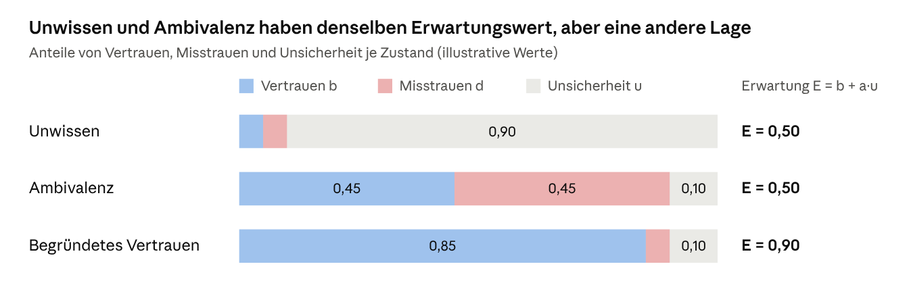
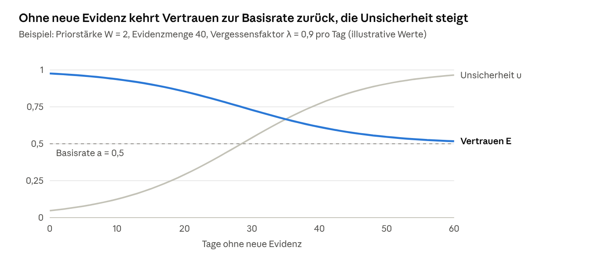
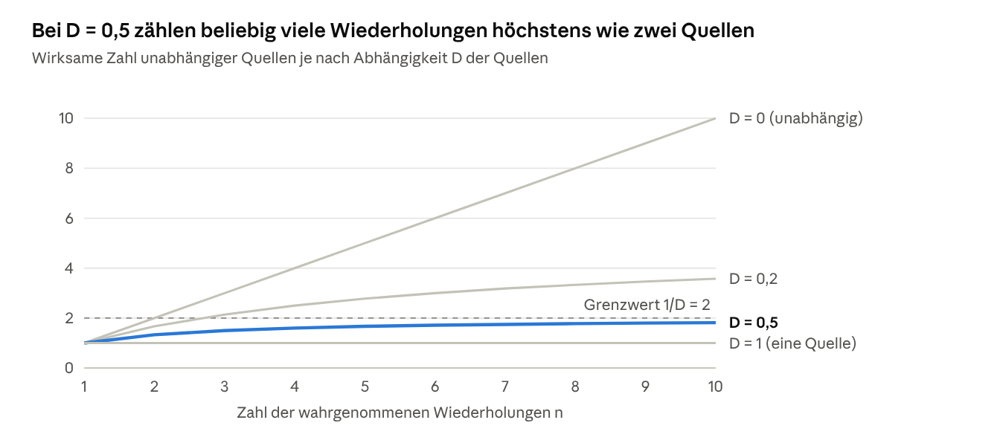
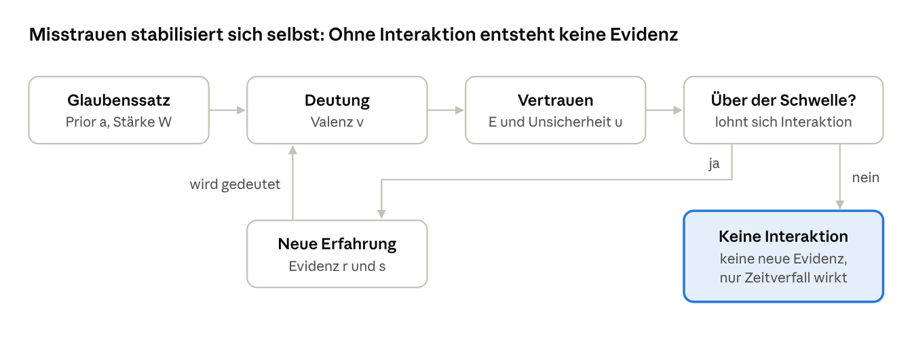
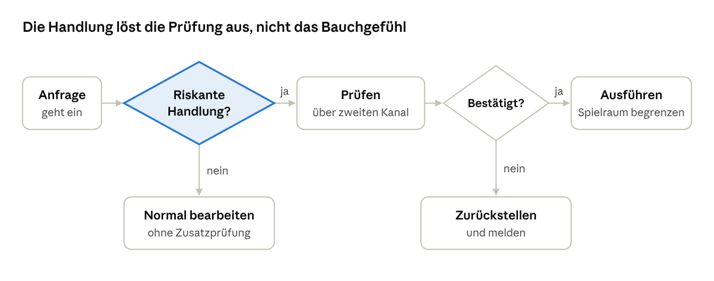
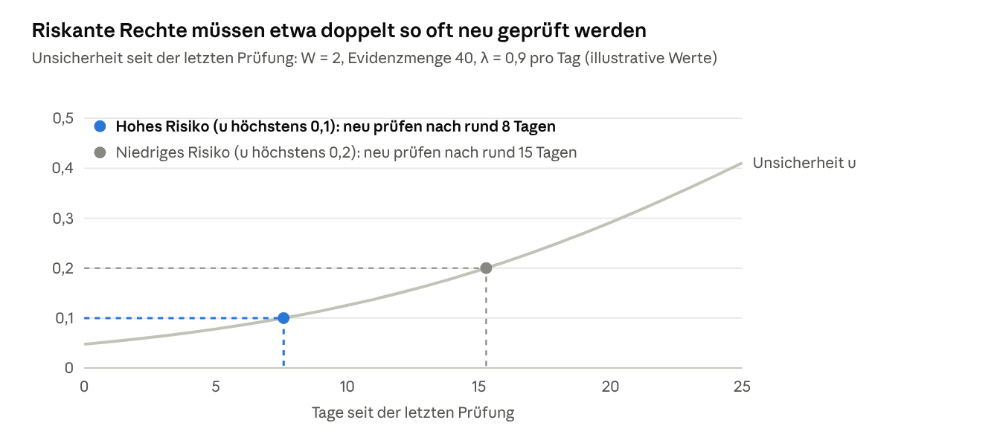
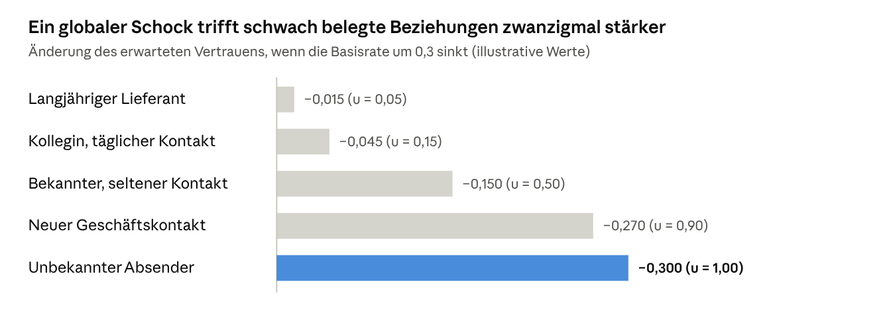
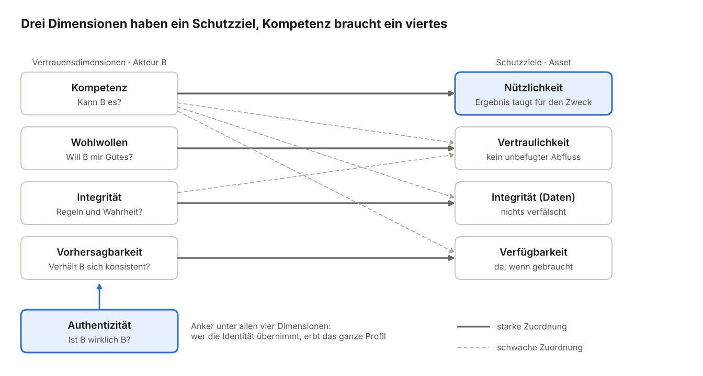

# Trust is Engineered – Version 0.6 (Entwurf)

> **ENTWURF (DRAFT).** Arbeitsstand, nicht begutachtet und nicht empirisch validiert. Inhalte, Kapitelnummern und Literaturangaben können sich ändern; Literatur ist teils noch nicht am Original geprüft (Vermerke in Kapitel 16).

Stand: 12. Oktober 2026 · Johannes Rumpf

Ein dynamisches, kontextsensitives Modell für Vertrauen, Misstrauen und Entscheidungen unter Unsicherheit. Status: Forschungskonzept und mathematische Modellhypothese, überarbeitet nach Literaturprüfung.

## 0. Was sich gegenüber den Vorversionen geändert hat

**Ergänzung in v0.6.** Neu ist Kapitel 7 „Gruppen und Organisation“. Es führt die Mesoebene ein (Team, Abteilung, Organisation), auf der Informationssicherheit tatsächlich gelebt wird, und zeigt, dass Gruppen weniger auf die Bewertung als auf die Prüfung wirken: über Verantwortungsdiffusion, Schutzdelegation („Das ist Aufgabe der IT“) und deskriptive Normen. Das Modell erhält keinen neuen Parameter, aber zwei abgeleitete Größen (Prüfdeckung C, effektives Vertrauen nach vermuteter Filterung E′), eine Grundannahme (G4), vier Hypothesen (H16 bis H19), sechs Vorhersagen (V22 bis V27) und fünf Regeln (S20 bis S24). H12 wird geschärft. Abschnitt 8.2 unterscheidet zwei Angriffsklassen (Missbrauch und Kalibrierung). Das Begleitpapier [Fallstudie 1](fallstudie-01-populistische-techniken.md) wendet das Modell auf populistische Argumentationstechniken als Kalibrierungsangriffe auf der Makroebene an. Durch das neue Kapitel 7 sind die bisherigen Kapitel 7 bis 15 jetzt 8 bis 16; Hypothesen-, Regel- und Vorhersagenummern bleiben stabil.

**Ergänzung in v0.5.** Neu war das Kapitel zu Vertrauensdimensionen und Schutzzielen (jetzt Kapitel 13). Ergebnis: Dimensionen und Schutzziele liegen auf zwei Achsen (Akteur und Asset), drei Dimensionen haben ein starkes Gegenstück, Kompetenz keines; für KI-Agenten wird Nützlichkeit zur eigenen Risikodimension (Hypothese H15, Regel S19, Abbildung 10).

**Version 0.4** ersetzte den mathematischen Kern, fasste die Hypothesen neu und richtete das Modell auf zwei Anwendungsprobleme aus.

| Bereich | v0.3 | v0.4 | Grund |
| --- | --- | --- | --- |
| Vertrauenswert | ein Skalar T in [0,1] | Tripel aus Vertrauen b, Misstrauen d, Unsicherheit u | Skalar trennt Unwissen nicht von Ambivalenz (Jøsang 2016; Lewicki et al. 1998) |
| Aktualisierung | T + α·s·(1−T) | Evidenzkonten r und s mit Vergessensfaktor λ | alte Regel ist Bush-Mosteller/Rescorla-Wagner: reihenfolgeabhängig, ohne Zeitverfall, strukturell asymmetrisch |
| Asymmetrie | β > α als Grundannahme | bedingt: abhängig von Dimension, Täuschung, Vorvertrauen | Kompetenz- und Integritätsverletzungen wirken verschieden (Kim et al. 2004) |
| Dimensionen | acht gleichrangige | Kompetenz, Wohlwollen, Integrität, Vorhersagbarkeit | ABI-Modell (Mayer et al. 1995) plus Predictability |
| Kontext | Rad des Lebens plus Tags | Aufgabendomäne × Verwundbarkeitstyp × Beziehungstyp | Rad des Lebens ist ein Coaching-Werkzeug, keine validierte Taxonomie |
| Gruppen | beeinflussen initiales Vertrauen | schwacher Prior mit kleiner Stichprobenstärke | individuelle Evidenz verdrängt Kategorien (Kunda & Thagard 1996) |
| Wiederholung | ΔT = Evidenz + Familiarität | zwei parallele Konten: normativ und deskriptiv | Differenz wird als Kalibrierungslücke messbar |
| Entscheidung | qualitativ | Schwellenregel aus Schaden und Nutzen, Prüfregel aus Prüfkosten | macht H3 und H6 operational |
| Adversariales Denken | verbessert Entscheidungen | handlungsgebunden statt generelle Skepsis | Skepsistrainings verschieben oft nur die Antworttendenz (Modirrousta-Galian & Higham 2023) |
| Anwendungsbereich | offen | Schulung, Agentenvertrauen, Simulation; kein Personen-Scoring für Dritte | EU AI Act Art. 5 Abs. 1 lit. c; DSGVO Art. 22 und 9 |

Neu waren in v0.4 die Kapitel zu Schulung (jetzt 9), Agenten und Maschinen (jetzt 10), Vorhersagen (jetzt 12) und Informationssicherheit (jetzt 14). Die Hypothesennummern bleiben über Versionen stabil: H3 ist jetzt Grundannahme G1, die Asymmetrieannahme ist H5a. In der Nummerierung ab v0.6 enthalten die Kapitel 4, 6, 7, 12, 13 und 14 eigene Ableitungen aus dem Modell. Sie sind als Modellaussagen gekennzeichnet und noch nicht empirisch geprüft.

## 1. Ausgangslage und Zielsetzung

### 1.1 Vertrauen in einer KI-geprägten Welt

AI Slop, Deepfakes, Love Scams und KI-generierte Identitäten verändern die Voraussetzungen, unter denen Menschen Informationen und anderen Entitäten vertrauen. **Nicht mehr allein der Inhalt entscheidet über Glaubwürdigkeit.** Relevant wird, woher er stammt, wie er entstanden ist und über welchen Kanal er kommt.

Beispiele:

- Ist eine Person auf LinkedIn diejenige, die sie vorgibt zu sein?
- Ist ein Jobangebot, eine Einladung oder eine Produktbewertung authentisch?
- Zeigt ein beeindruckendes Arbeitsergebnis Kompetenz oder nur eine überzeugende KI-Ausgabe?
- Was bedeutet es, wenn viele scheinbar unabhängige Quellen dieselbe Behauptung wiederholen?
- Darf ein KI-Agent, der sich korrekt ausweist, die angeforderte Handlung auch auslösen?

Die Veränderung wirkt auf der Makroebene (Öffentlichkeit, Institutionen, Informationsqualität), auf der Mesoebene (Teams, Abteilungen, Organisationen, in denen Sicherheitsentscheidungen tatsächlich fallen) und auf der Mikroebene (einzelne Vertrauensentscheidungen). Kapitel 7 behandelt die Mesoebene.

### 1.2 Verschiebung der Bewertung von Arbeit

Generative KI senkt die Kosten, ein überzeugendes Ergebnis zu erzeugen. Ein Signal ist nur glaubwürdig, wenn es für Täuschende teuer ist (Spence 1973). **Ergebnismerkmale verlieren deshalb an Aussagekraft.** Gewicht gewinnen der nachvollziehbare Entstehungsprozess, überprüfbare Evidenz und die verwendeten Quellen.

### 1.3 Zwei Anwendungsprobleme

Das Modell ist ein theoretischer Rahmen für zwei praktische Probleme.

**Problem A – Menschen schulen.** Wie lernen Menschen, Vertrauensmissbrauch wie Phishing und Social Engineering mit geringem Aufwand und hoher Trefferquote zu erkennen, ohne legitime Anfragen pauschal abzulehnen?

**Problem B – Maschinen einbinden.** Wie lässt sich Vertrauen zwischen Mensch und Agent sowie zwischen Maschinen etablieren und wiederkehrend verifizieren?

**Beide Probleme haben dieselbe Struktur: Eine Entität muss entscheiden, welche Handlung sie einer anderen bei unvollständiger Evidenz erlaubt.**

### 1.4 Forschungsfragen

1. Wie lässt sich Vertrauen zwischen Menschen, Gruppen, Institutionen und technischen Systemen kontextabhängig, dynamisch und unter Unsicherheit modellieren?
2. Welche Abweichung besteht zwischen tatsächlicher (deskriptiver) und evidenzgerechter (normativer) Vertrauensbildung, und wie nutzen Angreifer sie?
3. Welche Vorhersagen erlaubt das Modell zu Misstrauen, Kontextübertragung, Verlust über Zeit sowie zur Wirkung von Nachrichten und globalen Ereignissen?
4. Welche Regeln für Schulung, Agentensysteme und Informationssicherheit folgen daraus?

Deskriptives und normatives Ziel bleiben methodisch getrennt. **Ihre Differenz ist der zentrale Untersuchungsgegenstand.**

## 2. Begriffliche und theoretische Grundlagen

### 2.1 Definition von Vertrauen

**Vertrauen ist eine subjektive, kontextabhängige Erwartung über das Verhalten einer Entität unter Unsicherheit, verbunden mit der Bereitschaft, sich verwundbar zu machen.** Die Definition folgt Rousseau, Sitkin, Burt & Camerer (1998) und Mayer, Davis & Schoorman (1995).

Vertrauen ist eine dreistellige Relation: A vertraut B in Bezug auf X (Hardin 2002). **Das Ziel ist nicht mehr Vertrauen, sondern Vertrauen in Vertrauenswürdiges** (O'Neill 2002).

Fünf Größen werden getrennt geführt:

1. Vertrauensbewertung: Wie positiv ist meine Erwartung?
2. Evidenzsicherheit: Wie gut ist sie begründet?
3. Verwundbarkeit: Welchen Schaden verursacht eine falsche Erwartung?
4. Handlungsbereitschaft: Welches Risiko gehe ich ein?
5. Berechtigung: Welchen Handlungsspielraum räume ich tatsächlich ein?

Mayer et al. (1995) trennen bereits Trust von Risk Taking in Relationship. Das Modell übernimmt diese Trennung als Grundannahme.

### 2.2 Vertrauen und Misstrauen sind zwei Größen

**Misstrauen ist nicht das Fehlen von Vertrauen.** Lewicki, McAllister & Bies (1998) beschreiben beide als getrennte Dimensionen. Reimann, Schilke & Cook (2017) finden unterschiedliche Ursprünge: **Vertrauen ist teils erblich, Misstrauen folgt der Sozialisation**.

Daraus folgen drei unterscheidbare Zustände, die ein einzelner Skalar gleichsetzt:

| Zustand | Vertrauen b | Misstrauen d | Unsicherheit u | Beispiel |
| --- | --- | --- | --- | --- |
| Unwissen | niedrig | niedrig | hoch | unbekannter Absender |
| Ambivalenz | hoch | hoch | niedrig | fähiger Kollege mit bekanntem Interessenkonflikt |
| begründetes Vertrauen | hoch | niedrig | niedrig | langjähriger, geprüfter Lieferant |



*Abbildung 1: Drei Zustände im Vergleich · illustrative Werte, Basisrate a = 0,5*

Unwissen und Ambivalenz ergeben denselben Erwartungswert. Sie unterscheiden sich in der Unsicherheit: Bei Unwissen ändert ein einzelnes Ereignis viel, bei Ambivalenz wenig. Dieselbe Trennung unterscheidet die epistemische Blase (u gegenüber Außenquellen) von der Echokammer (d gegenüber Außenquellen); beide verlangen entgegengesetzte Gegenmaßnahmen (7.8).

### 2.3 Vertrauen schenken und Vertrauen verdienen

Initiales Vertrauen ist ein Vorschuss ohne direkte Erfahrung. Erfahrungsbasiertes Vertrauen entsteht aus Beobachtungen. Im Modell entspricht der Vorschuss dem Prior, die Erfahrung der gesammelten Evidenz. **Hohes initiales Vertrauen bedeutet nie hohe Evidenzsicherheit.**

Die Entwicklungsphasen nach Lewicki & Bunker (calculus-, knowledge- und identification-based trust) und die Initialbildung nach McKnight, Cummings & Chervany (1998) werden als Bezugsrahmen übernommen.

### 2.4 Dimensionen der Vertrauenswürdigkeit

Vertrauenswürdigkeit wird oft über viele Einzelmerkmale beschrieben, etwa Ehrlichkeit, Verlässlichkeit, Offenheit, Respekt und Verantwortung. Diese Merkmale sind nicht unabhängig. Das Modell führt vier Kerndimensionen.

| Kerndimension | Leitfrage | Zugeordnete Einzelmerkmale |
| --- | --- | --- |
| Kompetenz (Ability) | Kann B es? | Kompetenz |
| Wohlwollen (Benevolence) | Will B mir Gutes? | Wohlwollen, Respekt |
| Integrität (Integrity) | Hält B sich an Regeln und Wahrheit? | Ehrlichkeit, Integrität, Verantwortung, Offenheit |
| Vorhersagbarkeit (Predictability) | Verhält B sich konsistent? | Verlässlichkeit |

Die Zuordnung folgt Mayer et al. (1995) und McKnight, Choudhury & Kacmar (2002). Die ABI-Faktoren korrelieren hoch, wirken aber eigenständig (Colquitt, Scott & LePine 2007). Die Faktorstruktur ist per konfirmatorischer Faktorenanalyse zu prüfen.

**Kompetenz und Integrität müssen mindestens getrennt bleiben, weil Verletzungen verschieden wirken** (Abschnitt 4.4). Für Maschinen und Agenten entsprechen die Dimensionen performance, purpose und process nach Lee & See (2004).

### 2.5 Einordnung: Trust-Engineering bei Chen (2021)

Den Begriff Trust-Engineering verwendet bereits Chen (2021), allerdings mit anderem Ziel. **Chen gestaltet den Vertrauensnehmer, dieses Modell gestaltet die Vertrauensentscheidung.** Beide Ansätze ergänzen sich.

Chen beschreibt Vertrauen als vierstellige Relation R(A, B, φ, G): A vertraut B in Bezug auf eine Handlung φ, die einem Ziel G dient. Das erweitert die dreistellige Relation aus Abschnitt 2.1 um das Ziel. In diesem Modell steckt das Ziel in Nutzen N und Schaden L der Handlung (Abschnitt 6.2).

| Aussage bei Chen (2021) | Entsprechung in diesem Modell |
| --- | --- |
| Schwellenbedingung: Vertrauen besteht, wenn die zugeschriebene Wahrscheinlichkeit m eine Schwelle n erreicht | Schwellenregel in 6.2; die Schwelle folgt hier aus Schaden und Nutzen der Handlung |
| Der Wert 0,5 steht in solchen Ansätzen für Unsicherheit | b, d und u trennen Unwissen von Ambivalenz (2.2) |
| Sich-Verlassen ist noch kein Vertrauen: Auf Fehlfunktion folgt Enttäuschung, auf Vertrauensbruch das Gefühl von Verrat; Vertrauen setzt eine normative Erwartung voraus | nur teilweise abgebildet: Integritätsverletzungen mit Täuschung wiegen schwerer (4.4) |
| Misstrauen kann die angemessene Ausgangshaltung sein, abhängig von Umfeld, Domäne und Folgen | Basisrate a je Kontext; neue Agenten starten mit u = 1 (10.2) |
| Vertrauensnehmer ist eher ein KI-Ökosystem aus Entwicklern, Betreibern und Nutzern als ein einzelnes System | Anbieter, Modell und Betreiber als eigene Knoten; Attestierung (10.2, 10.3) |
| Vertrauenssignale über das äußere Erscheinungsbild nutzen Urteilsschwächen aus und machen das System nicht vertrauenswürdiger | Signale ohne Diagnostizität (q nahe 0) erhöhen nur das deskriptive Konto und vergrößern Γ (4.8, 8.4) |
| Wertschätzung der Vertrauenden als Teil der Belohnungsfunktion lernender Agenten | keine Entsprechung; solche Bewertungen wären hier Evidenz, die nach Unabhängigkeit D zu gewichten ist (4.7) |

Daraus folgt eine Grenze. In Chens Begriffen beschreibt dieses Modell vor allem kalibriertes Sich-Verlassen und die daraus abgeleitete Berechtigung. Normative Erwartungen und Reaktionen wie das Gefühl, verraten worden zu sein, bildet es nicht eigens ab. Ob Agenten Vertrauensnehmer im vollen Sinn sein können, lässt es offen.

## 3. Vertrauen als gerichteter, kontextabhängiger Graph

### 3.1 Grundmodell

Vertrauen wird als gerichteter Graph G = (V, E) modelliert. V ist die Menge der Entitäten, E die Menge gerichteter Beziehungen. Entitäten sind Personen, Gruppen, Organisationen, Institutionen, technische Systeme und KI-Agenten.

**Die Beziehung ist gerichtet, nicht symmetrisch und zeitlich veränderlich.** A kann B stark vertrauen, während B A wenig vertraut. Bei technischen Objekten ohne eigene Bewertung ist die Beziehung einseitig. Agenten, die selbst Berechtigungen prüfen, führen eigene Kanten.


*Abbildung 2: Beispielgraph · vier Entitäten, gerichtete Kanten je Kontext*

Zwischen denselben zwei Entitäten bestehen mehrere Kanten: je Richtung und je Kontext eine. Mitgliedschaft ist ein eigener Kantentyp.

Jede Kante trägt pro Kontext c und Dimension k eine Meinung statt eines Skalars:

```math
\omega_{A\to B,c,k} = (b,\; d,\; u,\; a), \qquad b + d + u = 1
```

b ist Vertrauen, d Misstrauen, u Unsicherheit, a die Basisrate (Prior). Die Darstellung folgt der Subjective Logic (Jøsang 2016).

### 3.2 Kontext

**Vertrauen ist nicht universell**: Ich kann dem Fachurteil einer Person vertrauen, ihr aber kein Geld leihen. Der Kontext wird als Tripel definiert:

```math
c = (\text{Aufgabendomäne},\; \text{Verwundbarkeitstyp},\; \text{Beziehungstyp})
```

| Komponente | Ausprägungen (Beispiele) |
| --- | --- |
| Aufgabendomäne | Fachurteil, Zahlungsfreigabe, Datenzugriff, Codeausführung, Pflege |
| Verwundbarkeitstyp | finanziell, informationell, körperlich, reputativ, emotional |
| Beziehungstyp | partikular (bekannt), generalisiert (fremd), institutionell, technisch |

Die Unterscheidung partikular, generalisiert und institutionell ist empirisch belegt (Delhey, Newton & Welzel 2011; Freitag & Bauer 2013). Die Feingliederung der Aufgabendomänen ist eine Modellannahme.

### 3.3 Gruppen als Entitäten und als Prior

Gruppen sind eigene Knoten. Mitgliedschaft ist ein eigener Kantentyp und von Vertrauen getrennt.

Gruppenzugehörigkeit setzt die Basisrate a und eine kleine Priorstärke W einer neuen Kante. Der Effekt ist belegt: Menschen kooperieren stärker mit der Eigengruppe, d ≈ 0,32 über 212 Studien (Balliet, Wu & De Dreu 2014). Der Prior verliert mit jeder individuellen Beobachtung an Gewicht (Kunda & Thagard 1996).

Gruppenwissen sagt Aggregate oft brauchbar, Einzelpersonen aber schwach voraus, weil die Streuung innerhalb von Gruppen groß ist (Jussim 2012). **Ein gruppenbasierter Prior darf deshalb nie allein eine Berechtigung begründen oder verweigern.** Davon unberührt bleibt, dass Gruppen stark auf die Evidenzaufnahme und das Prüfverhalten ihrer Mitglieder wirken (Kapitel 7); schwach ist nur die Vorhersage einzelner Vertrauenswürdigkeit aus der Zugehörigkeit.

### 3.4 Gruppen als Träger gemeinsamer Überzeugungen

Gruppen entwickeln Normen und Narrative, etwa „Unsere Informationsquellen sind glaubwürdiger als andere“. Diese wirken auf die Basisraten ihrer Mitglieder. Individuelle und gruppenbezogene Überzeugungen bleiben getrennt: Eine Person kann einer Gruppe angehören, ohne deren Überzeugungen zu teilen.

Formal lässt sich die Verankerung an Gruppenüberzeugungen mit dem Friedkin-Johnsen-Modell abbilden (Friedkin & Johnsen 1990). *Offen bleibt, unter welchen Bedingungen Gruppen individuelle Glaubenssätze verstärken oder verändern.*

## 4. Dynamische Vertrauensentwicklung

### 4.1 Evidenzmodell statt Skalar

Jede Kante führt pro Kontext und Dimension zwei Evidenzkonten: r für positive, s für negative Evidenz. Dazu kommen die Basisrate a und die Priorstärke W. Daraus ergibt sich die Meinung:

```math
b = \frac{r}{r+s+W}, \qquad d = \frac{s}{r+s+W}, \qquad u = \frac{W}{r+s+W}, \qquad E = b + a\,u
```

E ist die erwartete Vertrauenswürdigkeit. u ist die Evidenzsicherheit in umgekehrter Lesart: Viel Evidenz ergibt kleines u. Das Modell entspricht dem Beta Reputation System (Jøsang & Ismail 2002).

Der Vorteil gegenüber einem einzelnen Vertrauenswert: **E = 0,5 ohne jede Beobachtung (u = 1) ist unterscheidbar von E = 0,5 nach tausend gemischten Beobachtungen (u nahe 0).**

### 4.2 Initiales Vertrauen

Eine neue Kante startet mit r = s = 0, also u = 1 und E = a. Die Basisrate a entsteht aus drei Quellen:

```math
a_{A\to B,c} = w_1\,U_A + w_2\,P_{A,c} + w_3\,G_{A,B,c}, \qquad w_1+w_2+w_3 = 1
```

U ist die generelle Vertrauensneigung von A, P die kontextspezifische Erwartung, G der Gruppen- oder Kategorienprior. Die Priorstärke W bestimmt, wie viel Evidenz nötig ist, um a zu überstimmen. Glaubenssätze wirken auf a und W (Abschnitt 5.3).

Initiales Vertrauen entsteht außerdem durch Empfehlungen, Identitäts- und Kompetenznachweise, bekannte Kanäle, begrenzte Zusammenarbeit und verbindliche Regeln. Plattformen und Institutionen wirken als Gatekeeper. **Eine Plattformgarantie ist selbst nur eine Evidenzquelle mit eigener Unsicherheit und kein Ersatz für unabhängige Evidenz.**

### 4.3 Aktualisierung und Zeitverfall

Ein Ereignis e zum Zeitabstand Δt aktualisiert beide Konten:

```math
r \leftarrow \lambda^{\Delta t}\,r + g^{+}, \qquad s \leftarrow \lambda^{\Delta t}\,s + g^{-}
```

```math
g^{\pm} = \varrho_e \cdot q_e \cdot w^{\pm}_{k} \cdot r_{e,c} \cdot \max(\pm v_e,\,0)
```

| Größe | Bedeutung | Bereich |
| --- | --- | --- |
| λ | Vergessensfaktor pro Zeiteinheit | (0, 1] |
| ϱ | Unabhängigkeitsgewicht der Quelle | [0, 1] |
| q | Diagnostizität: Wie teuer wäre das Signal für einen Täuschenden? | [0, 1] |
| w± | Dimensionsgewicht für positive bzw. negative Evidenz | > 0 |
| r(e,c) | Relevanz des Ereignisses für Kontext c | [0, 1] |
| v | Valenz des Ereignisses | [−1, 1] |

Ohne Vergessen (λ = 1) ist das Ergebnis unabhängig von der Reihenfolge der Ereignisse. Mit λ < 1 zählt Aktuelles bewusst stärker.

Ohne neue Evidenz schrumpfen r und s. Die Unsicherheit u steigt gegen 1, und E kehrt zur Basisrate a zurück. **Vertrauen zerfällt also nicht zu null, sondern zu Unwissen.** Die Halbwertszeit der Evidenz ist:

```math
t_{1/2} = \frac{\ln 2}{-\ln \lambda}
```

Bei konstanter Evidenzrate g pro Zeiteinheit sättigt das Konto bei g / (1 − λ). Vollständige Sicherheit ist damit unerreichbar:

```math
u_{\min} = \frac{W}{W + \dfrac{g}{1-\lambda}}
```



*Abbildung 3: Zeitverfall nach Abschnitt 4.3 · illustrative Parameter, 60 Tage*

Das erwartete Vertrauen sinkt nicht auf null, sondern nähert sich der Basisrate. Was verloren geht, ist die Sicherheit der Einschätzung.

### 4.4 Bedingte Asymmetrie

Die Wirkung eines einzelnen Ereignisses der Stärke g auf E bei bisheriger Evidenzmenge n = r + s + W ist:

```math
\Delta E^{+} = (1-E)\,\frac{g}{n+g}, \qquad \Delta E^{-} = -E\,\frac{g}{n+g}
```

Das entspricht der Lernregel nach Bush-Mosteller und Rescorla-Wagner mit einer Lernrate g / (n + g), die mit wachsender Evidenz sinkt. Die klassische Regel mit konstanter Lernrate ist ein Spezialfall. Drei Folgen:

- **Pufferung.** Ein Fehltritt wiegt bei langer positiver Historie weniger. Das deckt sich mit Befunden, dass bestehendes Vertrauen negative Ereignisse abfedert (Cvetkovich et al. 2002; White et al. 2003).
- **Strukturelle Asymmetrie.** Bei hohem E ist der mögliche Verlust größer als der mögliche Gewinn, auch bei gleichen Gewichten.
- **Dimensionsabhängigkeit.** Die Gewichte w+ und w− hängen von der Dimension ab.

| Ereignistyp | Verhältnis w− zu w+ | Beleg |
| --- | --- | --- |
| Integritätsverletzung mit Täuschung | deutlich größer 1 | Schweitzer, Hershey & Bradlow 2006 |
| Integritätsverletzung ohne Täuschung | größer 1 | Skowronski & Carlston 1989 |
| Kompetenzfehler | kleiner oder gleich 1 | Reeder & Brewer 1979; Kim et al. 2004 |
| Unzuverlässigkeit | nahe 1, reparierbar | Schweitzer et al. 2006 |

Eine feste Annahme, dass negative Erfahrungen stets stärker wirken als positive, ist damit nicht nötig. **Das Asymmetrieprinzip (Slovic 1993; Baumeister et al. 2001) gilt als Tendenz für Integrität, nicht generell.**

### 4.5 Kontextübertragung

Ein Ereignis wirkt über r(e,c) auf mehrere Kontexte. Ein nicht zurückgezahltes Darlehen trifft stark den Kontext Geldleihen, teilweise die Integrität allgemein, kaum die Fachkompetenz.

Modellannahme: **Integritätsevidenz überträgt sich breit über Kontexte, Kompetenzevidenz schmal.** Ein Ereignis darf nicht über Domäne und Tags mehrfach als unabhängige Evidenz gezählt werden.

### 4.6 Ausbreitung im Graphen

Vertrauensinformationen breiten sich über Dritte aus. Der Effekt ist belegt und für Misstrauen stärker (Burt & Knez 1995; Sommerfeld et al. 2007). Normativ ist Vertrauen aber nicht transitiv (Christianson & Harbison 1997).

Das Modell trennt funktionales Vertrauen (B kann die Aufgabe) von Empfehlungsvertrauen (C urteilt gut über andere). Eine Empfehlung von C über B wird mit dem Empfehlungsvertrauen von A in C abgezinst:

```math
b_{A:B} = b_{A\to C}\,b_{C\to B}, \quad d_{A:B} = b_{A\to C}\,d_{C\to B}, \quad u_{A:B} = d_{A\to C} + u_{A\to C} + b_{A\to C}\,u_{C\to B}
```

Das ist der Abzinsungsoperator der Subjective Logic. **Entlang einer Kette kann Vertrauen nur sinken und Unsicherheit nur steigen.** Eigene Erfahrung, fremde Aussage und unabhängig verifizierte Information bleiben getrennte Evidenzarten. Deskriptiv wird am wenigsten abgezinst, wenn C zur Eigengruppe gehört (H4a, Abschnitt 7.6).

### 4.7 Wiederholung, Familiarität und Quellenabhängigkeit

Wiederholte Aussagen werden eher für wahr gehalten, auch ohne neue Evidenz (Illusory Truth Effect; Hasher et al. 1977). Der Effekt ist klein und robust: g = 0,37 nach Korrektur für Publikationsbias über 182 Studien (Ye et al. 2026). Er wächst logarithmisch mit der Zahl der Wiederholungen (Hassan & Barber 2021).

Das Modell führt deshalb zwei parallele Konten.

**Normatives Konto.** n Wiederholungen aus Quellen mit Abhängigkeit D zählen nur als effektive Stichprobe:

```math
n_{\text{eff}} = \frac{n}{1 + (n-1)\,D}, \qquad \lim_{n\to\infty} n_{\text{eff}} = \frac{1}{D}
```

Bei D = 1 (eine Ursprungsquelle) bleibt n_eff = 1, gleich wie oft die Aussage erscheint. Bei D = 0,5 erreichen beliebig viele Wiederholungen höchstens den Wert zweier unabhängiger Quellen.



*Abbildung 4: Effektive Stichprobe nach Abschnitt 4.7 · vier Abhängigkeitsgrade, 1 bis 10 Wiederholungen*

Nur bei unabhängigen Quellen wächst die Evidenz mit jeder Wiederholung. Schon bei geringer Abhängigkeit flacht die Kurve früh ab.

**Deskriptives Konto.** Es enthält zusätzlich einen Familiaritätsterm:

```math
r^{\text{desk}} = r^{\text{norm}} + \varphi\,(1-m)\,\ln(1+R)
```

R ist die Zahl wahrgenommener Wiederholungen, φ die individuelle Anfälligkeit, m der Grad des Genauigkeitsfokus. Ein Genauigkeitsfokus beim Erstkontakt dämpft den Effekt (Brashier, Eliseev & Marsh 2020). Sehr häufige Wiederholung kann die Glaubwürdigkeit wieder senken (Koch & Zerback 2013). Der Term braucht daher eine Sättigung.

**Menschen unterscheiden echten und scheinbaren Konsens schlecht** (Yousif, Aboody & Keil 2019) und vernachlässigen korrelierte Quellen (Enke & Zimmermann 2019). Wiederholung erhöht auch die Glaubwürdigkeit der Quelle selbst (Mattavelli, Brambilla & Unkelbach 2025). Dieser Befund ist präregistriert, eine unabhängige Replikation steht aus.

### 4.8 Die Kalibrierungslücke

Die Differenz beider Konten ist die zentrale abgeleitete Größe:

```math
\Gamma_{A\to B,c} = E^{\text{desk}} - E^{\text{norm}}
```

Γ > 0 bedeutet ungerechtfertigtes Vertrauen (False Trust), Γ < 0 ungerechtfertigtes Misstrauen (False Distrust). **Γ ist die Angriffsfläche für Social Engineering und zugleich die Zielgröße für Schulung.**

## 5. Psychologische Einflussgrößen

Menschen beginnen Beziehungen nicht ohne Vorerfahrung. Das Modell ordnet die Einflussgrößen vier Ebenen mit eigener Zeitskala zu, damit derselbe Mechanismus nicht doppelt modelliert wird.

| Ebene | Modellgröße | Veränderung | Wirkt auf |
| --- | --- | --- | --- |
| Disposition | Vertrauensneigung U | sehr langsam | Basisrate a |
| Überzeugungen | Glaubenssätze, Kontextprior P | langsam | a, W, Valenz v |
| Lernparameter | λ, w+, w−, Priorstärke W | mittel | Aktualisierung |
| Momentaner Zustand | Aktivierung H | schnell | Handlungsbereitschaft, Prüfaufwand |

### 5.1 Disposition statt Urvertrauen

Statt des Begriffs Urvertrauen (Erikson) verwendet das Modell die messbare Vertrauensneigung (Propensity to Trust). **Sie sagt Vertrauen eigenständig vorher, vor allem bei wenig Information über das Gegenüber** (Colquitt, Scott & LePine 2007).

Die Neigung ist teils dispositionell. Zwillingsstudien schätzen die Erblichkeit des Vertrauensverhaltens auf etwa 10 bis 20 Prozent (Cesarini et al. 2008). Andere Arbeiten finden kaum genetischen Einfluss (Van Lange, Vinkhuyzen & Posthuma 2014). Generalisiertes Vertrauen gilt bei Uslaner (2002) als weitgehend erfahrungsresistent.

### 5.2 Prägende Erfahrungen und Lernparameter

**Prägende Erfahrungen verändern nach dem Modell weniger die Disposition als die kontextspezifischen Prioren und die Lernparameter.** Belege für erfahrungsabhängige Prioren liefern Alesina & La Ferrara (2002) und Dohmen et al. (2012). Dagegen findet Bauer (2015) in Paneldaten keinen konsistenten Effekt von Viktimisierung auf generalisiertes Vertrauen. Resilienz ist der häufigste Verlauf nach belastenden Ereignissen (Bonanno 2004).

Die Aktivierung H wird als Schätzung der Umweltvolatilität gelesen. In einer als unberechenbar erlebten Umwelt ist eine höhere Lernrate angemessen (Behrens et al. 2007). Im Modell bedeutet das: kleineres λ und kleineres W. Abweichende Volatilitätsschätzung ist bei Ängstlichkeit beschrieben (Browning et al. 2015).

H ist kein klinischer Traumawert und darf nicht zur Diagnose dienen. Traumatische Erfahrungen führen nicht bei allen Menschen zu denselben Reaktionen.

### 5.3 Glaubenssätze

Glaubenssätze sind relativ stabile Überzeugungen einer Entität über sich, andere oder die Welt. Sie sind Eigenschaften des bewertenden Knotens:

```math
\mathcal{B}_A = \{b_1,\ldots,b_n\}, \qquad b_i = (p_i,\; q_i,\; C_i)
```

p ist der Inhalt, q die Stärke in [0,1], C die Menge betroffener Kontexte. Glaubenssätze wirken an drei Stellen.

| Wirkung | Modellgröße | Beispiel |
| --- | --- | --- |
| Vorschuss | Basisrate a | „Menschen sind grundsätzlich ehrlich“ erhöht a |
| Beharrung | Priorstärke W | „Ich kann Menschen gut einschätzen“ erhöht W: Evidenz wirkt schwächer |
| Deutung | Valenz v und Gewichte w± | „Wer einmal lügt, lügt immer“ erhöht w− für Integrität |

Die Deutungsfunktion lautet:

```math
v_{A,e,c} = f(e,\,c,\,\mathcal{B}_A) \in [-1,\,1]
```

Beispiel: Ein Kollege widerspricht einer Führungskraft öffentlich. Wer Widerspruch als Integrität liest, bewertet positiv. Wer Loyalität als Schweigen versteht, bewertet negativ.

**Gegenläufige Aktualisierung ist aber die Ausnahme.** Über 52 Themen fanden Wood & Porter (2019) kaum Backfire-Effekte. Gruppen aktualisieren meist parallel in dieselbe Richtung (Coppock 2022). Das Modell erwartet Vorzeichenwechsel nur bei mehrdeutigen Ereignissen. Bei eindeutigen Ereignissen unterscheiden sich Personen in a, W und Stärke, nicht in der Richtung.

Messbare Kandidaten für Glaubenssätze sind Primal World Beliefs (Clifton et al. 2019), implizite Theorien über Veränderbarkeit (Haselhuhn, Schweitzer & Wood 2010) und der Hostile Attribution Bias (Crick & Dodge 1994).

### 5.4 Rückkopplung und Lernfalle

Glaubenssätze, Deutung und Erfahrung bilden einen Kreis: Glaubenssatz, Deutung, Vertrauensänderung, Verhalten, neue Erfahrung, Bestätigung oder Revision.

Der Kreis ist asymmetrisch. **Wer nicht vertraut, interagiert nicht und erhält keine korrigierende Evidenz** (Denrell 2005). Menschen unterschätzen deshalb die Vertrauenswürdigkeit anderer, und symmetrisches Feedback reduziert diesen Zynismus (Fetchenhauer & Dunning 2010). Erwartungen können sich zudem selbst erfüllen (Kelley & Stahelski 1970).

Im Modell heißt das: Sinkt E unter die Schwelle für Interaktion, kommt keine Evidenz mehr an. Nur der Zeitverfall λ führt die Kante dann zur Basisrate zurück.



*Abbildung 5: Rückkopplung nach Abschnitt 5.4 · Lernschleife und Lernfalle*

Oberhalb der Schwelle läuft die Schleife und korrigiert sich. Unterhalb endet sie in einer Sackgasse: Das Urteil bleibt bestehen, weil nichts mehr dagegen sprechen kann. Die Lernfalle hat eine kollektive Form: Eine Gruppe, die Außenquellen vorab diskreditiert, erhält als Ganze keine korrigierende Evidenz (7.8).

Ob Erfahrungen generalisiertes Vertrauen verändern, ist umstritten. Im Labor verschiebt es sich in Richtung der Erfahrung (Paxton & Glanville 2015). In Paneldaten wirken Erfahrungen teilweise, etwa Arbeitslosigkeit (Mewes et al. 2021).

### 5.5 Momentaner Zustand

**Stress und Zeitdruck verändern nicht die Bewertung E, sondern Handlungsbereitschaft und Prüfaufwand.** Eine Person kann einer anderen grundsätzlich vertrauen und sich in einer Situation trotzdem nicht sicher genug fühlen. Vertrauensbewertung und Handlungsbereitschaft bleiben getrennte Größen.

## 6. Entscheidungsschicht und Modellarchitektur

### 6.1 Drei getrennte Fragen

Eine Vertrauensentscheidung zerfällt in drei Prüfungen, die nicht füreinander einstehen:

| Frage | Prüft | Modellgröße |
| --- | --- | --- |
| Identität | Wer ist die Entität? | Evidenz zur Kantenzuordnung |
| Autorisierung | Darf sie diese Handlung auslösen? | Berechtigung P |
| Sachliche Richtigkeit | Stimmt die konkrete Aussage oder Anforderung? | Evidenz zum Ereignis selbst |

**Eine bestätigte Identität beweist weder Berechtigung noch Richtigkeit.** Vertrauen in die Person beweist keines der drei.

### 6.2 Schwellenregel für Berechtigungen

Eine Handlung x bringt bei legitimer Anfrage den Nutzen N und bei Missbrauch den Schaden L. Sie ist erst lohnend, wenn die Wahrscheinlichkeit der Legitimität die Schwelle θ übersteigt:

```math
\theta_x = \frac{L_x}{L_x + N_x}
```

Die Berechtigung wird erteilt, wenn das normative Vertrauen abzüglich eines Unsicherheitsabschlags die Schwelle erreicht:

```math
E^{\text{norm}} - \kappa\,u \;\ge\; \theta_x
```

κ ist die Risikoaversion. Zwei Folgen: **Die Schwelle hängt nur von der Handlung ab, nicht von der Person.** Und hohe Unsicherheit senkt die Berechtigung auch bei hohem Erwartungswert.

Beispiel: Eine Überweisung mit L = 50.000 Euro und N = 500 Euro ergibt θ ≈ 0,99. Kein realistisch erreichbares persönliches Vertrauen genügt allein. Die Handlung braucht zusätzliche unabhängige Evidenz.

### 6.3 Prüfregel

Eine zusätzliche Prüfung mit Kosten K und Erkennungswahrscheinlichkeit τ lohnt sich, wenn gilt:

```math
K \;<\; \tau \cdot (1 - E^{\text{norm}}) \cdot L_x
```

**Prüfungen müssen also billig sein, damit sie bei kleinem Restzweifel noch ausgelöst werden.** Das begründet die Forderung nach aufwandsarmen Verfahren in Kapitel 9. K und τ werden in Organisationen nicht individuell, sondern durch Norm, Rolle und vermutete Prüfung anderer gesetzt (7.3 bis 7.5).

### 6.4 Modellgrößen im Überblick

| Größe | Symbol | Funktion |
| --- | --- | --- |
| Vertrauen, Misstrauen, Unsicherheit | b, d, u | Meinung pro Kante, Kontext, Dimension |
| Erwartete Vertrauenswürdigkeit | E | b + a·u |
| Evidenzkonten | r, s | positive und negative Evidenz |
| Basisrate und Priorstärke | a, W | Vorschuss und Beharrung |
| Vergessensfaktor | λ | Zeitverfall der Evidenz |
| Quellenabhängigkeit | D | Korrelation der Quellen |
| Diagnostizität | q | Fälschungskosten eines Signals |
| Wiederholung | R | wahrgenommene Häufigkeit |
| Kalibrierungslücke | Γ | deskriptiv minus normativ |
| Verwundbarkeit | L | Schaden bei Missbrauch |
| Zuordnungsstärke | μ | Wirkung einer Dimension auf ein Schutzziel (13.2) |
| Prüfdeckung | C | abgeleitet: Anteil der Fälle mit mindestens einer Prüfung in einer Gruppe (7.3) |
| Angenommene Erkennungsrate | τ_I | abgeleitet: unterstellte Filterleistung einer Institution (7.4) |
| Berechtigung | P | eingeräumter Handlungsspielraum |
| Glaubenssätze | B | Filter für a, W, v |
| Aktivierung | H | momentaner Zustand |

### 6.5 Architektur und Verarbeitungsschritte

Das Modell besteht aus sechs Schichten: Entitäten, Beziehungen, Erfahrungen, Überzeugungen, psychologischer Zustand und Entscheidung. Jedes Ereignis durchläuft sieben Schritte:

1. Ereignis erfassen.
2. Kontext und Dimension bestimmen.
3. Quelle bewerten: Unabhängigkeit D und Diagnostizität q.
4. Deuten: Valenz v, im deskriptiven Konto durch Glaubenssätze gefärbt.
5. Beide Evidenzkonten aktualisieren, mit Zeitverfall.
6. Langsame Größen anpassen: Prioren und Glaubenssätze.
7. Entscheiden: Schwellenregel und Prüfregel anwenden.


*Abbildung 6: Verarbeitung eines Ereignisses · zwei Evidenzkonten, eine Entscheidung*

Jedes Ereignis speist zwei Konten. **Entschieden wird nur auf Basis des normativen Kontos**; die Differenz zum deskriptiven Konto ist die Kalibrierungslücke Γ. Der Zeitverfall λ wirkt auf beide Konten.

Diese Prozessbeschreibung ist eine Architekturhypothese.

## 7. Gruppen und Organisation

Die Kapitel 3 bis 6 beschreiben Vertrauen als Kante A→B. Informationssicherheit wird aber in Teams, Abteilungen und Firmen gelebt. Dort entscheidet nicht nur, wie A die Evidenz über B bewertet, sondern welche Evidenz A überhaupt erreicht, wie die Gruppe sie deutet und ob A die Prüfung selbst durchführt oder sie stillschweigend anderen überlässt. **Gruppen wirken auf allen drei Stufen, und sie wirken vor allem auf die Prüfung, nicht auf die Bewertung.** Das erklärt, warum individuelle Awareness-Schulung so wenig bewirkt (Abschnitt 9.1): Sie adressiert die Bewertung des Einzelnen, während das Prüfverhalten von Rolle, Norm und wahrgenommener Deckung durch andere bestimmt wird. Dieses Kapitel ist eine Ableitung aus dem Modell und aus sozialpsychologischer Literatur, die überwiegend nicht in Sicherheitskontexten erhoben wurde. Es führt keinen neuen Parameter ein.

### 7.1 Drei Ebenen

Abschnitt 1.1 nennt die Makro- und die Mikroebene. Dazwischen liegt die Ebene, auf der Sicherheitsentscheidungen tatsächlich fallen:

| Ebene | Einheit | Typische Handlung | Wo im Modell |
| --- | --- | --- | --- |
| Mikro | Kante A→B | Zahlung, Freigabe, Datenweitergabe | Kapitel 3 bis 6, 9 |
| Meso | Team, Abteilung, Organisation | Prüfen, Melden, Normen befolgen oder umgehen | dieses Kapitel |
| Makro | Öffentlichkeit, Kategorien | Zustimmung, Weitergabe, Abwendung | Abschnitt 12.4, Fallstudie 1 |

### 7.2 Drei Stufen, auf denen Gruppen wirken

| Stufe | Frage | Modellgrößen | Leitbefund |
| --- | --- | --- | --- |
| Evidenzaufnahme | Welche Evidenz erreicht A? | D, R, n_eff | Gruppen teilen Quellen; D innerhalb der Gruppe ist hoch (4.7) |
| Deutung | Wie bewertet A sie? | B, a, W, v, w± | Gruppenüberzeugungen färben Valenz und Dimension (3.4, 5.3) |
| Prüfung | Prüft A, oder jemand anderes? | K, τ, Prüfdeckung C | Prüfung ist in Gruppen ein öffentliches Gut und wird unterversorgt |

Die ersten beiden Stufen sind im Modell angelegt; neu ist hier nur der Bezug auf Gruppen. Die dritte Stufe ist neu und für Informationssicherheit die wichtigste.

Drei Befunde gelten als gesichert und bilden Grundannahme G4 (Abschnitt 11.1): Sichtbare Urteile anderer verschieben eigene Urteile, selbst bei eindeutiger Evidenz (Asch 1951; Bond & Smith 1996). Entscheidungen anderer werden als Evidenz übernommen, auch wenn sie ihrerseits nur auf Nachahmung beruhen (Informationskaskade; Bikhchandani, Hirshleifer & Welch 1992). Und die Bereitschaft zu handeln sinkt mit der Zahl möglicher Handelnder (Darley & Latané 1968; Fischer et al. 2011).

### 7.3 Prüfung als öffentliches Gut

Kann eine Handlung von n Personen geprüft werden und prüft jede mit Wahrscheinlichkeit c_n, ist die Prüfdeckung:

```math
C = 1 - (1 - c_n)^n
```

Empirisch sinkt c_n mit n schneller, als der Exponent gewinnt. Jeder Einzelne wendet die Prüfregel aus 6.3 nicht auf (1−E), sondern auf das Restrisiko nach der vermuteten Prüfung der anderen an. Vermuten alle dasselbe, prüft niemand. **Zwei mögliche Prüfer ohne zugewiesene Zuständigkeit sind oft weniger als eine Prüfung.**

Das Vier-Augen-Prinzip schützt deshalb nur unter zwei Bedingungen: Beide Prüfer sind ausdrücklich zuständig, und sie prüfen unabhängig. Sehen beide dieselbe Begründung und dieselbe Anfrage über denselben Kanal, ist ihre Abhängigkeit D nahe 1 und die zweite Prüfung nach 4.7 fast ohne Evidenzwert. Das ist Abschnitt 10.7 (korrelierte Prüfer bei Agenten), übertragen auf Menschen.

### 7.4 Schutzdelegation: „Das ist Aufgabe der IT“

A hält eine Kante zur Sicherheitsinstitution I (IT, Security, Compliance) im Kontext „Abwehr von Angriffen“. Diese Kante hat drei Eigenschaften:

1. **Hohe Basisrate a**, institutionell begründet (Beziehungstyp institutionell, 3.2).
2. **u nahe 1**, weil erfolgreiche Abwehr unsichtbar ist. A sieht nur, was durchkommt, und hält es für geprüft. Das ist eine Überlebensverzerrung auf der Evidenzseite.
3. **Keine Rückmeldung bei Fehlern**, solange nichts passiert.

In der Prüfregel rechnet A nicht mit E_norm(B), sondern mit dem Wert nach vermuteter Filterung:

```math
E' = 1 - (1 - E)\,(1 - \tau_I)
```

τ_I ist die von A angenommene Erkennungsrate der Institution. Bei τ_I nahe 1 geht (1−E′) gegen 0, und **keine eigene Prüfung lohnt sich mehr, bei beliebigem Schaden L.** Tatsächlich liegt τ_I unter 1; Filter lassen einen Teil der Angriffe durch, und genau dieser Teil erreicht A.

Die Kalibrierungslücke liegt hier nicht auf A→B, sondern auf A→I: Γ_{A→I} > 0. **Sie wirkt als Multiplikator auf alle Kanten A→B im Zuständigkeitsbereich der Institution.** Der Satz „Das ist Aufgabe der IT, uns zu schützen“ ist im Modell kein Einstellungsproblem, sondern eine rational angewandte Prüfregel mit falsch kalibriertem τ_I. Verwandt ist die Risikokompensation: Wahrgenommener Schutz erhöht das Risikoverhalten (Peltzman 1975; Wilde 1982). Abschnitt 4.2 formuliert dasselbe für Plattformen: Eine Plattformgarantie ist selbst nur eine Evidenzquelle mit eigener Unsicherheit. Für Mitarbeitende ist die IT die Plattform.

Zwei Folgen nach ΔE = u·Δa (12.4): Weil u auf A→I hoch ist, trifft ein einziger sichtbarer Vorfall die Kante voll. Nach dem ersten erfolgreichen Angriff kippt „Die IT schützt uns“ in „Die IT taugt nichts“, ohne dass dazwischen eine kalibrierte Einschätzung läge. Beide Zustände sind Fehlkalibrierungen; die zweite erzeugt Security Fatigue und Umgehung (Stanton et al. 2016). Gegenmittel ist nicht mehr Vertrauen in die Institution, sondern sichtbare Evidenz über ihre Fehlerquote (Regel S22).

### 7.5 Normen schlagen Wissen

Ob A prüft, hängt stärker davon ab, was A für üblich hält (deskriptive Norm), als davon, was A weiß oder was vorgeschrieben ist (Cialdini, Reno & Kallgren 1990). Im Modell setzt die deskriptive Norm die Prüfkosten K. Eine Prüfung, die im Team als Misstrauen gilt, ist sozial teuer; eine, die als selbstverständlich gilt, ist billig. **K ist eine Gruppengröße, keine individuelle.** Das präzisiert Regel S14: Billig heißt vor allem sozial billig. Herley (2009) zeigt die Kehrseite: Wo Sicherheitsregeln den Einzelnen Aufwand kosten, aber den Nutzen anderen bringen, ist ihre Ablehnung individuell rational.

Angriffsform: Normalisierung („Das machen hier alle so“, „Der Chef will das immer schnell“). Sie senkt τ und hebt K, ohne eine einzige Bewertung zu verändern. Sie ist ein Kalibrierungsangriff (8.2) auf die Prüfstufe statt auf die Bewertungsstufe.

### 7.6 Gruppen als Angriffsfläche

| Angriff | Gruppeneffekt | Modellgröße |
| --- | --- | --- |
| Kompromittiertes Kollegenkonto | Eigengruppenprior, geringe Abzinsung innerhalb der Gruppe | G, H4 |
| CEO-Fraud | Autorität in der Gruppe plus Verantwortungsdiffusion („Die Buchhaltung prüft das schon“) | a, C |
| Lieferanten- und Projektbetrug | Swift Trust: hohe Basisrate bei u nahe 1 in temporären Teams (Meyerson, Weick & Kramer 1996) | a, u, V9 |
| Normalisierung von Regelverstößen | deskriptive Norm | K, τ |
| Interner Konsens („Wir haben das alle gesehen“) | Kaskade, D nahe 1 | n_eff |
| Schuldzuweisung nach Vorfall | Black-Sheep-Effekt (Marques, Yzerbyt & Leyens 1988): Abweichler aus der eigenen Gruppe werden härter bewertet; Meldung unterbleibt | s, S17 |

### 7.7 Gruppen als Schutzfaktor

Dieselben Mechanismen wirken kalibrierend, wenn die Quellen unabhängig sind (D niedrig) und die Signale etwas kosten (q hoch). Ob ein Gruppeneffekt die Kalibrierung verbessert oder verschlechtert, hängt an D und q, nicht am Effekt selbst.

| Effekt | Modellgröße | Bedingung |
| --- | --- | --- |
| Zugewiesene Prüfrolle | C, c_n | eine benannte Person je Handlungsklasse, kein „jemand“ |
| Unabhängige zweite Prüfung | D der Prüfer | anderer Kanal, andere Information, eigene Zuständigkeit |
| Psychologische Sicherheit (Edmondson 1999) | s wird gemeldet | Fehler ohne Sanktion (S17) |
| Strukturierter Dissens, Red Team (Janis 1972 als Gegenbild) | erzwungenes s | Gruppenvariante von Consider the Opposite |
| Weisheit der Vielen | n_eff | nur ohne gegenseitige Beeinflussung (Lorenz et al. 2011) |
| Klatsch als Reputationssystem | G2 | D niedrig (Sommerfeld et al. 2007) |
| Kontakt über Gruppengrenzen (Allport 1954; Pettigrew & Tropp 2006) | G durch individuelle Evidenz ersetzt | bricht die Lernfalle aus 5.4 |

### 7.8 Echokammer und Blase

Nguyen (2020) unterscheidet die epistemische Blase, in der andere Quellen schlicht fehlen, von der Echokammer, in der Außenquellen vorab diskreditiert werden. Im Modell ist die Blase ein u-Zustand gegenüber Außenquellen, die Kammer ein d-Zustand. Sie verlangen entgegengesetzte Gegenmaßnahmen: Kontakt mit Außenquellen löst die Blase auf und bestätigt die Kammer. **Ein einzelner Vertrauenswert könnte beide nicht unterscheiden.** Das ist das stärkste Alltagsbeispiel für die Trennung aus 2.2 und zugleich die kollektive Form der Lernfalle aus 5.4: Groupthink (Janis 1972) ist eine Gruppe unterhalb der Interaktionsschwelle gegenüber allem, was von außen kommt.

### 7.9 Grenzen

- **Übertragung.** Konformität, Kaskaden und Verantwortungsdiffusion sind in Labor und Feld gut belegt, aber kaum in Sicherheitskontexten gemessen. H16 bis H19 sind Übertragungen.
- **Messbarkeit.** τ_I, c_n und die deskriptive Norm sind nur in Feldstudien schätzbar. In Simulationen sind sie Annahmen (15.2).
- **Prüfquoten je Person sind Leistungskontrolle.** Die Messgrößen dieses Kapitels gelten je Team und Handlungsklasse, nie je Person (15.4, Regel S23).
- **Organisation ist nicht nur Gruppe.** Hierarchie, Anreize und formale Prozesse wirken zusätzlich. Das Kapitel bildet nur den Teil ab, der sich auf Evidenz, Deutung und Prüfung zurückführen lässt.

## 8. Vertrauen aus der Perspektive eines Angreifers

### 8.1 Vertrauen und Verwundbarkeit

Vertrauen erzeugt keine Sicherheitslücke. **Eine Verwundbarkeit entsteht, wenn eine positive Erwartung mit einem ausnutzbaren Handlungsspielraum verbunden ist.** Der Schaden hängt von der Berechtigung P und der Schadenshöhe L ab, nicht von der Höhe des Vertrauens.

Daten zu internem Betrug stützen das: Eigentümer und Vorstände verursachten im Median 500.000 USD Schaden, einfache Angestellte 60.000 USD (ACFE 2024). Die Daten sind korrelativ.

### 8.2 Vertrauensmissbrauch

Vertrauensmissbrauch liegt vor, wenn ein Akteur eine positive Erwartung gezielt nutzt, um gegen die Interessen oder vereinbarten Grenzen der vertrauenden Entität einen Vorteil zu erzielen.

**Eine enttäuschte Erwartung beweist keine feindliche Absicht.** Fehler, Überforderung, Missverständnisse und Interessenkonflikte erzeugen ebenfalls negative Erfahrungen. Im Modell zählt ein Kompetenzfehler deshalb anders als eine Täuschung (Abschnitt 4.4).

**Zwei Angriffsklassen.** Missbrauchsangriffe nutzen einen bereits eingeräumten Handlungsspielraum P aus; ihr Schaden folgt G1. Kalibrierungsangriffe verschieben stattdessen die Bewertung selbst: Sie vergrößern die Kalibrierungslücke Γ, ohne eine Berechtigung zu berühren. Social Engineering verbindet meist beide Stufen, erst kalibrieren, dann missbrauchen. Die Techniken in 8.4 wirken überwiegend als Kalibrierungsangriffe; der Missbrauch ist die anschließende Handlung. Auf der Makroebene können Kalibrierungsangriffe auch ohne Missbrauchsstufe Schaden anrichten, etwa als dauerhafte Fehlkalibrierung einer Öffentlichkeit ([Fallstudie 1](fallstudie-01-populistische-techniken.md)).

### 8.3 Drei Ebenen der Analyse

| Ebene | Leitfrage |
| --- | --- |
| Motivation | Welchen Vorteil will der Akteur erreichen? |
| Gelegenheit | Welche Beziehung oder Berechtigung öffnet die Möglichkeit? |
| Vorgehen | Wie lässt sich diese Beziehung missbrauchen? |

Die Ebenen entsprechen dem Fraud Triangle (Cressey 1953). Die vermutete Motivation dient der Hypothesenbildung, nicht der Schuldzuweisung.

### 8.4 Angriffe als Operationen auf Modellgrößen

**Jede Social-Engineering-Technik lässt sich als Eingriff in eine bestimmte Modellgröße lesen.** Damit wird sichtbar, welche Gegenmaßnahme an welcher Stelle wirkt.

| Technik | Manipulierte Größe | Wirkung im Modell | Gegenmaßnahme |
| --- | --- | --- | --- |
| Identitätsanmaßung, Deepfake-Stimme | Kantenzuordnung | Angreifer erbt die Evidenz r eines anderen Knotens | Identität über unabhängigen Kanal prüfen |
| Autoritäts- oder Gruppensignal | Basisrate a | hoher Vorschuss ohne Evidenz | Berechtigung getrennt von Status prüfen |
| Sockenpuppen, gefälschte Bewertungen | Wiederholung R, verdeckte Abhängigkeit D | deskriptives Konto wächst, normatives nicht | unabhängige Ursprünge zählen |
| Langer Vertrauensaufbau | Konto r über billige Ereignisse | hohes E aus Evidenz mit geringer Diagnostizität q | Evidenz nach Einsatzhöhe gewichten |
| Kontextwechsel | Übertragung r(e,c) | Vertrauen aus harmloser Domäne wird für riskante genutzt | Kontexte getrennt führen |
| Zeitdruck, Geheimhaltung | Prüfkosten K, Genauigkeitsfokus m | Prüfung unterbleibt, Familiarität wirkt stärker | Prüfung zur Pflicht je Handlungsklasse machen |
| Ansprache von Glaubenssätzen | Valenz v | Ereignis wird günstig gedeutet | Kontrollfragen zur eigenen Deutung |
| Pauschales Bestreiten echter Belege | Misstrauen d gegen wahre Evidenz | Liar's Dividend (Chesney & Citron 2019) | Herkunftsnachweise, Faktenprüfung |
| Normalisierung („Das machen hier alle so“) | deskriptive Norm, Prüfkosten K | Prüfung gilt als unüblich und unterbleibt | Prüfung als Teamnorm sichtbar machen (S23) |
| Ausnutzen der Schutzdelegation | angenommene Erkennungsrate τ_I | A hält Durchgelassenes für geprüft | Fehlerquote der Institution sichtbar machen (S22) |
| Kompromittiertes Kollegenkonto, Insider | Gruppenprior G, Abzinsung | Eigengruppe wird kaum abgezinst, Anfrage gilt als intern | Handlungsklasse prüfen, nicht Absendergruppe (S1) |
| Manipulierte Reputationswerte | das Modell selbst | falsche Evidenz im normativen Konto | Evidenzherkunft protokollieren |

Die Techniken treten kombiniert auf. Beispiel: Eine betrügerische Identität ist monatelang auf mehreren Plattformen sichtbar, sammelt scheinbar unabhängige Empfehlungen und stellt dann unter Zeitdruck eine Zahlungsanforderung. R ist hoch, D nahe 1, q niedrig, K künstlich erhöht.

## 9. Anwendung A: Vertrauensmissbrauch aufwandsarm erkennen

**Das Ziel ist kalibriertes Vertrauen, weder maximales Vertrauen noch maximales Misstrauen.** Schulung soll die Kalibrierungslücke Γ in beide Richtungen verkleinern.

### 9.1 Was die Evidenz über Schulung sagt

- Menschen erkennen Lügen mit etwa 54 Prozent Trefferquote, kaum über Zufall (Bond & DePaulo 2006). Training verbessert das nur wenig (Hauch et al. 2016).
- Jährliches Phishing-Training zeigte in einem randomisierten Versuch mit rund 19.500 Beschäftigten keinen messbaren Effekt, eingebettetes Training nur einen minimalen (Ho et al. 2025). Das Modell erklärt das so: Training wirkt auf die Bewertung des Einzelnen, das Prüfverhalten wird aber von Rolle, Norm und vermuteter Prüfung anderer bestimmt (Kapitel 7).
- Skepsis-Spiele verschieben vor allem die Antworttendenz: Teilnehmende lehnen mehr ab, auch Wahres (Modirrousta-Galian & Higham 2023; Hoes et al. 2024).
- Strukturierte Techniken wirken: Premortem (Mitchell, Russo & Pennington 1989), Consider the Opposite (Lord, Lepper & Preston 1984), Lateral Reading (Wineburg & McGrew 2019).
- Debiasing-Training mit Feedback überträgt sich in Einzelstudien ins Feld (Morewedge et al. 2015; Sellier, Scopelliti & Morewedge 2019).
- Feedback ist im Alltag einseitig: Wer ablehnt, erfährt nie, ob die Anfrage legitim war (Hogarth 2001; Fetchenhauer & Dunning 2010).

### 9.2 Folgerung: Handlung prüfen, nicht Täuschung erkennen

Inhaltliche Merkmale wie Rechtschreibung, Tonfall oder Bildqualität verlieren durch generative KI ihre Diagnostizität (q gegen 0). Schulung, die auf solche Merkmale zielt, veraltet.

Das Modell legt eine andere Regel nahe: **Die Prüfung hängt an der Handlungsklasse, nicht am Bauchgefühl gegenüber dem Absender.** Die Schwelle θ aus Abschnitt 6.2 ist personenunabhängig. Deshalb lässt sich die Regel ohne Einschätzung der Person anwenden.

| Auslöser (Handlungsklasse) | Feste Reaktion |
| --- | --- |
| Zahlung, Kontoänderung, Gutscheinkauf | Rückruf über eine selbst gewählte, bekannte Nummer |
| Zugangsdaten, MFA-Code, Passwort-Reset | nie weitergeben; Portal selbst aufrufen |
| Rechte- oder Rollenänderung | Freigabe durch zweite Person |
| Herausgabe vertraulicher Daten | Berechtigung beim Dateneigner prüfen |
| Software installieren, Fernzugriff gewähren | nur über den offiziellen IT-Kanal |
| Kanalwechsel, Geheimhaltung, Eile | als Anlass zur Prüfung behandeln, nicht als Beweis |

Die Tabelle ist ein Entwurf. Die konkreten Klassen sind je Organisation festzulegen.

### 9.3 Das Kurzverfahren unter Zeitdruck

Anliegen konkretisieren, Schaden abschätzen, unabhängig prüfen, Handlungsspielraum begrenzen.

Beispiel: Eine vermeintliche Führungskraft fordert dringend eine Zahlung. Die Frage lautet nicht „Vertraue ich dieser Person?“, sondern:

1. Identität über einen bekannten Kanal prüfen.
2. Berechtigung zur Zahlungsanforderung prüfen.
3. Sachliche Richtigkeit der Zahlung verifizieren.
4. Bei unzureichender Evidenz zurückstellen oder weitere Freigaben einholen.

**Zeitdruck ist ein Anlass zu erhöhter Sorgfalt, kein Beweis für einen Angriff.**



*Abbildung 7: Kurzverfahren nach Abschnitt 9.3 · zwei Entscheidungen, drei Ausgänge*

Die erste Entscheidung fragt nur nach der Art der Handlung. Wie vertrauenswürdig der Absender wirkt, spielt an dieser Stelle keine Rolle.

### 9.4 Die fünf Leitfragen für Entscheidungen ohne Zeitdruck

| Frage | Erkenntnisziel | Modellgröße |
| --- | --- | --- |
| Was genau soll ich glauben oder erlauben? | konkrete Handlung und Kontext | x, c |
| Wer gewinnt dadurch was? | Anreize und Interessenkonflikte | Motivation |
| Was könnte schiefgehen? | Schaden und Umkehrbarkeit | L |
| Welche unabhängige Evidenz existiert? | Belastbarkeit | D, q, u |
| Was ist der kleinste vertretbare nächste Schritt? | Begrenzung des Spielraums | P |

Die Fragen sind eine Synthese aus Premortem, Lateral Reading und Least Privilege, keine neue Erfindung.

### 9.5 Kontrollfragen gegen falsches Misstrauen

- Welche harmlose Erklärung gibt es?
- Welche Beobachtung würde meinen Verdacht widerlegen?
- Würde ich dieselben Hinweise bei einer sympathischen Person genauso bewerten?
- Kenne ich die Behauptung aus mehreren unabhängigen Quellen oder nur oft?
- Welche meiner Überzeugungen färbt diese Einschätzung?

### 9.6 Gestaltungsprinzipien für die Schulung

1. **Wenige Auslöser, feste Reaktion.** Wenn-dann-Regeln statt allgemeiner Wachsamkeit.
2. **Prüfung billig machen.** Die Prüfregel aus 6.3 greift nur bei kleinen Kosten K. Ein Rückruf muss in unter einer Minute möglich und sozial akzeptiert sein.
3. **Symmetrisch üben.** Übungen enthalten legitime und bösartige Fälle, mit Rückmeldung zu beiden Fehlerarten.
4. **Unterscheidung messen.** Erfolgsmaß ist die Trennschärfe, nicht die Ablehnungsquote.
5. **Struktur vor Wachsamkeit.** Wo ein Fehler teuer ist, schützt eine technische oder organisatorische Kontrolle, nicht die Aufmerksamkeit einer Person.
6. **Reibung begrenzen.** Jede Regel verbraucht Compliance-Budget (Beautement, Sasse & Wonham 2008). Zu viele Regeln erzeugen Umgehung und Security Fatigue (Stanton et al. 2016).
7. **Rolle und Norm statt Appell.** Jede Handlungsklasse hat eine benannte Prüfrolle, und die Prüfquote des Teams ist sichtbar. Ohne beides bleibt die Prüfung ein öffentliches Gut, das niemand bereitstellt (7.3, 7.5).

Diese Prinzipien sind aus Modell und Literatur abgeleitet. Ihre Wirksamkeit als Paket ist ungeprüft (Hypothese H12).

### 9.7 Messgrößen

| Messgröße | Bedeutung |
| --- | --- |
| Trennschärfe d′ | Unterscheidung legitimer und bösartiger Anfragen |
| Kriterium c | generelle Neigung zum Ablehnen |
| Meldequote und Meldezeit | Anteil und Geschwindigkeit gemeldeter Angriffe |
| Prüfquote je Handlungsklasse | Anteil ausgelöster Fälle mit tatsächlicher Prüfung |
| Zeitaufwand je Prüfung | Reibung |
| Kalibrierung (Brier-Score) | Übereinstimmung von Sicherheit und Trefferquote |
| Prüfdeckung C je Handlungsklasse | Anteil der Fälle mit mindestens einer unabhängigen Prüfung, gemessen je Team (7.3) |
| Angenommene Erkennungsrate τ_I | wie stark Mitarbeitende der Institution die Prüfung überlassen (7.4) |

### 9.8 Entscheidungsprotokolle

Für seltene, folgenreiche Entscheidungen hilft ein kurzes Protokoll.

- **Vorher:** Erwartung, vorliegende Evidenz, eigene Sicherheit in Prozent, mögliche Glaubenssätze.
- **Bei der Entscheidung:** gewährte Rechte, akzeptiertes Risiko.
- **Nachher:** tatsächlicher Verlauf, relevante Hinweise, falsche Annahmen, wirklich unabhängige Informationen.
- **Lernen:** War die Entscheidung methodisch gut, unabhängig vom Ergebnis? Hat Wiederholung die Einschätzung beeinflusst?

Das Protokoll sollte auch abgelehnte Fälle nachverfolgen, um die Lernfalle aus 5.4 zu umgehen. **Eine gute Entscheidung kann schlecht ausgehen. Ein gutes Ergebnis beweist keine gute Entscheidung.**

## 10. Anwendung B: Mensch-Agent- und Maschine-Maschine-Vertrauen

Dasselbe Modell gilt für technische Knoten. Der Unterschied: **Bei Maschinen lassen sich Evidenz, Zeitverfall und Berechtigung explizit implementieren statt nur beschreiben.** Dieses Kapitel ist eine Ableitung aus dem Modell und noch nicht empirisch geprüft.

### 10.1 Drei Richtungen

| Richtung | Kernproblem | Hauptrisiko |
| --- | --- | --- |
| Mensch vertraut Agent | Kalibrierung | Übervertrauen in flüssige Ausgaben, Untervertrauen nach Einzelfehlern |
| Agent vertraut Mensch oder Inhalt | Autorität einer Anweisung | eingeschleuste Anweisungen in gelesenen Inhalten, gefälschte Auftraggeber |
| Maschine vertraut Maschine | Identität, Delegation, Ketten | zu weite Rechte, transitive Ketten, korrelierte Prüfer |

### 10.2 Vertrauen etablieren

Vertrauen in eine technische Entität entsteht in sechs Schritten:

1. Identität unabhängig prüfen, kryptografisch statt über Selbstauskunft.
2. Zugangsmittel eindeutig zuordnen.
3. Aktuellen Besitz oder Kontrolle nachweisen.
4. Herkunft und Zustand belegen: welches Modell, welche Version, welche Werkzeuge, welche Konfiguration.
5. Berechtigungen zunächst eng begrenzen.
6. Vertrauen anhand verifizierten Verhaltens anpassen.

Schritt 1 bis 4 setzen nur die Basisrate a. Evidenz r entsteht erst aus geprüften Ergebnissen. **Ein korrekt ausgewiesener Agent startet mit u = 1.**

### 10.3 Zuordnung der Modellgrößen zu technischen Mechanismen

| Modellgröße | Technische Entsprechung (Beispiele) |
| --- | --- |
| Kantenzuordnung (Identität) | gegenseitige Authentifizierung, Workload-Identitäten, signierte Anfragen |
| Basisrate a | Attestierung von Anbieter, Modell und Laufzeitumgebung |
| Evidenzkonten r, s | protokollierte, nachgeprüfte Aufgabenergebnisse je Aufgabentyp |
| Diagnostizität q | schwer fälschbare Belege: Signaturen, reproduzierbare Ergebnisse, bestandene Tests |
| Vergessensfaktor λ | Gültigkeitsdauer von Zugangsmitteln, Intervall der erneuten Attestierung |
| Kontext c | Aufgabentyp und Datenklasse; Evidenz gilt nicht kontextübergreifend |
| Berechtigung P | eng geschnittene, kurzlebige Tokens und Fähigkeiten |
| Schwelle θ | Freigaberichtlinie je Handlungsklasse |
| Quellenabhängigkeit D | Verschiedenheit der Prüfer: anderes Modell, anderer Anbieter, Mensch |
| Abzinsung in Ketten | Delegation darf Rechte nur einengen, nie erweitern |

Die Grundsätze entsprechen Least Privilege (Saltzer & Schroeder 1975) und Zero Trust (NIST SP 800-207). Neu ist die Kopplung an ein Evidenzkonto mit Zeitverfall.

### 10.4 Wiederkehrend verifizieren

Ohne neue Evidenz wächst die Unsicherheit. Hat eine Kante zum Zeitpunkt der letzten Prüfung die Evidenzmenge n₀ = r + s, gilt danach:

```math
u(t) = \frac{W}{W + n_0\,\lambda^{t}}
```

Verlangt eine Handlungsklasse höchstens die Unsicherheit u_max, folgt das späteste Prüfintervall:

```math
t^{*} = \frac{\ln\!\left(\dfrac{W\,(1-u_{\max})}{u_{\max}\,n_0}\right)}{\ln \lambda}
```

Rechenbeispiel mit illustrativen Werten W = 2, n₀ = 40, λ = 0,9 pro Tag:

| Handlungsklasse | u_max | Prüfintervall t* |
| --- | --- | --- |
| niedriges Risiko | 0,2 | rund 15 Tage |
| hohes Risiko | 0,1 | rund 8 Tage |



*Abbildung 8: Prüfintervall nach Abschnitt 10.4 · illustrative Parameter, zwei Risikoklassen*

Die Kurve zeigt, wie die Unsicherheit ohne neue Evidenz wächst. Jede Risikoklasse schneidet sie an einer anderen Stelle; dort ist die nächste Prüfung fällig.

Drei Regeln folgen:

- **Riskantere Berechtigungen brauchen kürzere Prüfintervalle.**
- Mehr geprüfte Evidenz verlängert das Intervall, aber nur logarithmisch.
- Ein Versions- oder Konfigurationswechsel macht aus dem Agenten einen teilweise neuen Knoten. Die alte Evidenz ist abzuwerten, bis neue vorliegt.

### 10.5 Mensch vertraut Agent

Menschen nutzen Automation zu viel oder zu wenig (Parasuraman & Riley 1997). Auch bei zuverlässigen Systemen lässt die Überwachung nach (Parasuraman & Manzey 2010). Angemessenes Vertrauen braucht Information über Leistung, Arbeitsweise und Zweck des Systems (Lee & See 2004).

Flüssige, sichere Formulierung kostet ein Sprachmodell nichts. **Sie hat die Diagnostizität q nahe 0 und darf kein Vertrauen begründen.** Daraus folgt für die Gestaltung:

- Vertrauen je Aufgabentyp führen, nicht je Agent.
- Evidenz nur aus nachgeprüften Ergebnissen bilden.
- Unsicherheit und Belege sichtbar machen: Quellen, Tests, Zwischenschritte.
- Freigaben nach Schadenshöhe staffeln: umkehrbare Handlungen mit kleinem L autonom, unumkehrbare mit großem L nur mit menschlicher Freigabe.

### 10.6 Agent vertraut Mensch oder Inhalt

Für einen Agenten ist jede gelesene Webseite, E-Mail oder Datei eine Quelle mit unbekannter Absicht. Die Trennung aus 6.1 gilt streng:

- **Identität:** Anweisungen gelten nur vom authentifizierten Auftraggeber über den vorgesehenen Kanal.
- **Autorisierung:** **Inhalte aus Werkzeugen sind Daten und tragen keine Weisungsbefugnis.**
- **Richtigkeit:** Auch eine berechtigte Anweisung wird gegen Handlungsklasse und Schwelle geprüft.

Eine eingeschleuste Anweisung ist im Modell eine Identitätsanmaßung nach 8.4: Der Inhalt beansprucht die Kante des Auftraggebers.

### 10.7 Maschine vertraut Maschine

- **Keine Transitivität.** Vertraut A dem Dienst B, gilt das nicht für dessen Unterauftragnehmer C. Der Abzinsungsoperator aus 4.6 lässt Unsicherheit mit jedem Kettenglied wachsen. Praktisch begrenzt das die zulässige Delegationstiefe.
- **Einengende Delegation.** Weitergegebene Rechte sind höchstens so weit wie die eigenen und zeitlich kürzer.
- **Unabhängige Prüfer.** Zwei Instanzen desselben Modells sind korrelierte Quellen mit D nahe 1. Eine Gegenprüfung zählt nur bei verschiedenem Modell, anderer Datenbasis oder menschlichem Prüfer als zweite Evidenz. Für menschliche Prüfer gilt dasselbe (7.3).
- **Sybil-Resistenz.** Viele zustimmende Agenten gleichen Ursprungs zählen als eine Quelle (Douceur 2002).
- **Widerruf.** Negative Evidenz zur Integrität entzieht Berechtigungen sofort und kontextübergreifend.
- **Evidenzherkunft.** Jeder Eintrag im Evidenzkonto trägt Quelle und Prüfart, damit das Konto selbst prüfbar bleibt.

### 10.8 Agenten als kritische Mitdenker

Ein Agent kann für Menschen das normative Konto führen: unabhängige Ursprünge zählen, Handlungsklassen erkennen, die Prüfregel anwenden. **Er bewertet dabei die Evidenzlage einer Anfrage, nicht den Wert einer Person.** Diese Grenze ist auch rechtlich geboten (Abschnitt 15.4).

## 11. Grundannahmen und Hypothesen

Vier Aussagen gelten nach der Literaturprüfung als gesichert und sind Grundannahmen. Elf Hypothesen betreffen das Modell selbst, acht die beiden Anwendungsprobleme, die Informationssicherheit und die Organisation.

### 11.1 Grundannahmen

| ID | Grundannahme | Bezug im Modell | Zentrale Belege |
| --- | --- | --- | --- |
| G1 | Der Schaden eines Vertrauensmissbrauchs hängt vom eingeräumten Handlungsspielraum und der Verwundbarkeit ab, nicht von der Höhe des Vertrauens. | Abschnitte 6.2 und 8.1 | Mayer et al. 1995; Saltzer & Schroeder 1975; ACFE 2024 |
| G2 | Vertrauensinformationen breiten sich über soziale Beziehungen aus, Misstrauen stärker als Vertrauen. | Abschnitt 4.6 | Burt & Knez 1995; Sommerfeld et al. 2007 |
| G3 | Wiederholung erhöht die wahrgenommene Wahrheit von Aussagen ohne neue Evidenz. | Abschnitt 4.7 | Hasher et al. 1977; Ye et al. 2026 |
| G4 | In Gruppen werden Evidenzaufnahme, Deutung und Prüfverhalten sozial gebildet: Sichtbare Urteile anderer verschieben eigene Urteile, Entscheidungen anderer werden als Evidenz übernommen, und die Bereitschaft zu handeln sinkt mit der Zahl möglicher Handelnder. | Kapitel 7 | Asch 1951; Bond & Smith 1996; Bikhchandani et al. 1992; Darley & Latané 1968; Fischer et al. 2011 |

### 11.2 Hypothesen zum Modell

**H1 – Diagnostizität und Herkunftsnachweise.** Sinken die Kosten, ein überzeugendes Ergebnis zu erzeugen, verlieren Ergebnismerkmale ihre Aussagekraft für Vertrauenswürdigkeit. Herkunfts- und Prozessnachweise gewinnen nur dann an Gewicht, wenn sie für Täuschende teuer und für Empfänger verständlich sind. Pauschale KI-Kennzeichnung senkt auch die Glaubwürdigkeit wahrer Inhalte.

**H2 – Gruppen als schwacher Prior.** Gruppenzugehörigkeit bestimmt die Basisrate einer neuen Vertrauenskante. Ihr Einfluss sinkt mit jeder individuellen Beobachtung und sagt das Verhalten Einzelner nur schwach vorher. Das betrifft die Bewertung; auf Evidenzaufnahme und Prüfverhalten wirken Gruppen stark (G4, Kapitel 7).

**H4 – Abgezinste Ausbreitung.** Entlang einer Empfehlungskette sinkt gerechtfertigtes Vertrauen und wächst die Unsicherheit. Menschen zinsen Empfehlungen weniger stark ab, als es die Abhängigkeit der Quellen verlangt.

- **H4a – Eigengruppe.** Die Abzinsung ist am geringsten, wenn der Empfehlende zur Eigengruppe gehört. Kompromittierte Kollegenkonten und interne Weiterleitungen werden deshalb kaum geprüft.

**H5 – Erfahrung wirkt auf Prioren und Lernparameter.** Prägende Erfahrungen verändern kontextspezifische Prioren und Lernparameter stärker als die generalisierte Vertrauensneigung. Als unberechenbar erlebte Umwelten erhöhen die Lernrate.

**H5a – Bedingte Asymmetrie.** Negative Evidenz wiegt schwerer als positive bei Integritätsverletzungen, besonders mit Täuschung. Bei Kompetenzfehlern gilt das nicht. Umfangreiche positive Vorevidenz puffert einzelne negative Ereignisse.

**H6 – Getrennte Prüfungen.** Wer Identität, Autorisierung und sachliche Richtigkeit getrennt prüft und Berechtigungen an die Schadenshöhe statt an das Vertrauen in die Person bindet, trifft weniger riskante Fehlentscheidungen bei vertretbarem Zusatzaufwand.

**H7 – Handlungsgebundenes adversariales Denken.** Strukturiertes, an Handlungsklassen gebundenes adversariales Denken verbessert die Trennschärfe bei riskanten Entscheidungen. Allgemein gesteigerte Skepsis verschiebt nur die Antworttendenz und erhöht falsches Misstrauen.

**H8 – Trainierbarkeit unter Bedingungen.** Vertrauenskompetenz ist trainierbar, wenn das Training explizite Regeln vermittelt, beide Fehlerarten zeitnah rückmeldet und realitätsnah wiederholt wird. Ohne diese Bedingungen bleiben Effekte klein und kurzlebig. Zusätzliche Bedingung: Die Gruppennorm trägt die Prüfung (7.5); gegen die Norm bleibt individuelles Training wirkungslos.

**H9 – Übertragung von Familiarität auf Entitäten.** Wiederholte Begegnung mit einer Quelle, Organisation oder einem Agenten erhöht deren subjektive Vertrauensbewertung ohne neue unabhängige Evidenz. Der Effekt wächst abnehmend mit der Häufigkeit, sinkt bei Genauigkeitsfokus und kehrt sich bei Übersättigung um.

**H10 – Glaubenssätze als Prior und Deutungsfilter.** Glaubenssätze bestimmen Basisrate und Priorstärke und färben die Deutung mehrdeutiger Ereignisse. Bei eindeutigen Ereignissen aktualisieren Personen mit verschiedenen Glaubenssätzen in dieselbe Richtung, aber verschieden stark.

**H11 – Asymmetrische Rückkopplung.** Misstrauen stabilisiert sich selbst, weil es korrigierende Erfahrungen verhindert. Vertrauen wird leichter korrigiert, weil Enttäuschungen beobachtet werden. Kanten ändern sich schneller als Kontextprioren, diese schneller als Glaubenssätze. Die Rückkopplung gilt auch kollektiv: Gruppen, die Außenquellen diskreditieren, stabilisieren ihr Misstrauen als Ganze (7.8).

### 11.3 Hypothesen zu den Anwendungen

**H12 – Auslöserbasierte Schulung.** Eine Schulung mit wenigen Handlungsauslösern und fester, aufwandsarmer Prüfreaktion senkt die Erfolgsquote von Social-Engineering-Angriffen stärker als merkmalbasiertes Awareness-Training, ohne die Ablehnung legitimer Anfragen zu erhöhen. Der Effekt tritt nur in Verbindung mit zugewiesenen Prüfrollen und einer sichtbaren Teamnorm ein; als reine Individualschulung bleibt er klein (Kapitel 7).

**H13 – Zeitverfall und Wiederverifikation.** Vertrauen ohne neue Evidenz kehrt zur Basisrate zurück, während die Unsicherheit wächst. Systeme, die Berechtigungen an gealterte Evidenz koppeln und nach Risiko gestaffelt neu prüfen, begrenzen Schäden besser als Systeme mit einmaliger Vertrauensvergabe.

**H14 – Kalibriertes Agentenvertrauen.** Menschen kalibrieren ihr Vertrauen in Agenten besser, wenn Evidenz je Aufgabentyp aus geprüften Ergebnissen sichtbar ist, als wenn sie nur die Ausgabe sehen. Gegenprüfung durch korrelierte Agenten verbessert die Fehlererkennung kaum.

**H15 – Vertrauensdimensionen und Schutzziele.** Die vier Vertrauensdimensionen und die Schutzziele der Informationssicherheit beschreiben dasselbe Risiko von zwei Seiten: Die Dimensionen sind Eigenschaften des Akteurs B und bestimmen die Eintrittswahrscheinlichkeit, die Schutzziele sind Eigenschaften des Assets und bestimmen die Schadensart. Sie bilden eine Matrix, keine Abbildung aufeinander.

- **H15a – Drei Paare, eine Lücke.** Wohlwollen und Vertraulichkeit, Integrität und Datenintegrität sowie Vorhersagbarkeit und Verfügbarkeit sind starke Zuordnungen. Kompetenz wirkt schwach auf alle drei, hat in der CIA-Triade aber kein Gegenstück.
- **H15b – Authentizität als Anker.** Authentizität ist kein Gegenstück zu einer Dimension, sondern die Bedingung, unter der das Vertrauensprofil B zugerechnet wird. Identitätsanmaßung macht die Zurechnung aller Zeilen der Matrix zugleich ungültig; ob daraus ein Schaden entsteht, hängt weiterhin von Handlungsspielraum P und Schaden L ab (G1).
- **H15c – Nützlichkeit bei Agenten.** Für KI-Agenten wird Nützlichkeit zur eigenständigen Risikodimension, weil das Erreichen des Soll-Zustands probabilistisch ist. Unbrauchbare, aber verfügbare und unveränderte Ergebnisse gibt es auch bei klassischer IT; dort werden sie vor Inbetriebnahme als Qualitäts- oder Projektrisiko behandelt. Bei Agenten treten sie je Ausführung auf, häufiger und schwerer erkennbar, und werden damit zum Betriebsrisiko, das sich weder auf Verfügbarkeit noch auf Datenintegrität abbilden lässt.

**H16 – Schutzdelegation.** Je höher die wahrgenommene Erkennungsrate τ_I der Sicherheitsinstitution, desto seltener prüfen Mitarbeitende selbst, unabhängig von ihrem Wissen über Angriffsmerkmale. Die Kalibrierungslücke auf der Kante zur Institution sagt Klickraten in Phishing-Simulationen besser voraus als Ergebnisse von Awareness-Tests.

**H17 – Verantwortungsdiffusion bei Prüfungen.** Die Prüfdeckung C je Handlungsklasse sinkt mit der Zahl möglicher Prüfer, sofern keine Rolle zugewiesen ist. Eine benannte Prüfrolle erreicht höhere Deckung als zwei unbenannte.

**H18 – Normen vor Wissen.** Die deskriptive Norm im Team (wahrgenommene Prüfquote der Kollegen) sagt das eigene Prüfverhalten besser voraus als individuelles Wissen und als die vorgeschriebene Regel.

**H19 – Sichtbare Lücke statt Appell.** Macht die Sicherheitsinstitution ihre Fehlerquote sichtbar, sinkt τ_I, und die Prüfquote steigt stärker als nach allgemeiner Awareness-Kommunikation.

### 11.4 Evidenzstatus

| ID | Status | Stützende Quellen | Einschränkende Quellen |
| --- | --- | --- | --- |
| H1 | teilweise belegt | Chesney & Citron 2019; Schiff et al. 2025; Nightingale & Farid 2022; Spence 1973 | Altay & Gilardi 2024; Wang et al. 2026; fehlende Nutzerstudien zu Content Credentials |
| H2 | gut belegt | Balliet et al. 2014; Foddy et al. 2009; Kunda & Thagard 1996 | Jussim 2012 |
| H4 | normativ begründet, deskriptiv teilweise belegt | Jøsang 2016; Enke & Zimmermann 2019 | Christianson & Harbison 1997 |
| H5 | teilweise belegt | Dohmen et al. 2012; Behrens et al. 2007; Reimann et al. 2017 | Cesarini et al. 2008; Uslaner 2002; Bauer 2015 |
| H5a | teilweise belegt | Kim et al. 2004; Schweitzer et al. 2006; Skowronski & Carlston 1989 | Gal & Rucker 2018 |
| H6 | konzeptionell stark, Individualebene ungeprüft | Lee & See 2004; ACFE 2024; FBI IC3 2024 | Beautement et al. 2008; Parasuraman & Manzey 2010 |
| H7 | umstritten | Mitchell et al. 1989; Lord et al. 1984 | Modirrousta-Galian & Higham 2023; Hoes et al. 2024; Levine 2014 |
| H8 | teilweise belegt | Morewedge et al. 2015; Mellers et al. 2014; Fetchenhauer & Dunning 2010 | Hauch et al. 2016; Hogarth 2001; Ho et al. 2025 |
| H9 | erste präregistrierte Evidenz | Mattavelli et al. 2025; Montoya et al. 2017 | Brashier et al. 2020; Koch & Zerback 2013 |
| H10 | teilweise belegt | Lord, Ross & Lepper 1979; Delgado et al. 2005; Haselhuhn et al. 2010 | Wood & Porter 2019; Coppock 2022 |
| H11 | teilweise belegt | Denrell 2005; Fetchenhauer & Dunning 2010; Paxton & Glanville 2015 | Uslaner 2002; Bauer 2015; Mewes et al. 2021 |
| H12 | ungeprüft | abgeleitet aus H6 bis H8 | Ho et al. 2025 zeigt geringe Wirkung bisheriger Trainings |
| H13 | ungeprüft | abgeleitet aus Abschnitt 4.3; NIST SP 800-207 | Kosten häufiger Prüfung |
| H14 | ungeprüft | Lee & See 2004; Glikson & Woolley 2020 | Automation Complacency |
| H15 | konzeptionell begründet, ungeprüft | Mayer et al. 1995; Parker 1998; NIST AI 100-1 2023; OWASP 2025 | Nützlichkeit außerhalb Parker nicht etabliert; Abgrenzung zur Datenintegrität empirisch unscharf |
| H16 | ungeprüft; Übertragung | Peltzman 1975; Wilde 1982; Herley 2009 | keine Messung von τ_I in Sicherheitskontexten bekannt |
| H17 | Mechanismus gut belegt, Übertragung ungeprüft | Darley & Latané 1968; Fischer et al. 2011 | Bystander-Effekt schwächer bei hoher Gefahr (Fischer et al. 2011) |
| H18 | Mechanismus gut belegt, Übertragung ungeprüft | Cialdini et al. 1990; Beautement et al. 2008 | Normeffekte sind kontextabhängig |
| H19 | ungeprüft | abgeleitet aus H16 und ΔE = u·Δa | Risiko des Kippens in Untervertrauen (V22) |

### 11.5 Operationalisierung

Für jede Hypothese sind vor einer Prüfung festzulegen: unabhängige und abhängige Variablen, Störfaktoren, Messverfahren, erwartete Richtung und Kriterien für Bestätigung oder Widerlegung. Psychologische Hypothesen (H2, H5, H9 bis H11) und Wirksamkeitshypothesen (H6 bis H8, H12 bis H14) brauchen verschiedene Designs. H15 ist eine Strukturhypothese: Sie wird durch Kodierung realer Vorfälle nach Dimension und Schutzziel geprüft, nicht durch ein Experiment. H16 bis H19 sind Feldhypothesen auf Teamebene; abhängige Variable ist die Prüfdeckung C, nie das Verhalten Einzelner. Wirksamkeit wird immer über Trennschärfe und Antworttendenz getrennt gemessen.

## 12. Was das Modell vorhersagt

Ja: **Aus dem Evidenzmodell folgen prüfbare Aussagen zu Misstrauen, Kontexten, Zeitverlauf und globalen Ereignissen.** Alle Aussagen in diesem Kapitel sind Ableitungen aus den Gleichungen in Kapitel 4 und 6. Sie sind Vorhersagen, keine Befunde. Wo die Literatur bereits passt, ist das vermerkt.

### 12.1 Vertrauen und Misstrauen

| Nr. | Vorhersage | Herleitung | Prüfbar durch |
| --- | --- | --- | --- |
| V1 | Junge Beziehungen reagieren stark auf Einzelereignisse, alte kaum. | Lernrate g / (n + g) sinkt mit Evidenzmenge | Vertrauensspiel mit variierter Vorgeschichte |
| V2 | Ambivalente Beziehungen sind stabil, unbekannte volatil, obwohl beide E nahe 0,5 haben. | gleiches E, verschiedenes u | getrennte Skalen für Vertrauen und Misstrauen |
| V3 | Ein Fehltritt kostet bei hohem Vertrauen absolut mehr als bei mittlerem. | ΔE− ist proportional zu E | deckt sich mit dem Asymmetrieprinzip (Slovic 1993) |
| V4 | Misstrauen erholt sich langsamer, als Vertrauen fällt, auch bei gleichen Gewichten. | unter der Interaktionsschwelle kommt keine Evidenz; nur Zeitverfall wirkt | Feedback symmetrisch vs. asymmetrisch (Fetchenhauer & Dunning 2010) |
| V5 | Viele kleine positive Erfahrungen erzeugen subjektiv hohes Vertrauen, das riskante Handlungen normativ nicht trägt. | deskriptiv zählt jedes Ereignis, normativ gewichtet q nach Einsatzhöhe | Simulation des langen Vertrauensaufbaus |

V5 beschreibt das Muster des Anlage- und Liebesbetrugs: lange Phase billiger Bestätigungen, dann eine Anforderung mit hohem Schaden.

### 12.2 Kontexte

| Nr. | Vorhersage | Herleitung | Prüfbar durch |
| --- | --- | --- | --- |
| V6 | Eine entdeckte Täuschung senkt Vertrauen in allen Kontexten, ein Kompetenzfehler nur in seiner Domäne. | Integritätsevidenz überträgt breit, Kompetenzevidenz schmal | Vignettenstudie mit Kontextvariation |
| V7 | Angriffe gelingen bevorzugt in Kontexten mit wenig Evidenz, aber vertrauter Beziehung. | u ist kontextspezifisch, Familiarität nicht | Auswertung realer Vorfälle nach Kontextwechsel |
| V8 | Gruppen- und Statussignale dominieren Erstkontakte und verlieren mit Evidenz an Einfluss. | Einfluss der Basisrate auf E ist a·u | belegt für Kategorien (Kunda & Thagard 1996) |
| V9 | In Einmalkontakten, etwa auf Plattformen, bleiben Kategorien- und Plattformsignale dauerhaft bestimmend. | u bleibt nahe 1, weil nie individuelle Evidenz entsteht | Feldexperimente auf Marktplätzen |

### 12.3 Verlust über Zeit

| Nr. | Vorhersage | Herleitung | Prüfbar durch |
| --- | --- | --- | --- |
| V10 | Ohne Kontakt fällt Vertrauen nicht auf null, sondern kehrt zur Basisrate zurück. | r und s schrumpfen, E geht gegen a | Längsschnitt ruhender Beziehungen |
| V11 | Nach langer Pause fühlt sich eine Beziehung intakt an, trägt aber keine riskanten Handlungen. | E nahe a bei hoher Basisrate, aber u hoch | Vergleich von Bewertung und Handlungsbereitschaft |
| V12 | Seltener Kontakt begrenzt die erreichbare Sicherheit dauerhaft. | u_min hängt von der Evidenzrate g ab | Simulation mit variierter Kontaktfrequenz |
| V13 | Ein Bruch verblasst mit der Halbwertszeit der Evidenz, sofern nichts an ihn erinnert. | s zerfällt mit λ | Erinnerungsreize als experimentelle Bedingung |
| V14 | Kompetenzevidenz altert in schnell veränderlichen Domänen schneller als Integritätsevidenz. | Zusatzannahme: λ ist dimensionsabhängig | offen; als Annahme zu prüfen |

### 12.4 Nachrichten und globale Effekte

Eine Nachricht über eine Kategorie, etwa Banken, Behörden, Fremde im Netz oder KI-Inhalte, verschiebt die Basisrate a dieser Kategorie. Die Wirkung auf eine einzelne Kante ist:

```math
\Delta E = u \cdot \Delta a
```

**Globale Ereignisse treffen also Kanten mit wenig Evidenz voll und gut belegte Kanten kaum.**



*Abbildung 9: Wirkung einer Basisratenverschiebung nach Abschnitt 12.4 · fünf Beispielkanten, illustrative Werte*

Dieselbe Nachricht wirkt je nach Evidenzlage verschieden stark. Gut belegte Beziehungen bleiben fast unberührt.

| Nr. | Vorhersage | Herleitung | Prüfbar durch |
| --- | --- | --- | --- |
| V15 | Skandale und Betrugswellen senken Vertrauen in Fremde und Institutionen stärker als in Bekannte. | ΔE = u·Δa | Paneldaten vor und nach Ereignissen |
| V16 | Nach Schocks ziehen sich Menschen auf bekannte Beziehungen zurück. | nur Kanten mit kleinem u bleiben über der Schwelle | Veränderung des Vertrauensradius (Delhey et al. 2011) |
| V17 | Intensive Berichterstattung über ein Einzelereignis entkoppelt gefühltes von tatsächlichem Risiko. | deskriptiv wächst mit ln(1 + R), normativ bleibt n_eff = 1 | Medienintensität gegen Ereignishäufigkeit |
| V18 | Öffentliches Misstrauen hält an, solange berichtet wird, und zerfällt danach mit der Halbwertszeit. | Wiederholung gleicht den Zeitverfall aus | Zeitreihen nach Ende der Berichterstattung |
| V19 | Sinkt die Basisrate für die Echtheit von Inhalten, sammeln alle langsamer Evidenz, und verifizierte Kanäle gewinnen an Wert. | q sinkt für Inhaltsevidenz; u bleibt im ganzen Graphen hoch | Nutzung verifizierter Kanäle über Zeit |
| V20 | Gruppen mit gemeinsamen, voneinander abhängigen Quellen überschätzen ihre Sicherheit. | hohe Abhängigkeit D wird als Unabhängigkeit gelesen | Quellenüberlappung gegen Urteilssicherheit |
| V21 | Auf Netzwerkebene erholt sich Vertrauen nach einem Schock langsamer, als es fiel. | Misstrauen breitet sich stärker aus (G2) und stabilisiert sich selbst (H11) | agentenbasierte Simulation, Vergleich mit Umfragereihen |

V15 und V19 passen zu vorhandenen Befunden: Pauschale KI-Kennzeichnung senkt auch die Glaubwürdigkeit wahrer Schlagzeilen (Altay & Gilardi 2024), und der Verweis auf mögliche Fälschung nützt Beschuldigten (Schiff et al. 2025).

### 12.5 Gruppen und Organisation

| Nr. | Vorhersage | Herleitung | Prüfbar durch |
| --- | --- | --- | --- |
| V22 | Nach dem ersten sichtbaren Sicherheitsvorfall kippt das Vertrauen in die IT von Übervertrauen in Untervertrauen, ohne Zwischenzustand. | u auf A→I hoch, ΔE = u·Δa (7.4) | Befragung zu τ_I vor und nach Vorfällen |
| V23 | Teams mit hoher Quellenabhängigkeit melden Angriffe seltener, obwohl mehr Personen sie sehen. | Kaskade: „Wenn es gefährlich wäre, hätte jemand gemeldet“ | Meldequote gegen Teamgröße und Quellenüberlappung |
| V24 | Vier-Augen-Freigaben mit demselben Informationsstand senken die Fehlerrate kaum gegenüber einer Einzelfreigabe. | D der Prüfer nahe 1 (7.3) | Vergleich korrelierter und unabhängiger Zweitfreigaben |
| V25 | Neue Projekt- und Lieferantenbeziehungen sind in Vorfallsdaten überrepräsentiert. | Swift Trust, V9 | Vorfälle nach Beziehungsalter |
| V26 | Kontakt mit Außenquellen verbessert die Kalibrierung in Blasen und verschlechtert sie in Echokammern. | u gegen d (7.8) | getrennte Messung von u und d gegenüber Außenquellen vor Kontakt |
| V27 | Awareness-Training ohne Rollen- und Normänderung verändert Testergebnisse, nicht Prüfquoten. | H12, H18 | Testwerte gegen gemessene Prüfdeckung |

### 12.6 Grenzen der Vorhersagen

Die Vorhersagen sind qualitativ. Quantitative Aussagen brauchen geschätzte Parameter λ, W, w± und φ je Population und Kontext. Die Formel ΔE = u·Δa nimmt an, dass Nachrichten nur die Basisrate verschieben. Betrifft eine Nachricht eine konkrete Entität, ist sie Evidenz auf deren Kante.

## 13. Vertrauensdimensionen und Schutzziele der Informationssicherheit

Nur teilweise: **Die vier Vertrauensdimensionen decken die Schutzziele Vertraulichkeit, Integrität und Verfügbarkeit nicht ab, sondern ergänzen sie.** Beide Modelle zerlegen dasselbe Risiko, aber an verschiedenen Stellen: Die Dimensionen beschreiben den Akteur B, die Schutzziele das Asset. Drei Dimensionen haben trotzdem ein enges Gegenstück. Kompetenz hat keines, und genau diese Lücke wird bei KI-Agenten praktisch relevant. Dieses Kapitel ist eine Ableitung aus dem Modell und noch nicht empirisch geprüft (Hypothese H15).

### 13.1 Schutzziele als Schadensarten

Die Informationssicherheit beschreibt Schutzbedarf über drei klassische Schutzziele. ISO/IEC 27000:2018 definiert Vertraulichkeit als Eigenschaft, dass Information unbefugten Personen, Entitäten oder Prozessen nicht zugänglich gemacht wird, Integrität als Richtigkeit und Vollständigkeit und Verfügbarkeit als Zugänglichkeit und Nutzbarkeit auf Anforderung einer befugten Entität. FIPS 199 und das BSI-IT-Grundschutz-Kompendium verwenden dieselben drei Grundwerte. Alle drei Quellen lassen weitere Schutzziele zu: ISO/IEC 27000 nennt Authentizität, Zurechenbarkeit, Nichtabstreitbarkeit und Zuverlässigkeit, das BSI fasst Authentizität und Nichtabstreitbarkeit unter Verbindlichkeit zusammen und ordnet Angaben zu Autor und Erstellungszeit der Integrität zu. FIPS 199 geht am weitesten: Authentizität und Nichtabstreitbarkeit gelten dort als Teil der Integrität. **Ob Authentizität ein eigenes Schutzziel ist, beantworten die Normen nicht einheitlich** (Abschnitt 13.5).

Parker (1998) hielt die Triade für unvollständig und erweiterte sie auf sechs Elemente: Vertraulichkeit und Besitz, Integrität und Authentizität, Verfügbarkeit und Nützlichkeit (Utility). Sein Beispiel für Nützlichkeit: Daten werden verschlüsselt, danach geht der Schlüssel verloren. Die Daten sind vorhanden, unverändert und vertraulich, aber unbrauchbar. Integrität bedeute nicht Gültigkeit und Verfügbarkeit nicht Brauchbarkeit.

Entscheidend für den Vergleich ist, wo Schutzziele im Risikobegriff liegen. Risiko ist die Kombination aus Eintrittswahrscheinlichkeit und Schadenshöhe. FIPS 199 kategorisiert ausdrücklich nach dem erwarteten Schaden bei Verlust eines Schutzziels, nicht nach der Wahrscheinlichkeit eines Angriffs. Die Schutzbedarfsfeststellung des IT-Grundschutzes fragt ebenfalls nach dem Schaden. **Schutzziele beschreiben die Schadensseite.** Die Wahrscheinlichkeitsseite, also wer angreift, mit welcher Absicht und welcher Fähigkeit, liegt in der Bedrohungsmodellierung. Dort ist Absicht verortet, nicht in den Schutzzielen.

### 13.2 Zwei Achsen statt einer Deckung

Daraus folgt der Kategorienunterschied. Die Vertrauensdimensionen aus Abschnitt 2.4 sind Merkmale von B. Sie bestimmen, wie wahrscheinlich B eine Erwartung erfüllt, und liegen damit auf der Akteursseite des Risikos. Die Schutzziele sind Merkmale eines Assets. Sie sagen nichts über B, sondern benennen, in welcher Hinsicht das Asset beschädigt werden kann. Die Verwundbarkeit, die Rousseau et al. (1998) und Mayer et al. (1995) als Kern des Vertrauens beschreiben, wird im Asset-Management nicht als Bereitschaft geführt, sondern als Schaden L.

Das Modell enthält diese Trennung bereits. Grundannahme G1 bindet den Schaden an Handlungsspielraum P und Verwundbarkeit L, nicht an die Höhe des Vertrauens. Abschnitt 8.1 formuliert es so: Eine Verwundbarkeit entsteht, wenn eine positive Erwartung auf einen ausnutzbaren Handlungsspielraum trifft. Die Erwartung ist die Dimensionsachse, der Spielraum mit seinem Schaden die Schutzzielachse. Der Verwundbarkeitstyp „informationell“ im Kontext c (Abschnitt 3.2) lässt sich damit nach Schutzziel ausdifferenzieren.

Beide Modelle spannen eine Matrix auf. Die Zeilen sind die Dimensionen k, die Spalten die Schutzziele z. In einer Zelle liegt das Risiko, dass B in Dimension k versagt und dadurch Schutzziel z verletzt wird:

```math
\text{Risiko}_{k,z} \approx \left(1 - E^{\text{norm}}_{k}\right)\cdot \mu_{k,z}\cdot L_{z}(P)
```

E ist das erwartete Vertrauen in Dimension k, μ(k,z) die Stärke der Zuordnung aus Abschnitt 13.7 und L(P) der Schaden am Schutzziel z, den B mit dem eingeräumten Handlungsspielraum P höchstens anrichten kann. **Ohne Handlungsspielraum ist L(P) = 0, und das Risiko verschwindet, gleich wie gering das Vertrauen ist.** Das ist G1 in Zellform: Der Schaden hängt an P und L, das Vertrauen bestimmt nur, wie wahrscheinlich er eintritt. **„B ist wohlwollend, aber unfähig im Umgang mit Schlüsseln“ ist eine andere Zelle als „B ist fähig, aber nicht wohlwollend, und gibt Daten weiter.“** Beide verletzen die Vertraulichkeit, brauchen aber verschiedene Gegenmaßnahmen. Die Formel ist dieselbe Struktur wie die Prüfregel in 6.3, aufgelöst nach Dimension und Schutzziel.

### 13.3 Die Paare und ihre Grenzen

**Wohlwollen und Vertraulichkeit (stark).** Wohlwollen fragt, ob B mir Gutes will. Im Informationskontext heißt das vor allem: B verwendet mein Wissen nicht gegen mich. Vertraulichkeit ist die Schadensseite derselben Erwartung.

**Integrität und Datenintegrität (stark).** Die Dimension Integrität mit den Einzelmerkmalen Ehrlichkeit, Verantwortung und Offenheit entspricht dem Schutzziel Integrität: B verfälscht nichts, sagt die Wahrheit über den Zustand des Assets und ist zurechenbar. Die Zurechenbarkeit verbindet das Paar mit den erweiterten Schutzzielen Verbindlichkeit und Nichtabstreitbarkeit.

**Vorhersagbarkeit und Verfügbarkeit (stark).** Verlässlichkeit heißt, die Leistung ist da, wenn sie gebraucht wird. FIPS 199 verwendet für Verfügbarkeit selbst das Wort „verlässlich“.

**Integrität und Vertraulichkeit (schwach).** Geheimhaltung kann eine Zusage sein. Wer sich an Zusagen hält, hält auch diese. Die Verbindung greift aber nur, wo Vertraulichkeit vereinbart ist, und ist schwächer als die über Wohlwollen.

**Kompetenz und alle drei (schwach), ohne eigenes Gegenstück.** Ein unfähiges B leakt versehentlich, verfälscht durch Fehler, verursacht Ausfälle. Kompetenz hat in der Triade aber keine eigene Spalte. **CIA setzt voraus, dass das System das Richtige tut, und misst nur, ob es dabei ungestört bleibt.** Diese Lücke ist der wichtigste Befund des Vergleichs (Abschnitt 13.4).

Drei Beobachtungen schärfen die Zuordnung.

*Falscher Freund.* Beide Modelle verwenden das Wort Integrität für Verschiedenes. Als Dimension bedeutet es Prinzipientreue einer Person, als Schutzziel Unverändertheit von Daten. Ein Akteur mit hoher persönlicher Integrität kann durch einen Fehler die Datenintegrität verletzen; ein Akteur ohne jede Prinzipientreue kann Daten unverändert lassen und sie trotzdem missbrauchen. Dieses Kapitel spricht deshalb von Integrität (Dimension) und Datenintegrität (Schutzziel).

*Absicht und Versehen.* Kompetenz und Vorhersagbarkeit erklären vor allem unbeabsichtigte Schäden: Fehler, Schwankung, Ausfall. Sie stehen der Safety nahe, die Schäden ohne Angreifer betrachtet. Wohlwollen und Integrität erklären absichtliche Schäden: Angriff, Täuschung, Regelbruch. Sie stehen der Security und der Bedrohungsmodellierung nahe. Das deckt sich mit der bedingten Asymmetrie in 4.4 und mit S17: Kompetenzfehler und Täuschung sind verschiedene Ereignisse, weil sie auf verschiedenen Zeilen der Matrix liegen.

*Offenheit und Vertraulichkeit.* Offenheit ist ein Einzelmerkmal der Integrität, Vertraulichkeit verlangt Verschwiegenheit. Beide sind vereinbar, wenn klar ist, wem gegenüber B offen ist (A) und wem gegenüber verschwiegen (Dritten). Ein B, das besonders offen wirkt, kann ein Vertraulichkeitsrisiko sein.

### 13.4 Kompetenz ohne Gegenstück: Nützlichkeit

Wenn Kompetenz kein Schutzziel hat, stellt sich die Frage, welches ihr entspräche. Die Antwort ist Parkers Nützlichkeit: Das Ergebnis ist vorhanden, unverändert und vertraulich, aber unbrauchbar. Das ist das Schadensbild fehlender Kompetenz.

In ISO/IEC 27000 und im IT-Grundschutz ist Nützlichkeit kein Schutzziel. Sie ist dort ein gegebener Wert: Ein Asset wird betrachtet, weil es wirtschaftlich sinnvoll ist, und aus diesem Wert folgt der Schutzbedarf. **Nützlichkeit ist Eingangsgröße der Schutzbedarfsfeststellung, nicht Gegenstand des Schutzes.**

In der Praxis wird ein Angriff auf die Nützlichkeit meist über die Verfügbarkeit dargestellt. Ransomware macht Daten unbrauchbar, indem sie sie unzugänglich macht. Ein verlorener Schlüssel wirkt wie ein Ausfall, ein inkompatibles Format wie fehlende Verfügbarkeit in nutzbarer Form. Für Schäden, die nachträglich im Betrieb entstehen, ist diese Abbildung meist ausreichend.

Sie bricht dort, wo das Ergebnis verfügbar und unverändert ist, aber von Anfang an unzureichend: eine falsche Beratung, ein plausibler, aber unzutreffender Agenten-Output, eine korrekt umgesetzte, aber falsche Spezifikation. Solche Fälle landen notdürftig bei der Datenintegrität, obwohl nichts verfälscht wurde. Es gab nie einen richtigen Zustand, der hätte verändert werden können.

Daraus folgt ein Abgrenzungskriterium. **Sicherheitsmodelle setzen einen Soll-Zustand voraus und schützen ihn gegen Abweichung. Kompetenz betrifft, ob der Soll-Zustand überhaupt erreicht wird.** Nützlichkeit ist die Stelle, an der das Vertrauensmodell über das Sicherheitsrisiko hinaus ins Leistungsrisiko reicht. Das erklärt, warum Kompetenz als einzige Dimension kein Gegenstück in der Triade hat: Nicht das Vertrauensmodell ist unscharf, sondern das Sicherheitsmodell endet an dieser Grenze.

Im Modell ist die Nützlichkeit bereits angelegt. Die dritte Prüfung in 6.1, die sachliche Richtigkeit, fragt genau danach: Stimmt die Anforderung oder das Ergebnis? Und Chens Ziel G in der vierstelligen Relation (Abschnitt 2.5) ist der Zweck, dem die Handlung dienen soll. Nützlichkeit heißt, dass φ tatsächlich G dient.

### 13.5 Authentizität als Anker

Authentizität ist in erweiterten Modellen ein eigenes Schutzziel (Parker 1998; ISO/IEC 27000:2018), in anderen Teil der Integrität (FIPS 199; BSI 2023). Für das Vertrauensmodell ist eine dritte Lesart fruchtbarer: **Authentizität ist kein Gegenstück zu einer Dimension, sondern der Anker unter dem gesamten Vertrauensprofil.** Bevor A fragt, ob B es kann, Gutes will, Regeln hält und konsistent handelt, muss geklärt sein: Ist B wirklich B?

Die Abgrenzung zur Datenintegrität ist präzise. Datenintegrität betrifft den Inhalt (unverändert?), Authentizität die Herkunft (von wem?). Herkunft ist aber keine Frage danach, was beschädigt wird, sondern danach, wem A vertraut. Authentizität gehört deshalb auf die Akteursachse.

Im Modell ist das die Kantenzuordnung aus 6.1 und 7.4. Identitätsanmaßung ist dort der Angriff, bei dem ein Angreifer die Evidenz r eines anderen Knotens erbt. In der Sprache dieses Kapitels: **Wer die Identität übernimmt, übernimmt nicht eine Dimension, sondern das ganze Profil.** Beim CEO-Fraud leiht sich der Angreifer Kompetenz, Wohlwollen, Integrität und Verlässlichkeit, die A der echten Führungskraft zuschreibt. Kein Schutzziel wird dadurch schon verletzt. Ungültig wird die Zurechnung: Alle Zellen der Matrix beruhen dann auf Evidenz, die nicht zum Gegenüber gehört. Ob ein Schaden entsteht, entscheidet erst die angeforderte Handlung mit ihrem Spielraum P und Schaden L. Deshalb setzt die Schwellenregel in 6.2 bei der Handlung an und nicht bei der Person. Die Schritte 1 bis 4 in 10.2 und die Zero-Trust-Forderung, Identität vor jeder Sitzung neu zu prüfen (NIST SP 800-207), sichern diesen Anker, nicht eine einzelne Zelle.

### 13.6 Nützlichkeit als eigene Dimension für Agenten

Neu ist das Nützlichkeitsrisiko nicht. Auch klassische Software kann verfügbar und unverändert sein und trotzdem nicht leisten, was gebraucht wird, etwa bei einer korrekt umgesetzten, aber falschen Spezifikation (13.4). Dort wird es aber vor Inbetriebnahme behandelt: durch Anforderungsanalyse, Test und Abnahme. Danach verhält sich ein deterministisches System bei gleicher Eingabe gleich, und die Kompetenzfrage gilt als beantwortet. Das Risiko liegt im Projekt, nicht im Betrieb, und fällt deshalb aus der Schutzbedarfsfeststellung heraus.

Bei KI-Agenten ist das Erreichen des Soll-Zustands selbst probabilistisch und situationsabhängig. Der Unterschied ist graduell, aber folgenreich: Das Risiko tritt je Ausführung neu auf, häufiger und schwerer erkennbar, und wandert damit aus dem Projekt in den Betrieb. **Ein Agent kann verfügbar, vertraulich und manipulationsfrei arbeiten und trotzdem unbrauchbare Ergebnisse liefern**: durch Halluzination, plausiblen Fehloutput oder Fehldeutung der Aufgabe. Flüssige Formulierung hat dabei die Diagnostizität q nahe 0 (Abschnitt 10.5). Eine feste Referenz, gegen die Datenintegrität Abweichungen messen könnte, fehlt häufig; das NIST AI RMF hält fest, dass für KI-Systeme eine Grundwahrheit mitunter nicht existiert oder nicht verfügbar ist.

Dass die Sicherheitsmodelle hier enden, zeigen die KI-Rahmenwerke selbst, indem sie die fehlende Eigenschaft eigens einführen. Das NIST AI RMF 1.0 nennt sieben Merkmale vertrauenswürdiger KI und stellt „valid and reliable“ als notwendige Bedingung und Basis der übrigen dar, während „secure and resilient“ getrennt über Vertraulichkeit, Integrität und Verfügbarkeit definiert wird (NIST AI 100-1). Nützlichkeit und CIA stehen dort nebeneinander, nicht ineinander. Das Rahmenwerk nennt ungenaue, aber sichere, datenschutzfreundliche und transparente Systeme ausdrücklich unerwünscht und verlangt Mechanismen, um Systeme abzuschalten, deren Ergebnisse dem beabsichtigten Gebrauch nicht entsprechen. Der EU AI Act führt in Art. 15 Genauigkeit, Robustheit und Cybersicherheit als getrennte Anforderungen an Hochrisiko-Systeme.

Auch die Sicherheits-Community bestätigt die Verschiebung. Die OWASP Top 10 für LLM-Anwendungen führen Misinformation (LLM09:2025) als eigenes Risiko: falsche, aber glaubwürdig wirkende Inhalte, verursacht durch Halluzination und verstärkt durch ungeprüftes Vertrauen der Nutzer (OWASP 2025). Daneben steht Excessive Agency (LLM06:2025), also zu viel Funktion, Berechtigung und Autonomie, dessen Folgen OWASP über Vertraulichkeit, Integrität und Verfügbarkeit hinweg beschreibt. Beide zusammen zeigen das Muster der Matrix: **Excessive Agency vergrößert P und damit den Schaden in den CIA-Spalten, Misinformation ist ein Schaden in der Nützlichkeitsspalte ohne jede CIA-Verletzung.**

Die Vertrauensforschung liefert die passende Begriffsachse. Bei Lee & See (2004) entspricht Performance der Kompetenz, Process der Vorhersagbarkeit und Integrität, Purpose dem Wohlwollen. Jacovi et al. (2021) fassen Mensch-KI-Vertrauen als vertraglich: Es bezieht sich auf einen Vertrag über erwartetes Verhalten und ist nur gerechtfertigt, wenn es durch die tatsächliche Vertrauenswürdigkeit verursacht ist. Nützlichkeit ist in dieser Sprache der Vertragsgegenstand selbst. Der Agent schuldet nicht nur, dass er nichts verrät, nichts verfälscht und erreichbar ist, sondern dass sein Ergebnis für den Zweck taugt. Über- und Untervertrauen (Parasuraman & Riley 1997) sind damit Nützlichkeitsrisiken auf der Seite von A.

**Folgerung:** Bei Agenten reicht die Abbildung der Nützlichkeit auf Verfügbarkeit oder Datenintegrität nicht mehr. Ein unbrauchbares, aber verfügbares und unverändertes Ergebnis ist kein Randfall, sondern das charakteristische Fehlerbild. Nützlichkeit wird von einer stillschweigend gegebenen Eingangsgröße zu einer Risikodimension, die je Aufgabentyp bewertet, gemessen und überwacht werden muss. Das stützt die Regeln in 10.5 und Hypothese H14 von der Schadensseite her und erklärt, warum Kompetenzevidenz dort je Aufgabentyp geführt wird.



*Abbildung 10: Vertrauensdimensionen und Schutzziele nach Abschnitt 13.3 bis 13.6 · starke und schwache Zuordnungen, Authentizität als Anker*

Die vier starken Zuordnungen liegen auf der Diagonale. Kompetenz wirkt zusätzlich schwach auf alle anderen Schutzziele. Authentizität ist keine fünfte Zeile, sondern die Bedingung, dass alle vier Zeilen tatsächlich B zugeordnet sind.

### 13.7 Die Matrix

| Dimension | Vertraulichkeit | Datenintegrität | Verfügbarkeit | Nützlichkeit |
| --- | --- | --- | --- | --- |
| **Kompetenz** – Kann B es? | Kann B Geheimnisse technisch schützen? · Leak durch Fehlkonfiguration | Kann B fehlerfrei verarbeiten? · Daten durch Fehler beschädigt | Kann B den Betrieb halten? · Ausfall durch Unvermögen | Kann B das richtige Ergebnis erzeugen? · plausibel, aber falsch |
| **Wohlwollen** – Will B mir Gutes? | Verwendet B mein Wissen nicht gegen mich? · Weitergabe, Erpressung | Will B mir Wahres liefern? · gezielte Manipulation | Will B für mich da sein? · Zurückhalten, Lock-in | Arbeitet B an meinem Ziel? · Ergebnis dient B oder Dritten |
| **Integrität** – Regeln und Wahrheit? | Hält B Geheimhaltungszusagen? · gebrochene Verschwiegenheit | Verfälscht B nichts und steht dafür ein? · Fälschung, Vertuschung | Hält B zugesagte Leistung? · verschwiegene Ausfälle | Sagt B ehrlich, wo seine Grenzen liegen? · vorgetäuschte Kompetenz |
| **Vorhersagbarkeit** – Konsistent? | Behandelt B Information immer gleich? · situative Lecks | Liefert B reproduzierbare Ergebnisse? · schwankende Datenstände | Ist die Leistung da, wenn gebraucht? · Lastspitzenausfall | Ist die Qualität stabil? · mal brauchbar, mal nicht; Drift |

*Tabelle 13.1: Leitfrage und typisches Schadensbild je Zelle*

| Dimension | Vertraulichkeit | Datenintegrität | Verfügbarkeit | Nützlichkeit | Schadenstyp |
| --- | --- | --- | --- | --- | --- |
| Kompetenz | schwach | schwach | schwach | **stark** | Versehen |
| Wohlwollen | **stark** | schwach | schwach | schwach | Absicht |
| Integrität | schwach | **stark** | schwach | schwach | Absicht |
| Vorhersagbarkeit | schwach | schwach | **stark** | schwach | Schwankung |
| Authentizität | – | – | – | – | Anker unter allen Zeilen |

*Tabelle 13.2: Zuordnungsstärke μ(k,z) · Einstufungen sind begründete Setzungen, keine Messwerte*

Gemessen an der Triade allein liegen drei starke Paare in einer 4×3-Matrix, während die Kompetenzzeile nur schwach besetzt ist. Das ist die mittlere Überdeckung. Erst die Nützlichkeitsspalte schließt die Lücke.

### 13.8 Folgerungen

**Für das Modell.** Vertrauensdimensionen und Schutzziele werden nicht ineinander übersetzt, sondern kombiniert. Eine Risikobewertung, die nur Schutzziele betrachtet, setzt Kompetenz und Authentizität stillschweigend voraus. Eine Vertrauensbewertung ohne Schutzziele bleibt unklar darüber, was auf dem Spiel steht. Für Agenten heißt das: Nützlichkeit wird als vierte Spalte in Schutzbedarfs- und Risikobewertungen geführt und mit Validierungs- und Monitoring-Evidenz belegt (Regel S19 in 14.1).

**Kontrolle und Vertrauen.** Schutzziele werden über Kontrollen durchgesetzt: Verschlüsselung, Rechte, Redundanz. Vertrauen wird dort gebraucht, wo Kontrolle fehlt; Mayer et al. (1995) definieren es als Verwundbarkeit unabhängig von der Möglichkeit, B zu überwachen. Die Matrix zeigt, wo das der Fall ist. Für die Nützlichkeitsspalte von Agenten gibt es kaum technische Kontrollen, die ein falsches, aber plausibles Ergebnis sicher verhindern. Dort bleibt nur kalibriertes Vertrauen, gestützt auf geprüfte Ergebnisse je Aufgabentyp und menschliche Abnahme bei hohem L.

**Für Schulung.** Das Kurzverfahren in 9.3 beginnt mit der Identität, und dieses Kapitel liefert den Grund: Wer die Identität übernimmt, übernimmt das ganze Profil. Die erste Prüffrage lautet deshalb immer „Ist B wirklich B?“ über einen unabhängigen Kanal, bevor irgendeine Dimension bewertet wird.

**Für Mensch-Agent-Vertrauen.** Nutzer von Agenten brauchen die umgekehrte Schulung. Ein Agent kann authentisch, verfügbar und vertraulich sein und trotzdem nicht kompetent für die konkrete Aufgabe. Die Prüffrage lautet hier „Taugt dieses Ergebnis für meinen Zweck?“, und sie ist pro Ergebnis zu stellen, nicht einmal pro System. Auch diese Prüfung unterliegt der Verantwortungsdiffusion: Teilen sich mehrere Personen die Abnahme von Agentenergebnissen, braucht sie eine benannte Rolle (7.3).

### 13.9 Grenzen

- **Nützlichkeit ist außerhalb von Parker kaum etabliert.** Weder ISO/IEC 27000 noch der IT-Grundschutz führen sie als Schutzziel. Die These stützt sich auf die Parallele zu „valid and reliable“ im AI RMF, nicht auf eine Normänderung.
- **Abgrenzung zu Datenintegrität und Verfügbarkeit.** Ob ein Ergebnis nie richtig war oder nachträglich verändert wurde, ist nicht immer beobachtbar, etwa bei vergifteten Trainingsdaten. Dort überlagern sich Zellen.
- **Zuordnungsstärken sind argumentativ.** Tabelle 13.2 ist eine Setzung. Eine empirische Prüfung, etwa durch Kodierung realer Vorfälle nach Zeile und Spalte, steht aus.
- **Uneinheitliche Normlage zu Authentizität.** Die Lesart als Anker ist ein Vorschlag; FIPS 199 und BSI ordnen sie der Integrität zu, Parker und ISO/IEC 27000 führen sie eigenständig.
- **Agent als B oder als Werkzeug von B.** Offen bleibt, ob ein Agent selbst Vertrauensnehmer ist oder Werkzeug seines Betreibers (2.5). Davon hängt ab, wem Wohlwollen und Integrität zugeschrieben werden.

## 14. Praktische Aussagen zur Informationssicherheit

Ja: Aus dem Modell folgen vierundzwanzig konkrete Regeln. Viele sind als gute Praxis bekannt, etwa Zero Trust, Least Privilege und Funktionstrennung. **Der Beitrag des Modells ist eine gemeinsame Begründung, eine Rangfolge nach Schadenshöhe und eine Rechenregel für Prüfintervalle.** Die Regeln sind Ableitungen und als Paket nicht empirisch geprüft.

### 14.1 Berechtigung und Entscheidung

| Nr. | Regel | Folgt aus | Umsetzung (Beispiele) |
| --- | --- | --- | --- |
| S1 | Berechtigungen hängen an der Handlung, nicht an der Person. | Schwelle θ ist personenunabhängig | Freigabestufen je Handlungsklasse und Betrag |
| S2 | Identität, Autorisierung und Richtigkeit werden einzeln geprüft. | drei getrennte Evidenzfragen (6.1) | Zahlungsfreigabe prüft Absender, Zeichnungsrecht und Rechnung getrennt |
| S3 | Hohes Ansehen und lange Zugehörigkeit ersetzen keine Kontrolle. | Schaden wächst mit P und L, nicht mit dem Vertrauen (G1) | Vier-Augen-Prinzip auch für Leitungsebene |
| S4 | Für Handlungen mit sehr hohem Schaden reicht persönliches Vertrauen nie aus. | θ nahe 1 ist mit u_min > 0 nicht erreichbar | zweite unabhängige Freigabe, technische Limits |
| S19 | Bei Agenten wird das Ergebnis je Aufgabe auf Nützlichkeit geprüft, nicht nur das System auf Verfügbarkeit und Integrität. | Kompetenz hat kein Gegenstück in der CIA-Triade (13.4, 13.6) | Abnahmekriterien je Aufgabentyp, Stichproben nachgeprüfter Ergebnisse, Nützlichkeit als vierte Spalte der Schutzbedarfsfeststellung |

S2 trifft den Kern von Business Email Compromise: 2024 wurden dem FBI dazu rund 2,77 Milliarden USD Schaden gemeldet (FBI IC3 2024). Der Angriff nutzt die Gleichsetzung von vertrautem Absender und berechtigter Zahlung.

### 14.2 Evidenz und Kanäle

| Nr. | Regel | Folgt aus | Umsetzung (Beispiele) |
| --- | --- | --- | --- |
| S5 | Eine Bestätigung über denselben Kanal ist keine zweite Evidenz. | D = 1 ergibt n_eff = 1 | Rückruf über selbst gewählte Nummer, nie über Angaben aus der Anfrage |
| S6 | Mehrheit zählt nur bei Unabhängigkeit. | n_eff ist durch 1 / D begrenzt | Bewertungen, Meldungen und Agentenvoten nach Ursprung entdoppeln |
| S7 | Inhaltsmerkmale taugen nicht mehr als Echtheitsbeleg. | Diagnostizität q geht mit Erzeugungskosten gegen 0 | Schulung auf Handlungsauslöser statt auf Tippfehler oder Stimmklang |
| S8 | Nur teure Signale zählen als Nachweis. | q misst Fälschungskosten | Signaturen, Besitznachweise, vorab vereinbarte Kennwörter |
| S9 | Das Evidenzkonto selbst ist ein Schutzobjekt. | Manipulation des Modells (8.4) | manipulationssichere Protokolle mit Herkunft je Eintrag |

### 14.3 Zeit und Kontext

| Nr. | Regel | Folgt aus | Umsetzung (Beispiele) |
| --- | --- | --- | --- |
| S10 | Vertrauen altert und muss erneuert werden. | Zeitverfall λ, Prüfintervall t* | kurzlebige Zugangsmittel, Rezertifizierung von Rechten, Sperre ruhender Konten |
| S11 | Riskantere Rechte werden häufiger geprüft. | t* sinkt mit kleinerem u_max | gestaffelte Intervalle je Risikoklasse |
| S12 | Vertrauen aus einer Domäne begründet keine Rechte in einer anderen. | Evidenz ist kontextspezifisch | Rollentrennung; Anhebung der Prüfstufe bei Kontextwechsel |
| S13 | Vertrauen ist nicht transitiv; Ketten werden begrenzt. | Abzinsungsoperator (4.6) | Lieferanten und Unterauftragnehmer einzeln prüfen, Delegationstiefe begrenzen |

### 14.4 Menschen und Organisation

| Nr. | Regel | Folgt aus | Umsetzung (Beispiele) |
| --- | --- | --- | --- |
| S14 | Prüfungen müssen billig sein, sonst unterbleiben sie. | Prüfregel K < τ·(1 − E)·L | Rückrufverzeichnis, Meldeknopf, feste Ansprechstelle |
| S15 | Struktur schlägt Wachsamkeit. | geringe Wirkung von Awareness-Training (Ho et al. 2025) | technische Sperren und Freigaben für Hochrisiko-Handlungen |
| S16 | Falsches Misstrauen wird als Kostenfaktor gemessen. | Γ < 0 ist ein Fehler wie Γ > 0 | Quote abgelehnter legitimer Anfragen, Zeitaufwand je Prüfung |
| S17 | Fehler und Täuschung werden verschieden behandelt. | bedingte Asymmetrie (4.4) | Fehlklicks führen zu Unterstützung, nicht zu Sanktion; Täuschung führt zu sofortigem, breitem Entzug |
| S18 | Nach einer Angriffswelle werden Schwellen gezielt für schwach belegte Kanten angehoben. | ΔE = u·Δa | strengere Prüfung für neue Kontakte und geänderte Stammdaten statt für alle |

S17 hat einen praktischen Grund: Wer für einen Fehlklick bestraft wird, meldet ihn nicht. Die Organisation verliert dann Evidenz. Diese Begründung ist eine Annahme und zu prüfen.

### 14.5 Gruppen und Organisation

| Nr. | Regel | Folgt aus | Umsetzung (Beispiele) |
| --- | --- | --- | --- |
| S20 | Jede Handlungsklasse hat eine benannte Prüfrolle, kein „jemand prüft“. | Verantwortungsdiffusion, Prüfdeckung C (7.3) | Prüfer im Freigabeprozess namentlich; Vertretungsregel |
| S21 | Zweite Prüfer prüfen unabhängig: anderer Kanal, eigene Information, eigene Zuständigkeit. | D der Prüfer (7.3) | Zweitfreigabe sieht die Anfrage, nicht die Begründung der Erstfreigabe |
| S22 | Die Sicherheitsinstitution macht sichtbar, was sie nicht abfängt. | Schutzdelegation, τ_I (7.4) | Quartalszahl durchgekommener Angriffe; Hinweis auf gefilterten Mails: „Gefiltert heißt nicht geprüft“ |
| S23 | Prüfquoten werden je Team gemessen und als Norm kommuniziert, nie je Person. | deskriptive Norm (7.5); Leistungskontrolle (15.4) | Team-Dashboard; keine Einzelauswertung |
| S24 | Neue Beziehungen erhalten höhere Schwellen, bis individuelle Evidenz vorliegt. | Swift Trust, u nahe 1 (7.6, V9) | Zweitfreigabe für Erstzahlungen an neue Lieferanten und für Stammdatenänderungen |

S22 hat ein Risiko: Wird die Fehlerquote ohne Einordnung kommuniziert, kippt τ_I in Untervertrauen (V22). Die Zahl gehört deshalb neben die Prüfregel für den Einzelnen, nicht allein.

### 14.6 Die vier wichtigsten Regeln

Wenn nur vier Regeln eingeführt werden können:

1. **S1 mit S5:** Für eine kurze Liste riskanter Handlungen gilt immer eine Prüfung über einen zweiten, selbst gewählten Kanal.
2. **S10:** Jede Berechtigung hat ein Ablaufdatum, gestaffelt nach Risiko.
3. **S14:** Die Prüfung dauert unter einer Minute und ist ausdrücklich erwünscht.
4. **S20:** Eine benannte Person prüft. Ohne diese Regel laufen die drei anderen ins Leere, weil die Prüfung zwar vorgesehen ist, aber von niemandem durchgeführt wird.

Diese Auswahl folgt aus dem Verhältnis von Schadenshöhe zu Aufwand im Modell. Sie ist eine Empfehlung, kein Befund.

## 15. Forschungsplan, Grenzen und offene Fragen

### 15.1 Phasen

| Phase | Ziel | Ergebnis |
| --- | --- | --- |
| 1 Begriffe und Literatur | markierte Quellenangaben gegenprüfen; Bezug zu Rousseau, Mayer, Lewicki, Jøsang, Lee & See herstellen | konsistentes Begriffsmodell mit getrennten belegten und hypothetischen Annahmen |
| 2 Formale Spezifikation | Evidenzmodell, Kontextübertragung, Abzinsung und beide Konten vollständig definieren | mathematisch konsistente Spezifikation |
| 3 Minimale Simulation | kleiner Graph mit normativem und deskriptivem Konto | sichtbare Kalibrierungslücke Γ je Szenario |
| 4 Heuristik und Schulung | Auslöserliste, Kurzverfahren, Übungsfälle mit beiden Fehlerarten | prüfbares Trainingskonzept (H12) |
| 5 Agentenprototyp | Evidenzkonto mit Zeitverfall und Freigabeschwellen für einen Agenten | prüfbare Umsetzung (H13, H14) |
| 6 Evaluation | präregistrierte Studien mit Trennschärfe, Antworttendenz, Zeitaufwand | Bestätigung oder Widerlegung je Hypothese |

Die technische Prüfung einer Simulation ist keine empirische Validierung des psychologischen Modells.

### 15.2 Simulationsszenarien

1. Aufbau einer neuen beruflichen Beziehung.
2. Einzelner schwerer Bruch bei kurzer und bei langer Vorgeschichte (V1, V3).
3. Täuschung gegen Kompetenzfehler bei gleicher Ereignisstärke (H5a, V6).
4. Langer Vertrauensaufbau mit billigen Ereignissen, dann Hochrisiko-Anforderung (V5).
5. Hundert Wiederholungen einer Behauptung bei D = 1, 0,5 und 0 (V17).
6. Ruhende Beziehung über mehrere Halbwertszeiten (V10 bis V12).
7. Globale Nachricht mit Verschiebung der Basisrate (V15, V16).
8. Misstrauen unter der Interaktionsschwelle mit und ohne erzwungenes Feedback (V4).
9. Empfehlungskette mit drei Gliedern (H4).
10. Agent mit Versionswechsel und erneuter Attestierung (H13).
11. Gegenprüfung durch korrelierte und unabhängige Agenten (H14).
12. Zahlungsanforderung unter Zeitdruck mit und ohne Auslöserregel (H12).
13. Agent liefert verfügbare, unveränderte, aber unbrauchbare Ergebnisse; Vergleich der Erkennung mit und ohne Nützlichkeitsprüfung je Aufgabentyp (H15c).
14. Team mit n = 1, 2 und 4 möglichen Prüfern, Rolle zugewiesen und nicht zugewiesen (H17, V24).
15. Schutzdelegation: τ_I angenommen 0,99 gegen tatsächlich 0,9, mit und ohne sichtbare Fehlerquote (H16, H19, V22).
16. Zwei Gruppen mit gleichem E gegenüber Außenquellen, einmal u-dominiert (Blase), einmal d-dominiert (Kammer), unter Außenkontakt (V26).

### 15.3 Grenzen und methodische Risiken

- **Quantifizierung.** Auch ein Tripel aus b, d und u ist eine Abstraktion. Es ist nicht belegt, dass menschliches Vertrauen sich so vollständig abbilden lässt.
- **Subjektivität.** Das Modell muss beobachtbare Tatsachen von subjektiven Bewertungen trennen.
- **Kausalität.** Eine beobachtete Vertrauensänderung zeigt nicht, welcher Faktor sie verursacht hat.
- **Parameterfülle.** λ, W, w±, φ, D und q sind zahlreich. Ohne hierarchische Schätzung und Modellvergleich droht ein unwiderlegbares Modell.
- **Identifizierbarkeit.** Basisrate und Priorstärke lassen sich aus Verhalten nur mit geeigneten Designs trennen.
- **Normativer Maßstab.** Das normative Konto setzt voraus, dass D und q bestimmbar sind. Im Alltag sind sie oft nur schätzbar.
- **Psychologische Vereinfachung.** Disposition, Prägung, Trauma und Glaubenssätze sind komplexe Konzepte. Einzelne Parameter sind bewusste Vereinfachungen.
- **Manipulation des Modells.** Ein System, das Vertrauen berechnet, wird selbst Angriffsziel (8.4, S9).
- **Meso-Parameter.** τ_I, c_n und die deskriptive Norm sind nur in Feldstudien schätzbar. Die Befunde zu Konformität, Kaskaden und Verantwortungsdiffusion stammen überwiegend nicht aus Sicherheitskontexten (7.9).
- **Vertrauen oder Sich-Verlassen.** Das Modell bildet normative Erwartungen nicht eigens ab. In der Unterscheidung von Chen (2021) beschreibt es vor allem kalibriertes Sich-Verlassen (2.5).

### 15.4 Ethik und Recht

Das Modell dient der Selbstreflexion, der Schulung, der Simulation und der Bewertung technischer Systeme. **Es dient nicht der Bewertung von Personen für Entscheidungen Dritter.**

- **EU AI Act, Art. 5 Abs. 1 lit. c.** Verboten sind KI-Systeme, die Personen über einen Zeitraum anhand ihres Sozialverhaltens oder persönlicher Merkmale bewerten, wenn das zu Benachteiligung in fremden Kontexten oder zu unverhältnismäßiger Benachteiligung führt. Ein Graph, der Gruppenvertrauen überträgt und kontextübergreifend fortschreibt, läge nahe an diesem Tatbestand.
- **DSGVO Art. 22.** Nach dem EuGH-Urteil C-634/21 (SCHUFA, 7.12.2023) kann schon die Erstellung eines Scores eine automatisierte Entscheidung sein.
- **DSGVO Art. 9.** Erfasste Glaubenssätze können weltanschauliche oder gesundheitsbezogene Daten sein.
- **Diskriminierung.** Gruppenprioren können sich selbst bestätigen. Sie dürfen nie allein eine Entscheidung tragen (3.3).
- **Leistungskontrolle.** Prüfquoten und Meldequoten je Person sind eine Verhaltens- und Leistungskontrolle und in Deutschland mitbestimmungspflichtig (BetrVG § 87 Abs. 1 Nr. 6). Die Messgrößen aus Kapitel 7 werden deshalb je Team und Handlungsklasse erhoben (S23).

Die rechtliche Einordnung ist eine Ersteinschätzung und ersetzt keine juristische Prüfung.

### 15.5 Offene Fragen

**Theoretisch**

- Sind Vertrauen und Misstrauen zwei Dimensionen oder zwei Lesarten derselben Evidenz?
- Wie unterscheiden sich Vertrauen, Glaubwürdigkeit und Reputation im Modell?
- Welche Rolle spielen Emotion und Intuition jenseits der Aktivierung H?
- Braucht das Modell eine eigene Größe für normative Erwartungen, um Vertrauen von bloßem Sich-Verlassen zu unterscheiden (Chen 2021)?
- Ist Nützlichkeit ein Schutzziel neben Vertraulichkeit, Integrität und Verfügbarkeit oder eine Größe außerhalb der Sicherheit (13.4)? Lässt sich die Grenze zwischen „nie richtig“ und „nachträglich verändert“ empirisch ziehen?

**Mathematisch**

- Wie werden D und q im Alltag geschätzt?
- Ist der Vergessensfaktor je Dimension und Kontext verschieden (V14)?
- Welche Form hat die Sättigung des Familiaritätsterms?
- Wie wird die Kontextübertragung r(e,c) parametrisiert, ohne Evidenz doppelt zu zählen?
- Wie verändern sich Glaubenssätze formal: als langsamer Prior über Prioren?

**Psychologisch**

- Übertragen sich Familiaritätseffekte auf Organisationen und Agenten (H9)?
- Unter welchen Bedingungen werden Glaubenssätze revidiert?
- Wie wirken Stress und Zeitdruck auf Prüfaufwand und Genauigkeitsfokus?

**Praktisch**

- Welche Auslöserliste ist kurz genug, um befolgt zu werden, und breit genug, um zu schützen?
- Wie viel unabhängige Evidenz ist für welche Handlungsklasse nötig?
- Wie werden λ und u_max für Agentensysteme begründet festgelegt?
- Wie erkennt ein Mensch, dass seine Einschätzung auf Familiarität statt auf Evidenz beruht?
- Wie lässt sich τ_I erheben, ohne durch die Frage selbst Untervertrauen in die Institution auszulösen?
- Welche Teamgröße und welche Rollenzuweisung maximieren die Prüfdeckung C bei vertretbarer Reibung?

### 15.6 Nächste Entwicklungsschritte

- [ ] Markierte Quellenangaben im Literaturverzeichnis gegenprüfen.
- [ ] Evidenzmodell aus Kapitel 4 als ausführbare Spezifikation schreiben.
- [ ] Minimale Simulation mit den Szenarien 2, 4, 5, 7 und 15 bauen.
- [ ] Auslöserliste und Übungsfälle für eine Pilotschulung entwerfen (H12).
- [ ] Prototyp eines Agenten-Evidenzkontos mit Prüfintervall t* entwerfen (H13).
- [ ] Präregistrierung für die erste Studie zu H6 oder H12 vorbereiten.
- [ ] Kodierschema für reale Vorfälle nach Dimension × Schutzziel entwerfen und an einer Stichprobe (etwa FBI IC3, ACFE) testen (H15).

### 15.7 Vorläufige Synthese

Künstlich erzeugte Inhalte entwerten die Merkmale, an denen Menschen bisher Vertrauenswürdigkeit abgelesen haben. Die angemessene Reaktion ist weder blindes Vertrauen noch grundsätzliches Misstrauen.

**Das Modell beschreibt Vertrauen als Evidenzlage mit drei Anteilen: Vertrauen, Misstrauen und Unwissen.** Es trennt die subjektive von der evidenzgerechten Bewertung und macht ihre Differenz messbar. Angriffe, Schulung und technische Kontrollen lassen sich als Eingriffe in dieselben Größen beschreiben.

Trust is engineered: nicht weil sich menschliches Vertrauen auf einen Algorithmus reduzieren ließe, sondern weil sich Entscheidungen, die auf Vertrauen beruhen, strukturieren, prüfen und verbessern lassen.

Das Ergebnis ist keine Maschine, die bestimmt, wem wir vertrauen sollen. Es ist ein Modell, das erklärt, warum wir vertrauen, wann wir uns irren und welche Handlung unter Unsicherheit vertretbar ist.

## 16. Literatur

Die Angaben stammen aus einer Literaturprüfung zu diesem Konzept. Einträge mit dem Vermerk „prüfen“ sind vor einer Veröffentlichung am Original gegenzuprüfen. Die übrigen Angaben wurden überwiegend nicht am Volltext verifiziert. Seit Oktober 2026 werden Einträge einzeln geprüft: „verifiziert JJJJ-MM-TT“ heißt, bibliographische Angaben und die zitierte Aussage wurden am Volltext geprüft; „Sekundärzitat“ heißt, die Angaben sind geprüft, die Aussage aber nur über Abstract oder Sekundärliteratur.

### Vertrauensbegriff und Modelle

- Castelfranchi, C. & Falcone, R. (2010). Trust Theory. Wiley.
- Chen, M. (2021). Trust and Trust-Engineering in Artificial Intelligence Research: Theory and Praxis. Philosophy & Technology, 34, 1429–1447. https://doi.org/10.1007/s13347-021-00465-4 (am Volltext geprüft)
- Colquitt, J. A., Scott, B. A. & LePine, J. A. (2007). Journal of Applied Psychology, 92(4), 909–927.
- Hardin, R. (2002). Trust and Trustworthiness. Russell Sage Foundation.
- Lewicki, R. J. & Bunker, B. B. (1996). In Kramer & Tyler (Hrsg.), Trust in Organizations. Sage. (prüfen)
- Lewicki, R. J., McAllister, D. J. & Bies, R. J. (1998). Academy of Management Review, 23(3), 438–458.
- Mayer, R. C., Davis, J. H. & Schoorman, F. D. (1995). An Integrative Model of Organizational Trust. Academy of Management Review, 20(3), 709–734.
- McKnight, D. H., Choudhury, V. & Kacmar, C. (2002). Information Systems Research, 13(3), 334–359.
- McKnight, D. H., Cummings, L. L. & Chervany, N. L. (1998). Academy of Management Review, 23(3), 473–490.
- O'Neill, O. (2002). A Question of Trust. Cambridge University Press.
- Rousseau, D. M., Sitkin, S. B., Burt, R. S. & Camerer, C. (1998). Not so different after all. Academy of Management Review, 23(3), 393–404.

### Formale und rechnerische Modelle

- Christianson, B. & Harbison, W. S. (1997). Why isn't trust transitive? Security Protocols Workshop, LNCS 1189, 171–176.
- Douceur, J. R. (2002). The Sybil Attack. IPTPS, LNCS 2429.
- Enke, B. & Zimmermann, F. (2019). Review of Economic Studies, 86(1), 313–332.
- Friedkin, N. E. & Johnsen, E. C. (1990). Journal of Mathematical Sociology, 15(3–4), 193–206.
- Jøsang, A. (2016). Subjective Logic. Springer.
- Jøsang, A. & Ismail, R. (2002). The Beta Reputation System. 15th Bled eConference.
- Marsh, S. (1994). Formalising Trust as a Computational Concept. Dissertation, University of Stirling.

### Asymmetrie, Verletzung und Reparatur

- Baumeister, R. F., Bratslavsky, E., Finkenauer, C. & Vohs, K. D. (2001). Review of General Psychology, 5(4), 323–370.
- Cvetkovich, G. et al. (2002). Risk Analysis, 22(2), 359–367.
- Gal, D. & Rucker, D. D. (2018). Journal of Consumer Psychology, 28(3), 497–516.
- Kim, P. H., Ferrin, D. L., Cooper, C. D. & Dirks, K. T. (2004). Journal of Applied Psychology, 89(1), 104–118.
- Reeder, G. D. & Brewer, M. B. (1979). Psychological Review, 86(1), 61–79.
- Schweitzer, M. E., Hershey, J. C. & Bradlow, E. T. (2006). Promises and lies. Organizational Behavior and Human Decision Processes, 101(1), 1–19.
- Skowronski, J. J. & Carlston, D. E. (1989). Psychological Bulletin, 105(1), 131–142.
- Slovic, P. (1993). Perceived risk, trust, and democracy. Risk Analysis, 13(6), 675–682.
- White, M. P. et al. (2003). Risk Analysis, 23(4), 717–726.

### Gruppen, Disposition und Erfahrung

- Alesina, A. & La Ferrara, E. (2002). Journal of Public Economics, 85(2), 207–234.
- Balliet, D., Wu, J. & De Dreu, C. K. W. (2014). Psychological Bulletin, 140(6), 1556–1581.
- Bauer, P. C. (2015). European Sociological Review, 31(4), 397–417.
- Behrens, T. E. J. et al. (2007). Nature Neuroscience, 10(9), 1214–1221.
- Bonanno, G. A. (2004). American Psychologist, 59(1), 20–28.
- Browning, M. et al. (2015). Nature Neuroscience, 18(4), 590–596.
- Burt, R. S. & Knez, M. (1995). Rationality and Society, 7(3), 255–292.
- Cesarini, D. et al. (2008). PNAS, 105(10), 3721–3726.
- Delhey, J., Newton, K. & Welzel, C. (2011). American Sociological Review, 76(5), 786–807.
- Dohmen, T., Falk, A., Huffman, D. & Sunde, U. (2012). Review of Economic Studies, 79(2), 645–677.
- Foddy, M., Platow, M. J. & Yamagishi, T. (2009). Psychological Science, 20(4), 419–422.
- Freitag, M. & Bauer, P. C. (2013). Public Opinion Quarterly, 77, 24–44.
- Jussim, L. (2012). Social Perception and Social Reality. Oxford University Press.
- Kunda, Z. & Thagard, P. (1996). Psychological Review, 103(2), 284–308.
- Mewes, J., Fairbrother, M., Giordano, G. N., Wu, C. & Wilkes, R. (2021). Social Science Research, 95, 102537.
- Paxton, P. & Glanville, J. L. (2015). Is trust rigid or malleable? Social Psychology Quarterly, 78(2), 194–204.
- Reimann, M., Schilke, O. & Cook, K. S. (2017). Trust is heritable, whereas distrust is not. PNAS, 114(27), 7007–7012.
- Sommerfeld, R. D., Krambeck, H.-J., Semmann, D. & Milinski, M. (2007). PNAS, 104(44), 17435–17440.
- Uslaner, E. M. (2002). The Moral Foundations of Trust. Cambridge University Press.
- Van Lange, P. A. M., Vinkhuyzen, A. A. E. & Posthuma, D. (2014). PLoS ONE, 9(4), e93880.

### Gruppen und Organisation

- Allport, G. W. (1954). The Nature of Prejudice. Addison-Wesley. (prüfen)
- Asch, S. E. (1951). Effects of group pressure upon the modification and distortion of judgments. In Guetzkow (Hrsg.), Groups, Leadership and Men. Carnegie Press. (prüfen)
- Bikhchandani, S., Hirshleifer, D. & Welch, I. (1992). A Theory of Fads, Fashion, Custom, and Cultural Change as Informational Cascades. Journal of Political Economy, 100(5), 992–1026. (prüfen)
- Bond, R. & Smith, P. B. (1996). Culture and conformity: A meta-analysis of studies using Asch's line judgment task. Psychological Bulletin, 119(1), 111–137. (prüfen)
- Cialdini, R. B., Reno, R. R. & Kallgren, C. A. (1990). A focus theory of normative conduct. Journal of Personality and Social Psychology, 58(6), 1015–1026. (prüfen)
- Darley, J. M. & Latané, B. (1968). Bystander intervention in emergencies: Diffusion of responsibility. Journal of Personality and Social Psychology, 8(4), 377–383. (prüfen)
- Edmondson, A. (1999). Psychological safety and learning behavior in work teams. Administrative Science Quarterly, 44(2), 350–383. (prüfen)
- Fischer, P. et al. (2011). The bystander-effect: A meta-analytic review on bystander intervention in dangerous and non-dangerous emergencies. Psychological Bulletin, 137(4), 517–537. (prüfen)
- Herley, C. (2009). So Long, and No Thanks for the Externalities: The Rational Rejection of Security Advice by Users. NSPW, 133–144. (prüfen)
- Janis, I. L. (1972). Victims of Groupthink. Houghton Mifflin. (prüfen)
- Lorenz, J., Rauhut, H., Schweitzer, F. & Helbing, D. (2011). How social influence can undermine the wisdom of crowd effect. PNAS, 108(22), 9020–9025. (prüfen)
- Marques, J. M., Yzerbyt, V. Y. & Leyens, J.-P. (1988). The „black sheep effect“. European Journal of Social Psychology, 18(1), 1–16. (prüfen)
- Meyerson, D., Weick, K. E. & Kramer, R. M. (1996). Swift trust and temporary groups. In Kramer & Tyler (Hrsg.), Trust in Organizations. Sage. (prüfen)
- Nguyen, C. T. (2020). Echo Chambers and Epistemic Bubbles. Episteme, 17(2), 141–161. (prüfen)
- Peltzman, S. (1975). The Effects of Automobile Safety Regulation. Journal of Political Economy, 83(4), 677–725. (prüfen)
- Pettigrew, T. F. & Tropp, L. R. (2006). A meta-analytic test of intergroup contact theory. Journal of Personality and Social Psychology, 90(5), 751–783. https://doi.org/10.1037/0022-3514.90.5.751 (Sekundärzitat)
- Wilde, G. J. S. (1982). The theory of risk homeostasis: Implications for safety and health. Risk Analysis, 2(4), 209–225. https://doi.org/10.1111/j.1539-6924.1982.tb01384.x (Sekundärzitat)

### Glaubenssätze und Rückkopplung

- Clifton, J. D. W. et al. (2019). Primal world beliefs. Psychological Assessment, 31(1), 82–101.
- Coppock, A. (2022). Persuasion in Parallel. University of Chicago Press.
- Crick, N. R. & Dodge, K. A. (1994). Psychological Bulletin, 115(1), 74–101.
- Delgado, M. R., Frank, R. H. & Phelps, E. A. (2005). Nature Neuroscience, 8(11), 1611–1618.
- Denrell, J. (2005). Psychological Review, 112(4), 951–978.
- Fetchenhauer, D. & Dunning, D. (2010). Why so cynical? Psychological Science, 21(2), 189–193.
- Haselhuhn, M. P., Schweitzer, M. E. & Wood, A. M. (2010). Psychological Science, 21(2), 181–183.
- Kelley, H. H. & Stahelski, A. J. (1970). Journal of Personality and Social Psychology, 16(1), 66–91.
- Lord, C. G., Ross, L. & Lepper, M. R. (1979). Journal of Personality and Social Psychology, 37(11), 2098–2109.
- Wood, T. & Porter, E. (2019). The elusive backfire effect. Political Behavior, 41(1), 135–163.

### Wiederholung und Familiarität

- Brashier, N. M., Eliseev, E. D. & Marsh, E. J. (2020). Cognition, 194, 104054.
- Fazio, L. K., Brashier, N. M., Payne, B. K. & Marsh, E. J. (2015). Knowledge Does Not Protect Against Illusory Truth. Journal of Experimental Psychology: General, 144(5), 993–1002. Zu zitieren als „Wissen schützt nicht zuverlässig“; vgl. Shechter & Klauer (2025), Personality and Social Psychology Bulletin.
- Hasher, L., Goldstein, D. & Toppino, T. (1977). Frequency and the Conference of Referential Validity. Journal of Verbal Learning and Verbal Behavior, 16(1), 107–112.
- Hassan, A. & Barber, S. J. (2021). Cognitive Research: Principles and Implications, 6, 38.
- Koch, T. & Zerback, T. (2013). Journal of Communication, 63(6), 993–1010.
- Mattavelli, S., Brambilla, M. & Unkelbach, C. (2025). Repeating statements increases source credibility. Personality and Social Psychology Bulletin, 52(9), 2724–2737.
- Montoya, R. M. et al. (2017). Psychological Bulletin, 143(5), 459–498.
- Ye et al. (2026). Nature Communications, 17, 3270. (Autorenliste prüfen)
- Yousif, S. R., Aboody, R. & Keil, F. C. (2019). The illusion of consensus. Psychological Science, 30(8), 1195–1204.

### KI, Herkunft und Automation

- Altay, S. & Gilardi, F. (2024). PNAS Nexus, 3(10), pgae403.
- Chesney, R. & Citron, D. (2019). Deep Fakes: A Looming Challenge. California Law Review, 107, 1753–1820.
- Glikson, E. & Woolley, A. W. (2020). Academy of Management Annals, 14(2), 627–660.
- Jacovi, A., Marasović, A., Miller, T. & Goldberg, Y. (2021). Formalizing Trust in Artificial Intelligence: Prerequisites, Causes and Goals of Human Trust in AI. FAccT '21, 624–635. https://doi.org/10.1145/3442188.3445923
- Lee, J. D. & See, K. A. (2004). Human Factors, 46(1), 50–80.
- Nightingale, S. J. & Farid, H. (2022). PNAS, 119(8), e2120481119.
- NIST (2023). Artificial Intelligence Risk Management Framework (AI RMF 1.0). NIST AI 100-1. https://doi.org/10.6028/NIST.AI.100-1
- OWASP (2025). OWASP Top 10 for LLM Applications 2025 (LLM06 Excessive Agency, LLM09 Misinformation). OWASP Foundation.
- Parasuraman, R. & Manzey, D. H. (2010). Human Factors, 52(3), 381–410.
- Parasuraman, R. & Riley, V. (1997). Human Factors, 39(2), 230–253.
- Schiff, K. J., Schiff, D. S. & Bueno, N. S. (2025). The Liar's Dividend. American Political Science Review, 119(1), 71–90.
- Spence, M. (1973). Job Market Signaling. Quarterly Journal of Economics, 87(3), 355–374.
- Wang, Sturgis & de Kadt (2026). AI labeling reduces the perceived accuracy of online content but has limited broader effects. Telematics and Informatics, 107. (prüfen)

### Training, adversariales Denken und Sicherheit

- ACFE (2024). Occupational Fraud 2024: A Report to the Nations.
- Beautement, A., Sasse, M. A. & Wonham, M. (2008). The compliance budget. NSPW, 47–58.
- Bond, C. F. & DePaulo, B. M. (2006). Personality and Social Psychology Review, 10(3), 214–234.
- Cressey, D. R. (1953). Other People's Money. Free Press.
- FBI Internet Crime Complaint Center (2024). Internet Crime Report 2024.
- Hauch, V., Sporer, S. L., Michael, S. W. & Meissner, C. A. (2016). Communication Research, 43(3), 283–343.
- Ho, G., Mirian, A., Luo, E. et al. (2025). Understanding the Efficacy of Phishing Training in Practice. IEEE Symposium on Security and Privacy.
- Hoes, E., Aitken, B., Zhang, J., Gackowski, T. & Wojcieszak, M. (2024). Nature Human Behaviour, 8, 1545–1553.
- Hogarth, R. M. (2001). Educating Intuition. University of Chicago Press.
- Levine, T. R. (2014). Journal of Language and Social Psychology, 33(4), 378–392.
- Lord, C. G., Lepper, M. R. & Preston, E. (1984). Journal of Personality and Social Psychology, 47(6), 1231–1243.
- Mellers, B. et al. (2014). Psychological Science, 25(5), 1106–1115.
- Mitchell, D. J., Russo, J. E. & Pennington, N. (1989). Journal of Behavioral Decision Making, 2(1), 25–38.
- Modirrousta-Galian, A. & Higham, P. A. (2023). Journal of Experimental Psychology: General, 152(9), 2411–2437.
- Morewedge, C. K. et al. (2015). Policy Insights from the Behavioral and Brain Sciences, 2(1), 129–140.
- Rose, S. et al. (2020). Zero Trust Architecture. NIST SP 800-207.
- Saltzer, J. H. & Schroeder, M. D. (1975). Proceedings of the IEEE, 63(9), 1278–1308.
- Sellier, A.-L., Scopelliti, I. & Morewedge, C. K. (2019). Psychological Science, 30(9), 1371–1379.
- Stanton, B. et al. (2016). Security fatigue. IT Professional, 18(5), 26–32.
- Wineburg, S. & McGrew, S. (2019). Teachers College Record, 121(11).

### Schutzziele der Informationssicherheit

- BSI (2017). BSI-Standard 200-1: Managementsysteme für Informationssicherheit, Version 1.0. Bundesamt für Sicherheit in der Informationstechnik. (prüfen)
- BSI (2023). IT-Grundschutz-Kompendium, Edition 2023, Glossar. Bundesamt für Sicherheit in der Informationstechnik. (Formulierungen zu Authentizität und Verbindlichkeit prüfen)
- ISO/IEC 27000:2018. Information technology – Security techniques – Information security management systems – Overview and vocabulary. (Definitionen am Normtext prüfen)
- NIST (2004). FIPS PUB 199: Standards for Security Categorization of Federal Information and Information Systems.
- Parker, D. B. (1998). Fighting Computer Crime: A New Framework for Protecting Information. Wiley. (Seitenzahl für Nützlichkeit prüfen)

### Recht

- Verordnung (EU) 2024/1689 (KI-Verordnung), Art. 5 Abs. 1 lit. c; Art. 15 (Genauigkeit, Robustheit und Cybersicherheit).
- Verordnung (EU) 2016/679 (DSGVO), Art. 9 und Art. 22.
- EuGH, Urteil vom 7.12.2023, C-634/21 (SCHUFA).
- Betriebsverfassungsgesetz (BetrVG), § 87 Abs. 1 Nr. 6.
