# Trust is Engineered – Version 0.7 (Draft)

> **DRAFT.** Work in progress, not peer reviewed and not empirically validated. Content, chapter numbers and references may change; some references have not yet been checked against the original (status notes in Chapter 16).

As of: 22 October 2026 · Johannes Rumpf · English translation of the German original of 12 October 2026, translated 18 October 2026, revised 22 October 2026; the English version is authoritative from now on (German original: [de/trust-is-engineered.md](de/trust-is-engineered.md)).

*Note on identifiers:* the identifiers are kept from the German original for stability: G = core assumption (*Grundannahme*), H = hypothesis, V = prediction (*Vorhersage*), S = security rule (*Sicherheitsregel*).

A dynamic, context-sensitive model of trust, distrust and decisions under uncertainty. Status: research concept and mathematical model hypothesis, revised after a literature review.

## 0. What has changed compared with earlier versions

**Addition in v0.7 (October 2026, in progress).** New Section 7.9 “Perceived coverage by others” shows that protection delegation (7.4) and diffusion of responsibility (7.3) are two instances of one term in the verification rule, 1 − τ̂_O, and derives the decrease of verification coverage with the number of unassigned verifiers and its dependence on the loss L from that rule (volunteer's dilemma; Figure 11). It separates the three processes of the bystander literature by model variable, places the same structure in risk compensation, automation complacency, free riding, social loafing and the redundancy problem, and states which four statements the unification adds beyond those literatures. Two predictions are new (V28, V29). The evidence rows of H16 and H17 now cite measurements from security contexts found in the related-work review (Zhang, Reithel & Li 2009; Brink, Eller & Gan 2015; Paravastu, Simmers & Anandarajan 2018); the former Section 7.9 is now 7.10. No parameter, hypothesis or rule changes.

**Clarifications in the English edition of v0.6 (October 2026).** Two formulas now state their assumptions: verification coverage C (7.3) assumes independent decisions, with the general case for dependent decisions added; the re-verification interval t* (10.4) states its domain (0 < λ < 1, n₀ > 0, u(0) < u_max) and the boundary cases. No statement, hypothesis or prediction changes.

**Addition in v0.6.** Chapter 7 “Groups and Organization” is new. It introduces the meso level (team, department, organization), at which information security is actually practiced, and shows that groups act less on the assessment than on verification: through diffusion of responsibility, protection delegation (“That's IT's job”) and descriptive norms. The model gains no new parameter, but two derived quantities (verification coverage C, effective trust after presumed filtering E′), one core assumption (G4), four hypotheses (H16 to H19), six predictions (V22 to V27) and five rules (S20 to S24). H12 is sharpened. Section 8.2 distinguishes two attack classes (abuse and calibration). The companion paper [Case Study 1](case-study-01-populist-techniques.md) applies the model to populist argumentation techniques as calibration attacks at the macro level. Because of the new Chapter 7, the former Chapters 7 to 15 are now 8 to 16; hypothesis, rule and prediction numbers remain stable.

**Addition in v0.5.** The chapter on trust dimensions and security objectives (now Chapter 13) was new. Result: dimensions and security objectives lie on two axes (actor and asset), three dimensions have a strong counterpart, competence has none; for AI agents, utility becomes a risk dimension of its own (hypothesis H15, rule S19, Figure 10).

**Version 0.4** replaced the mathematical core, reformulated the hypotheses and aligned the model with two application problems.

| Area | v0.3 | v0.4 | Reason |
| --- | --- | --- | --- |
| Trust value | a scalar T in [0,1] | triple of trust b, distrust d, uncertainty u | a scalar does not separate ignorance from ambivalence (Jøsang 2016; Lewicki et al. 1998) |
| Updating | T + α·s·(1−T) | evidence accounts r and s with forgetting factor λ | the old rule is Bush-Mosteller/Rescorla-Wagner: order-dependent, without temporal decay, structurally asymmetric |
| Asymmetry | β > α as a core assumption | conditional: dependent on dimension, deception, prior trust | competence and integrity violations act differently (Kim et al. 2004) |
| Dimensions | eight of equal rank | ability, benevolence, integrity, predictability | ABI model (Mayer et al. 1995) plus Predictability |
| Context | Wheel of Life plus tags | task domain × vulnerability type × relationship type | the Wheel of Life is a coaching tool, not a validated taxonomy |
| Groups | influence initial trust | weak prior with small sample strength | individual evidence displaces categories (Kunda & Thagard 1996) |
| Repetition | ΔT = evidence + familiarity | two parallel accounts: normative and descriptive | the difference becomes measurable as the calibration gap |
| Decision | qualitative | threshold rule from loss and benefit, verification rule from verification costs | makes H3 and H6 operational |
| Adversarial thinking | improves decisions | tied to actions instead of general skepticism | skepticism trainings often only shift the response bias (Modirrousta-Galian & Higham 2023) |
| Scope | open | training, agent trust, simulation; no scoring of persons for third parties | EU AI Act Art. 5(1)(c); GDPR Art. 22 and 9 |

New in v0.4 were the chapters on training (now 9), agents and machines (now 10), predictions (now 12) and information security (now 14). Hypothesis numbers remain stable across versions: H3 is now core assumption G1, the asymmetry assumption is H5a. In the numbering from v0.6 onward, Chapters 4, 6, 7, 12, 13 and 14 contain derivations of their own from the model. They are marked as model statements and have not yet been empirically tested.

## 1. Starting point and objectives

### 1.1 Trust in an AI-shaped world

AI slop, deepfakes, love scams and AI-generated identities change the conditions under which people trust information and other entities. **Content alone no longer determines credibility.** What becomes relevant is where it comes from, how it was created and through which channel it arrives.

Examples:

- Is a person on LinkedIn the one they claim to be?
- Is a job offer, an invitation or a product review authentic?
- Does an impressive work result show competence or merely a convincing AI output?
- What does it mean when many seemingly independent sources repeat the same claim?
- May an AI agent that identifies itself correctly also trigger the requested action?

The change acts at the macro level (public sphere, institutions, information quality), at the meso level (teams, departments, organizations in which security decisions are actually made) and at the micro level (individual trust decisions). Chapter 7 deals with the meso level.

### 1.2 Shift in the assessment of work

Generative AI lowers the cost of producing a convincing result. A signal is only credible if it is costly for deceivers (Spence 1973). **Features of the result therefore lose informative value.** Weight shifts to the traceable process of creation, verifiable evidence and the sources used.

### 1.3 Two application problems

The model is a theoretical framework for two practical problems.

**Problem A – Training people.** How do people learn to recognize abuse of trust such as phishing and social engineering with little effort and a high hit rate, without rejecting legitimate requests across the board?

**Problem B – Integrating machines.** How can trust between human and agent, and between machines, be established and verified on a recurring basis?

**Both problems have the same structure: an entity must decide which action it allows another entity under incomplete evidence.**

### 1.4 Research questions

1. How can trust between people, groups, institutions and technical systems be modeled in a context-dependent, dynamic way and under uncertainty?
2. What deviation exists between actual (descriptive) and evidence-appropriate (normative) trust formation, and how do attackers exploit it?
3. What predictions does the model allow about distrust, context transfer, loss over time, and the effect of news and global events?
4. Which rules for training, agent systems and information security follow from it?

The descriptive and the normative goal remain methodologically separate. **Their difference is the central object of investigation.**

## 2. Conceptual and theoretical foundations

### 2.1 Definition of trust

**Trust is a subjective, context-dependent expectation about the behavior of an entity under uncertainty, combined with the willingness to make oneself vulnerable.** The definition follows Rousseau, Sitkin, Burt & Camerer (1998) and Mayer, Davis & Schoorman (1995).

Trust is a three-place relation: A trusts B with respect to X (Hardin 2002). **The goal is not more trust, but trust in what is trustworthy** (O'Neill 2002).

Five quantities are kept separate:

1. Trust assessment: How positive is my expectation?
2. Evidential certainty: How well is it justified?
3. Vulnerability: What loss does a wrong expectation cause?
4. Willingness to act: What risk do I take?
5. Permission: What scope of action do I actually grant?

Mayer et al. (1995) already separate Trust from Risk Taking in Relationship. The model adopts this separation as a core assumption.

### 2.2 Trust and distrust are two quantities

**Distrust is not the absence of trust.** Lewicki, McAllister & Bies (1998) describe both as separate dimensions. Reimann, Schilke & Cook (2017) find different origins: **trust is partly heritable, distrust follows socialization**.

This yields three distinguishable states that a single scalar equates:

| State | Trust b | Distrust d | Uncertainty u | Example |
| --- | --- | --- | --- | --- |
| Ignorance | low | low | high | unknown sender |
| Ambivalence | high | high | low | capable colleague with a known conflict of interest |
| Justified trust | high | low | low | long-standing, verified supplier |

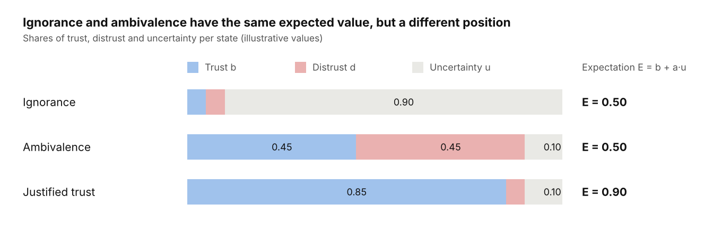

*Figure 1: Three states compared · illustrative values, base rate a = 0.5*

Ignorance and ambivalence yield the same expected value. They differ in uncertainty: under ignorance, a single event changes a lot; under ambivalence, little. The same separation distinguishes the epistemic bubble (u toward outside sources) from the echo chamber (d toward outside sources); the two call for opposite countermeasures (7.8).

### 2.3 Giving trust and earning trust

Initial trust is an advance without direct experience. Experience-based trust arises from observations. In the model, advance trust corresponds to the prior, experience to the accumulated evidence. **High initial trust never means high evidential certainty.**

The developmental phases according to Lewicki & Bunker (calculus-, knowledge- and identification-based trust) and initial formation according to McKnight, Cummings & Chervany (1998) are adopted as a frame of reference.

### 2.4 Dimensions of trustworthiness

Trustworthiness is often described through many individual traits, such as honesty, reliability, openness, respect and responsibility. These traits are not independent. The model uses four core dimensions.

| Core dimension | Guiding question | Assigned individual traits |
| --- | --- | --- |
| Ability (competence) | Can B do it? | competence |
| Benevolence | Does B wish me well? | benevolence, respect |
| Integrity | Does B adhere to rules and truth? | honesty, integrity, responsibility, openness |
| Predictability | Does B behave consistently? | reliability |

The assignment follows Mayer et al. (1995) and McKnight, Choudhury & Kacmar (2002). The ABI factors correlate highly but each has a distinct effect (Colquitt, Scott & LePine 2007). The factor structure is to be tested by confirmatory factor analysis.

**Competence and integrity must at least remain separate, because violations act differently** (Section 4.4). For machines and agents, the dimensions correspond to performance, purpose and process according to Lee & See (2004).

### 2.5 Positioning: trust engineering in Chen (2021)

The term trust engineering is already used by Chen (2021), though with a different goal. **Chen designs the trustee; this model designs the trust decision.** The two approaches complement each other.

Chen describes trust as a four-place relation R(A, B, φ, G): A trusts B with respect to an action φ that serves a goal G. This extends the three-place relation from Section 2.1 by the goal. In this model, the goal is contained in the benefit N and loss L of the action (Section 6.2).

| Statement in Chen (2021) | Counterpart in this model |
| --- | --- |
| Threshold condition: trust exists when the attributed probability m reaches a threshold n | threshold rule in 6.2; here the threshold follows from the loss and benefit of the action |
| In such approaches, the value 0.5 stands for uncertainty | b, d and u separate ignorance from ambivalence (2.2) |
| Reliance is not yet trust: malfunction is followed by disappointment, a breach of trust by a feeling of betrayal; trust presupposes a normative expectation | only partly represented: integrity violations with deception weigh more heavily (4.4) |
| Distrust can be the appropriate default stance, depending on environment, domain and consequences | base rate a per context; new agents start with u = 1 (10.2) |
| The trustee is more an AI ecosystem of developers, operators and users than a single system | provider, model and operator as separate nodes; attestation (10.2, 10.3) |
| Trust signals via outward appearance exploit weaknesses of judgment and do not make the system more trustworthy | signals without diagnosticity (q close to 0) only raise the descriptive account and enlarge Γ (4.8, 8.4) |
| Appreciation by trustors as part of the reward function of learning agents | no counterpart; such ratings would here be evidence to be weighted by independence D (4.7) |

This implies a limit. In Chen's terms, this model mainly describes calibrated reliance and the permission derived from it. It does not specifically represent normative expectations and reactions such as the feeling of having been betrayed. It leaves open whether agents can be trustees in the full sense.

## 3. Trust as a directed, context-dependent graph

### 3.1 Basic model

Trust is modeled as a directed graph G = (V, E). V is the set of entities, E the set of directed relationships. Entities are persons, groups, organizations, institutions, technical systems and AI agents.

**The relationship is directed, not symmetric, and changes over time.** A can trust B strongly while B trusts A little. For technical objects without an assessment of their own, the relationship is one-sided. Agents that verify permissions themselves maintain edges of their own.

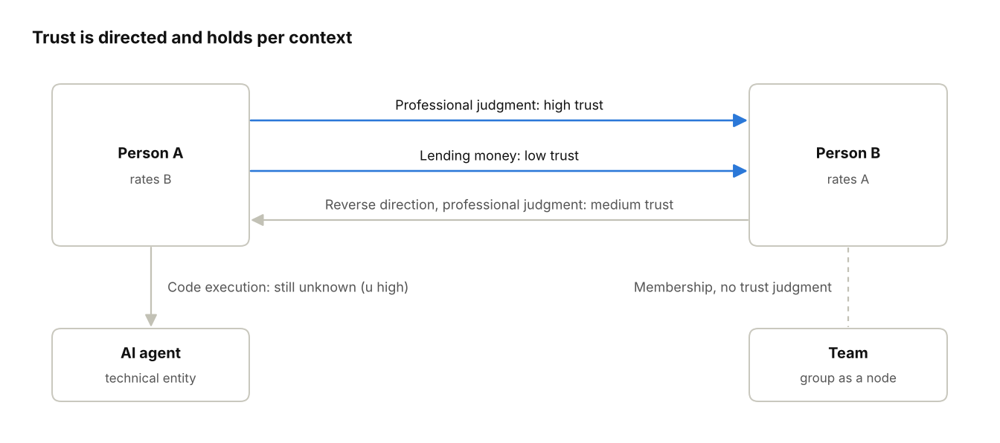

*Figure 2: Example graph · four entities, directed edges per context*

Between the same two entities there are several edges: one per direction and per context. Membership is an edge type of its own.

Each edge carries, per context c and dimension k, an opinion instead of a scalar:

```math
\omega_{A\to B,c,k} = (b,\; d,\; u,\; a), \qquad b + d + u = 1
```

b is trust, d distrust, u uncertainty, a the base rate (prior). The representation follows Subjective Logic (Jøsang 2016).

### 3.2 Context

**Trust is not universal**: I can trust a person's professional judgment but not lend them money. The context is defined as a triple:

```math
c = (\text{task domain},\; \text{vulnerability type},\; \text{relationship type})
```

| Component | Values (examples) |
| --- | --- |
| Task domain | professional judgment, payment approval, data access, code execution, care |
| Vulnerability type | financial, informational, physical, reputational, emotional |
| Relationship type | particular (known), generalized (stranger), institutional, technical |

The distinction between particular, generalized and institutional is empirically supported (Delhey, Newton & Welzel 2011; Freitag & Bauer 2013). The finer breakdown of task domains is a model assumption.

### 3.3 Groups as entities and as prior

Groups are nodes of their own. Membership is an edge type of its own and separate from trust.

Group membership sets the base rate a and a small prior strength W of a new edge. The effect is supported: people cooperate more with the in-group, d ≈ 0.32 across 212 studies (Balliet, Wu & De Dreu 2014). The prior loses weight with every individual observation (Kunda & Thagard 1996).

Group knowledge often predicts aggregates usefully but individuals weakly, because the variance within groups is large (Jussim 2012). **A group-based prior must therefore never by itself justify or deny a permission.** This leaves unaffected the fact that groups act strongly on their members' uptake of evidence and verification behavior (Chapter 7); only the prediction of individual trustworthiness from membership is weak.

### 3.4 Groups as carriers of shared convictions

Groups develop norms and narratives, such as “Our information sources are more credible than others”. These act on the base rates of their members. Individual and group-related convictions remain separate: a person can belong to a group without sharing its convictions.

Formally, anchoring to group convictions can be represented with the Friedkin-Johnsen model (Friedkin & Johnsen 1990). *It remains open under which conditions groups reinforce or change individual beliefs.*

## 4. Dynamic trust development

### 4.1 Evidence model instead of scalar

Each edge maintains, per context and dimension, two evidence accounts: r for positive, s for negative evidence. Added to these are the base rate a and the prior strength W. The opinion follows from them:

```math
b = \frac{r}{r+s+W}, \qquad d = \frac{s}{r+s+W}, \qquad u = \frac{W}{r+s+W}, \qquad E = b + a\,u
```

E is the expected trustworthiness. u is evidential certainty read inversely: much evidence yields a small u. The model corresponds to the Beta Reputation System (Jøsang & Ismail 2002).

The advantage over a single trust value: **E = 0.5 without any observation (u = 1) is distinguishable from E = 0.5 after a thousand mixed observations (u close to 0).**

### 4.2 Initial trust

A new edge starts with r = s = 0, i.e. u = 1 and E = a. The base rate a arises from three sources:

```math
a_{A\to B,c} = w_1\,U_A + w_2\,P_{A,c} + w_3\,G_{A,B,c}, \qquad w_1+w_2+w_3 = 1
```

U is A's general propensity to trust, P the context-specific expectation, G the group or category prior. The prior strength W determines how much evidence is needed to override a. Beliefs act on a and W (Section 5.3).

Initial trust also arises from recommendations, proofs of identity and competence, known channels, limited collaboration and binding rules. Platforms and institutions act as gatekeepers. **A platform guarantee is itself only a source of evidence with its own uncertainty and no substitute for independent evidence.**

### 4.3 Updating and temporal decay

An event e at time interval Δt updates both accounts:

```math
r \leftarrow \lambda^{\Delta t}\,r + g^{+}, \qquad s \leftarrow \lambda^{\Delta t}\,s + g^{-}
```

```math
g^{\pm} = \varrho_e \cdot q_e \cdot w^{\pm}_{k} \cdot r_{e,c} \cdot \max(\pm v_e,\,0)
```

| Quantity | Meaning | Range |
| --- | --- | --- |
| λ | forgetting factor per unit of time | (0, 1] |
| ϱ | independence weight of the source | [0, 1] |
| q | diagnosticity: How costly would the signal be for a deceiver? | [0, 1] |
| w± | dimension weight for positive or negative evidence | > 0 |
| r(e,c) | relevance of the event for context c | [0, 1] |
| v | valence of the event | [−1, 1] |

Without forgetting (λ = 1), the result is independent of the order of events. With λ < 1, recent events deliberately count more.

Without new evidence, r and s shrink. The uncertainty u rises toward 1, and E returns to the base rate a. **Trust therefore does not decay to zero, but to ignorance.** The half-life of evidence is:

```math
t_{1/2} = \frac{\ln 2}{-\ln \lambda}
```

At a constant evidence rate g per unit of time, the account saturates at g / (1 − λ). Complete certainty is therefore unattainable:

```math
u_{\min} = \frac{W}{W + \dfrac{g}{1-\lambda}}
```

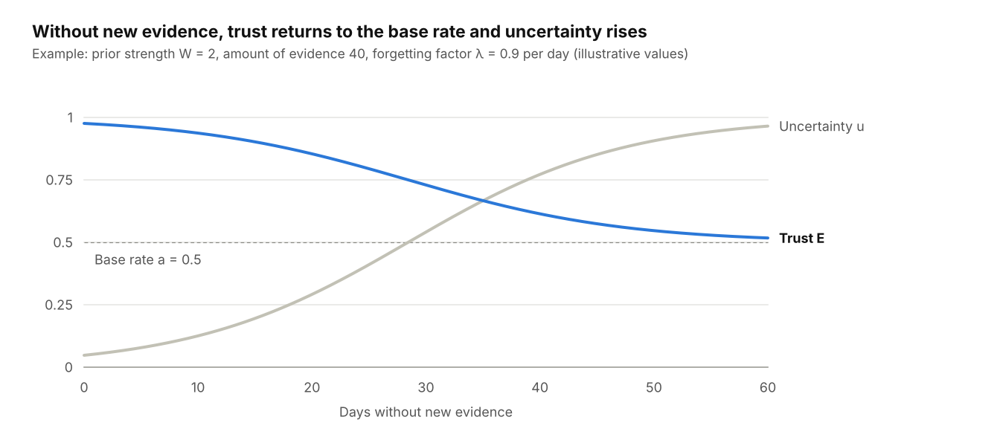

*Figure 3: Temporal decay according to Section 4.3 · illustrative parameters, 60 days*

Expected trust does not fall to zero but approaches the base rate. What is lost is the certainty of the assessment.

### 4.4 Conditional asymmetry

The effect of a single event of strength g on E, given a prior amount of evidence n = r + s + W, is:

```math
\Delta E^{+} = (1-E)\,\frac{g}{n+g}, \qquad \Delta E^{-} = -E\,\frac{g}{n+g}
```

This corresponds to the Bush-Mosteller and Rescorla-Wagner learning rule with a learning rate g / (n + g) that decreases as evidence grows. The classic rule with a constant learning rate is a special case. Three consequences:

- **Buffering.** A misstep weighs less after a long positive history. This is consistent with findings that existing trust cushions negative events (Cvetkovich et al. 2002; White et al. 2003).
- **Structural asymmetry.** At high E, the possible loss is larger than the possible gain, even with equal weights.
- **Dimension dependence.** The weights w+ and w− depend on the dimension.

| Event type | Ratio of w− to w+ | Evidence |
| --- | --- | --- |
| Integrity violation with deception | clearly greater than 1 | Schweitzer, Hershey & Bradlow 2006 |
| Integrity violation without deception | greater than 1 | Skowronski & Carlston 1989 |
| Competence error | less than or equal to 1 | Reeder & Brewer 1979; Kim et al. 2004 |
| Unreliability | close to 1, repairable | Schweitzer et al. 2006 |

A fixed assumption that negative experiences always act more strongly than positive ones is therefore unnecessary. **The asymmetry principle (Slovic 1993; Baumeister et al. 2001) holds as a tendency for integrity, not in general.**

### 4.5 Context transfer

An event acts on several contexts via r(e,c). An unrepaid loan strongly affects the context of lending money, partly integrity in general, and hardly professional competence.

Model assumption: **integrity evidence transfers broadly across contexts, competence evidence narrowly.** An event must not be counted several times as independent evidence via domain and tags.

### 4.6 Propagation in the graph

Trust information propagates via third parties. The effect is supported and stronger for distrust (Burt & Knez 1995; Sommerfeld et al. 2007). Normatively, however, trust is not transitive (Christianson & Harbison 1997).

The model separates functional trust (B can do the task) from referral trust (C judges others well). A recommendation by C about B is discounted by A's referral trust in C:

```math
b_{A:B} = b_{A\to C}\,b_{C\to B}, \quad d_{A:B} = b_{A\to C}\,d_{C\to B}, \quad u_{A:B} = d_{A\to C} + u_{A\to C} + b_{A\to C}\,u_{C\to B}
```

This is the discounting operator of Subjective Logic. **Along a chain, trust can only decrease and uncertainty can only increase.** Own experience, another's statement and independently verified information remain separate kinds of evidence. Descriptively, the least discounting occurs when C belongs to the in-group (H4a, Section 7.6).

### 4.7 Repetition, familiarity and source dependence

Repeated statements are more likely to be considered true, even without new evidence (Illusory Truth Effect; Hasher et al. 1977). The effect is small and robust: g = 0.37 after correction for publication bias across 182 studies (Ye et al. 2026). It grows logarithmically with the number of repetitions (Hassan & Barber 2021).

The model therefore maintains two parallel accounts.

**Normative account.** n repetitions from sources with dependence D count only as an effective sample:

```math
n_{\text{eff}} = \frac{n}{1 + (n-1)\,D}, \qquad \lim_{n\to\infty} n_{\text{eff}} = \frac{1}{D}
```

At D = 1 (one original source), n_eff = 1, no matter how often the statement appears. At D = 0.5, any number of repetitions reaches at most the value of two independent sources.

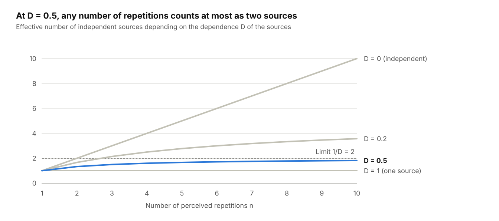

*Figure 4: Effective sample according to Section 4.7 · four degrees of dependence, 1 to 10 repetitions*

Only with independent sources does evidence grow with each repetition. Even at low dependence, the curve flattens early.

**Descriptive account.** It additionally contains a familiarity term:

```math
r^{\text{desc}} = r^{\text{norm}} + \varphi\,(1-m)\,\ln(1+R)
```

R is the number of perceived repetitions, φ the individual susceptibility, m the degree of accuracy focus. An accuracy focus at first contact dampens the effect (Brashier, Eliseev & Marsh 2020). Very frequent repetition can lower credibility again (Koch & Zerback 2013). The term therefore needs saturation.

**People distinguish genuine from apparent consensus poorly** (Yousif, Aboody & Keil 2019) and neglect correlated sources (Enke & Zimmermann 2019). Repetition also increases the credibility of the source itself (Mattavelli, Brambilla & Unkelbach 2025). This finding is preregistered; an independent replication has yet to be carried out.

### 4.8 The calibration gap

The difference between the two accounts is the central derived quantity:

```math
\Gamma_{A\to B,c} = E^{\text{desc}} - E^{\text{norm}}
```

Γ > 0 means unjustified trust (False Trust), Γ < 0 unjustified distrust (False Distrust). **Γ is the attack surface for social engineering and at the same time the target quantity for training.**

## 5. Psychological Factors

People do not begin relationships without prior experience. The model assigns the factors to four levels, each with its own time scale, so that the same mechanism is not modeled twice.

| Level | Model variable | Change | Acts on |
| --- | --- | --- | --- |
| Disposition | propensity to trust U | very slow | base rate a |
| Beliefs | beliefs, context prior P | slow | a, W, valence v |
| Learning parameters | λ, w+, w−, prior strength W | medium | updating |
| Momentary state | activation H | fast | willingness to act, verification effort |

### 5.1 Disposition instead of basic trust

Instead of the term basic trust (Erikson), the model uses the measurable propensity to trust. **It predicts trust independently, above all when little information about the counterpart is available** (Colquitt, Scott & LePine 2007).

The propensity is partly dispositional. Twin studies estimate the heritability of trust behavior at about 10 to 20 percent (Cesarini et al. 2008). Other work finds hardly any genetic influence (Van Lange, Vinkhuyzen & Posthuma 2014). Uslaner (2002) regards generalized trust as largely resistant to experience.

### 5.2 Formative experiences and learning parameters

**According to the model, formative experiences change the disposition less than the context-specific priors and the learning parameters.** Evidence for experience-dependent priors comes from Alesina & La Ferrara (2002) and Dohmen et al. (2012). By contrast, Bauer (2015) finds no consistent effect of victimization on generalized trust in panel data. Resilience is the most common trajectory after stressful events (Bonanno 2004).

The activation H is read as an estimate of environmental volatility. In an environment experienced as unpredictable, a higher learning rate is appropriate (Behrens et al. 2007). In the model this means a smaller λ and a smaller W. Deviating volatility estimation has been described in anxiety (Browning et al. 2015).

H is not a clinical trauma score and must not be used for diagnosis. Traumatic experiences do not lead to the same reactions in all people.

### 5.3 Beliefs

Beliefs are relatively stable convictions of an entity about itself, others or the world. They are properties of the evaluating node:

```math
\mathcal{B}_A = \{b_1,\ldots,b_n\}, \qquad b_i = (p_i,\; q_i,\; C_i)
```

p is the content, q the strength in [0,1], C the set of affected contexts. Beliefs act at three points.

| Effect | Model variable | Example |
| --- | --- | --- |
| Advance trust | base rate a | “People are basically honest” raises a |
| Persistence | prior strength W | “I am good at judging people” raises W: evidence has a weaker effect |
| Interpretation | valence v and weights w± | “Once a liar, always a liar” raises w− for integrity |

The interpretation function is:

```math
v_{A,e,c} = f(e,\,c,\,\mathcal{B}_A) \in [-1,\,1]
```

Example: A colleague publicly contradicts a manager. Someone who reads contradiction as integrity evaluates it positively. Someone who understands loyalty as silence evaluates it negatively.

**Opposite-direction updating, however, is the exception.** Across 52 topics, Wood & Porter (2019) found hardly any backfire effects. Groups mostly update in parallel in the same direction (Coppock 2022). The model expects sign reversals only for ambiguous events. For unambiguous events, people differ in a, W and strength, not in direction.

Measurable candidates for beliefs are Primal World Beliefs (Clifton et al. 2019), implicit theories about changeability (Haselhuhn, Schweitzer & Wood 2010) and the Hostile Attribution Bias (Crick & Dodge 1994).

### 5.4 Feedback loop and learning trap

Beliefs, interpretation and experience form a cycle: belief, interpretation, change in trust, behavior, new experience, confirmation or revision.

The cycle is asymmetric. **Someone who does not trust does not interact and receives no corrective evidence** (Denrell 2005). People therefore underestimate the trustworthiness of others, and symmetric feedback reduces this cynicism (Fetchenhauer & Dunning 2010). Expectations can also be self-fulfilling (Kelley & Stahelski 1970).

In the model this means: if E falls below the threshold for interaction, no more evidence arrives. Only the temporal decay λ then returns the edge to the base rate.

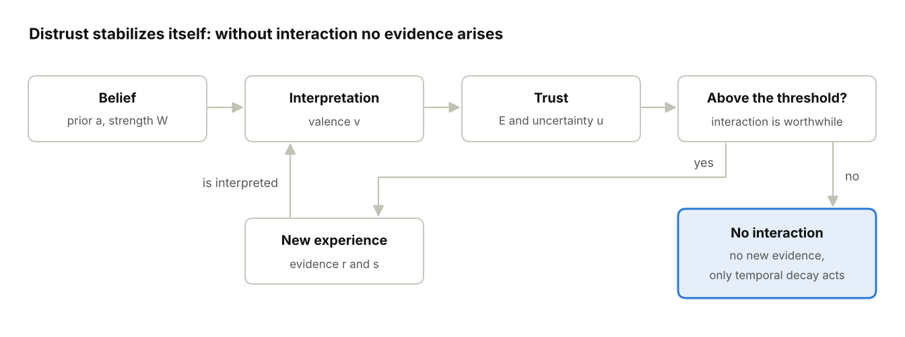

*Figure 5: Feedback loop according to Section 5.4 · learning loop and learning trap*

Above the threshold the loop runs and corrects itself. Below it, it ends in a dead end: the judgment persists because nothing can contradict it any longer. The learning trap has a collective form: a group that discredits outside sources in advance receives, as a whole, no corrective evidence (7.8).

Whether experiences change generalized trust is contested. In the laboratory it shifts in the direction of the experience (Paxton & Glanville 2015). In panel data, some experiences have an effect, for example unemployment (Mewes et al. 2021).

### 5.5 Momentary state

**Stress and time pressure do not change the evaluation E, but the willingness to act and the verification effort.** A person can trust another in principle and still not feel sure enough in a particular situation. Trust evaluation and willingness to act remain separate variables.

## 6. Decision Layer and Model Architecture

### 6.1 Three separate questions

A trust decision breaks down into three checks that do not substitute for one another:

| Question | Checks | Model variable |
| --- | --- | --- |
| Identity | Who is the entity? | evidence on edge attribution |
| Authorization | May it trigger this action? | permission P |
| Factual correctness | Is the specific statement or request correct? | evidence on the event itself |

**A confirmed identity proves neither permission nor correctness.** Trust in the person proves none of the three.

### 6.2 Threshold rule for permissions

An action x yields the benefit N for a legitimate request and the loss L in case of abuse. It is only worthwhile if the probability of legitimacy exceeds the threshold θ:

```math
\theta_x = \frac{L_x}{L_x + N_x}
```

The permission is granted if the normative trust minus an uncertainty penalty reaches the threshold:

```math
E^{\text{norm}} - \kappa\,u \;\ge\; \theta_x
```

κ is the risk aversion. Two consequences: **The threshold depends only on the action, not on the person.** And high uncertainty lowers the permission even when the expected value is high.

Example: A bank transfer with L = EUR 50,000 and N = EUR 500 yields θ ≈ 0.99. No realistically attainable personal trust suffices on its own. The action needs additional independent evidence.

### 6.3 Verification rule

An additional verification with cost K and detection probability τ is worthwhile if:

```math
K \;<\; \tau \cdot (1 - E^{\text{norm}}) \cdot L_x
```

**Verifications must therefore be cheap so that they are still triggered when residual doubt is small.** This justifies the requirement for low-effort procedures in Chapter 9. In organizations, K and τ are not set individually but by norm, role and the presumed verification by others (7.3 to 7.5).

### 6.4 Overview of model variables

| Variable | Symbol | Function |
| --- | --- | --- |
| Trust, distrust, uncertainty | b, d, u | opinion per edge, context, dimension |
| Expected trustworthiness | E | b + a·u |
| Evidence accounts | r, s | positive and negative evidence |
| Base rate and prior strength | a, W | advance trust and persistence |
| Forgetting factor | λ | temporal decay of evidence |
| Source dependence | D | correlation of sources |
| Diagnosticity | q | cost of faking a signal |
| Repetition | R | perceived frequency |
| Calibration gap | Γ | descriptive minus normative |
| Vulnerability | L | loss in case of abuse |
| Mapping strength | μ | effect of a dimension on a security objective (13.2) |
| Verification coverage | C | derived: share of cases with at least one verification in a group (7.3) |
| Assumed detection rate | τ_I | derived: filtering performance attributed to an institution (7.4) |
| Permission | P | granted scope of action |
| Beliefs | B | filter for a, W, v |
| Activation | H | momentary state |

### 6.5 Architecture and processing steps

The model consists of six layers: entities, relationships, experiences, beliefs, psychological state and decision. Each event passes through seven steps:

1. Record the event.
2. Determine context and dimension.
3. Evaluate the source: independence D and diagnosticity q.
4. Interpret: valence v, colored by beliefs in the descriptive account.
5. Update both evidence accounts, with temporal decay.
6. Adjust slow variables: priors and beliefs.
7. Decide: apply the threshold rule and the verification rule.

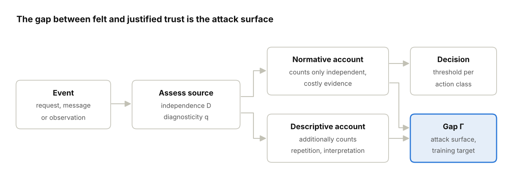

*Figure 6: Processing of an event · two evidence accounts, one decision*

Each event feeds two accounts. **Decisions are made only on the basis of the normative account**; the difference from the descriptive account is the calibration gap Γ. The temporal decay λ acts on both accounts.

This process description is an architectural hypothesis.

## 7. Groups and Organization

Chapters 3 to 6 describe trust as an edge A→B. Information security, however, is lived in teams, departments and companies. There, what matters is not only how A evaluates the evidence about B, but which evidence reaches A at all, how the group interprets it, and whether A carries out the verification personally or tacitly leaves it to others. **Groups act at all three stages, and they act above all on verification, not on evaluation.** This explains why individual awareness training achieves so little (Section 9.1): it addresses the individual's evaluation, while verification behavior is determined by role, norm and perceived coverage by others. This chapter is a derivation from the model and from social-psychological literature that was mostly not collected in security contexts. It introduces no new parameter.

### 7.1 Three levels

Section 1.1 names the macro and the micro level. Between them lies the level at which security decisions are actually made:

| Level | Unit | Typical action | Where in the model |
| --- | --- | --- | --- |
| Micro | edge A→B | payment, approval, data disclosure | Chapters 3 to 6, 9 |
| Meso | team, department, organization | verifying, reporting, following or circumventing norms | this chapter |
| Macro | public, categories | assent, sharing, turning away | Section 12.4, Case Study 1 |

### 7.2 Three stages at which groups act

| Stage | Question | Model variables | Key finding |
| --- | --- | --- | --- |
| Evidence intake | Which evidence reaches A? | D, R, n_eff | Groups share sources; D within the group is high (4.7) |
| Interpretation | How does A evaluate it? | B, a, W, v, w± | Group beliefs color valence and dimension (3.4, 5.3) |
| Verification | Does A verify, or someone else? | K, τ, verification coverage C | In groups, verification is a public good and is undersupplied |

The first two stages are already part of the model; the only new element here is the reference to groups. The third stage is new and the most important one for information security.

Three findings are considered established and form core assumption G4 (Section 11.1): Visible judgments of others shift one's own judgments, even when the evidence is unambiguous (Asch 1951; Bond & Smith 1996). Decisions of others are adopted as evidence, even if they in turn are based only on imitation (information cascade; Bikhchandani, Hirshleifer & Welch 1992). And the willingness to act decreases with the number of possible actors (Darley & Latané 1968; Fischer et al. 2011).

### 7.3 Verification as a public good

If an action can be verified by n persons and each decides independently and verifies with probability c_n, the verification coverage is:

```math
C = 1 - (1 - c_n)^n
```

In general, C is the probability that at least one person verifies, 1 − P(nobody verifies); the formula is the special case of independent decisions. With dependent decisions, C can be lower or higher than the formula gives; if all decide together, C = c_n.

Empirically, c_n decreases with n faster than the larger exponent compensates. Each individual applies the verification rule from 6.3 not to (1−E), but to the residual risk after the presumed verification by the others. If everyone presumes the same, nobody verifies; 7.9 derives the decrease from the verification rule. **Two possible verifiers without assigned responsibility often amount to less than one verification.**

The four-eyes principle therefore protects only under two conditions: both verifiers are explicitly responsible, and they verify independently. If both see the same justification and the same request via the same channel, their dependence D is close to 1 and, according to 4.7, the second verification has almost no evidential value. This is Section 10.7 (correlated verifiers in agents), transferred to humans.

### 7.4 Protection delegation: “That's IT's job”

A holds an edge to the security institution I (IT, security, compliance) in the context “defense against attacks”. This edge has three properties:

1. **High base rate a**, institutionally grounded (relationship type institutional, 3.2).
2. **u close to 1**, because successful defense is invisible. A sees only what gets through and assumes it has been checked. This is a survivorship bias on the evidence side.
3. **No feedback on errors**, as long as nothing happens.

In the verification rule, A does not calculate with E_norm(B), but with the value after presumed filtering:

```math
E' = 1 - (1 - E)\,(1 - \tau_I)
```

τ_I is the detection rate of the institution as assumed by A. With τ_I close to 1, (1−E′) tends to 0, and **no verification of one's own is worthwhile any longer, for any loss L.** In fact, τ_I is below 1; filters let part of the attacks through, and precisely this part reaches A.

The calibration gap here lies not on A→B but on A→I: Γ_{A→I} > 0. **It acts as a multiplier on all edges A→B within the institution's area of responsibility.** In the model, the sentence “It's IT's job to protect us” is not an attitude problem, but a rationally applied verification rule with a miscalibrated τ_I. A related phenomenon is risk compensation: perceived protection increases risk behavior (Peltzman 1975; Wilde 1982); in a security survey, perceived technical protection lowered the intention to comply with security policy (Zhang, Reithel & Li 2009). Section 4.2 formulates the same for platforms: a platform guarantee is itself only a source of evidence with its own uncertainty. For employees, IT is the platform.

Two consequences follow from ΔE = u·Δa (12.4): Because u is high on A→I, a single visible incident hits the edge in full. After the first successful attack, “IT protects us” flips to “IT is useless”, without any calibrated assessment in between. Both states are miscalibrations; the second produces security fatigue and circumvention (Stanton et al. 2016). The remedy is not more trust in the institution, but visible evidence about its error rate (Rule S22).

### 7.5 Norms beat knowledge

Whether A verifies depends more on what A considers usual (descriptive norm) than on what A knows or what is prescribed (Cialdini, Reno & Kallgren 1990). In the model, the descriptive norm sets the verification cost K. A verification that counts as distrust in the team is socially expensive; one that counts as a matter of course is cheap. **K is a group variable, not an individual one.** This refines Rule S14: cheap means above all socially cheap. Herley (2009) shows the flip side: where security rules cost the individual effort but bring the benefit to others, rejecting them is individually rational.

Attack form: normalization (“Everyone here does it this way”, “The boss always wants this done quickly”). It lowers τ and raises K without changing a single evaluation. It is a calibration attack (8.2) on the verification stage instead of the evaluation stage.

### 7.6 Groups as an attack surface

| Attack | Group effect | Model variable |
| --- | --- | --- |
| Compromised colleague account | in-group prior, little discounting within the group | G, H4 |
| CEO fraud | authority in the group plus diffusion of responsibility (“Accounting will check it”) | a, C |
| Supplier and project fraud | swift trust: high base rate with u close to 1 in temporary teams (Meyerson, Weick & Kramer 1996) | a, u, V9 |
| Normalization of rule violations | descriptive norm | K, τ |
| Internal consensus (“We all saw it”) | cascade, D close to 1 | n_eff |
| Blame after an incident | black sheep effect (Marques, Yzerbyt & Leyens 1988): deviants from one's own group are judged more harshly; reporting does not happen | s, S17 |

### 7.7 Groups as a protective factor

The same mechanisms have a calibrating effect when the sources are independent (D low) and the signals cost something (q high). Whether a group effect improves or worsens calibration depends on D and q, not on the effect itself.

| Effect | Model variable | Condition |
| --- | --- | --- |
| Assigned verification role | C, c_n | one named person per action class, no “someone” |
| Independent second verification | D of the verifiers | different channel, different information, own responsibility |
| Psychological safety (Edmondson 1999) | s is reported | errors without sanction (S17) |
| Structured dissent, red team (Janis 1972 as the negative example) | enforced s | group variant of Consider the Opposite |
| Wisdom of crowds | n_eff | only without mutual influence (Lorenz et al. 2011) |
| Gossip as a reputation system | G2 | D low (Sommerfeld et al. 2007) |
| Contact across group boundaries (Allport 1954; Pettigrew & Tropp 2006) | G replaced by individual evidence | breaks the learning trap from 5.4 |

### 7.8 Echo chamber and bubble

Nguyen (2020) distinguishes the epistemic bubble, in which other sources are simply absent, from the echo chamber, in which outside sources are discredited in advance. In the model, the bubble is a u-state towards outside sources, the chamber a d-state. They call for opposite countermeasures: contact with outside sources dissolves the bubble and confirms the chamber. **A single trust value could not distinguish between the two.** This is the strongest everyday example of the separation from 2.2 and at the same time the collective form of the learning trap from 5.4: groupthink (Janis 1972) is a group below the interaction threshold towards everything that comes from outside.

### 7.9 Perceived coverage by others: one structure behind 7.3 and 7.4

Sections 7.3 and 7.4 describe two mechanisms, but one structure. In both, A applies the verification rule from 6.3 not to the residual risk (1 − E), but to the residual risk after the verification that A attributes to other nodes. Let τ̂_O be the detection rate that A attributes to all other nodes O that could also verify the action. The verification rule becomes:

```math
K \;<\; \tau \cdot (1 - E)\,(1 - \hat{\tau}_O) \cdot L
```

Protection delegation (7.4) is the case O = {I} with τ̂_O = τ_I. Diffusion of responsibility (7.3) is the case in which O consists of the n − 1 colleagues, each presumed to verify with probability ĉ, so that τ̂_O = 1 − (1 − ĉ)^(n−1). Both lower one's own verification through the same term, and they combine multiplicatively: with an institution and n − 1 colleagues, 1 − τ̂_O = (1 − τ_I)(1 − ĉ)^(n−1). **Trust is not the cause of either effect but its weight:** τ_I and ĉ are A's opinions about the competence of I and of the colleagues in the context “verification”, and E on those edges decides how much coverage A ascribes to them.

**What the rule derives.** Let ρ = K / (τ (1 − E) L) be the ratio of verification cost to the expected loss prevented; ρ < 1, otherwise nobody verifies even alone. A potential verifier verifies as long as (1 − ĉ)^(n−1) > ρ. If every potential verifier presumes the same of the others and applies the same rule, the symmetric solution at which nobody gains by deviating is:

```math
c_n = 1 - \rho^{\,1/(n-1)}, \qquad C = 1 - \rho^{\,n/(n-1)}
```

For n = 1, c = 1 and C = 1; for n = 2, C = 1 − ρ²; as n grows, C falls monotonically towards 1 − ρ. This is the volunteer's dilemma (Diekmann 1985) with verification as the volunteered act. Two statements that 7.3 made only empirically follow from it. First, c_n falls with n fast enough that C falls too; the larger exponent does not compensate. Second, coverage rises with the loss L and falls with the verification cost K and with the trust E in the sender. The second statement turns the main moderator of the bystander literature into a prediction: the bystander effect is weaker in dangerous emergencies (Fischer et al. 2011); in the model, diffusion is weakest where L is high and visible, and strongest where the action looks harmless, such as a routine mail or a master-data change, which is exactly where social engineering operates (V28). The solution assumes that A knows n, treats the others as alike and applies the rule as a threshold; real c_n also carries the habitual part of behavior and the social part of K (7.5). It is a model statement, not a finding.

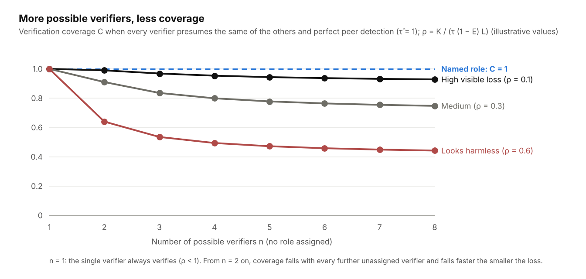

*Figure 11: Verification coverage C against the number of possible verifiers n · symmetric solution for three values of ρ; a named role keeps C = 1*

**What the model imports.** The rule does not explain why A presumes coverage by others at all, nor how strongly; that is core assumption G4 and comes from the bystander literature. That literature names three processes (Latané & Darley 1970), which the model keeps apart because they act on different variables:

| Process (Latané & Darley 1970) | Everyday form | Model variable | Where |
| --- | --- | --- | --- |
| Diffusion of responsibility | “Someone else will check.” | τ̂_O in the verification rule | 7.3, H17 |
| Pluralistic ignorance | “Nobody reacts, so it is harmless.” | inaction of others as evidence; D close to 1 | V23 |
| Audience inhibition | “If I am wrong, I look distrustful.” | social part of the verification cost K | 7.5, H18 |

Studies in security contexts usually measure these together, as an intention to report or to act (Brink, Eller & Gan 2015; Paravastu, Simmers & Anandarajan 2018). The separation is what makes H17, H18 and V23 testable one at a time.

**The same structure in other literatures.** Once the effect is read as “perceived coverage by other nodes”, it is recognizable in several fields that rarely cite one another:

| Literature | Coverage attributed to | Own protective act | Where in the model |
| --- | --- | --- | --- |
| Risk compensation, risk homeostasis (Peltzman 1975; Wilde 1982); in security, perceived technical protection (Zhang, Reithel & Li 2009) | technical protection | risk behavior rises | τ_I (7.4), H16 |
| Automation complacency (Parasuraman & Manzey 2010) | automation | monitoring declines | τ_I; H14 (10.5) |
| Free riding in public goods; security as a best-shot public good (Varian 2004; Grossklags, Christin & Chuang 2008) | other contributors | own contribution falls | C as a best-shot aggregate (7.3) |
| Volunteer's dilemma (Diekmann 1985) | other potential volunteers | probability of volunteering falls with n | c_n, C (this section) |
| Social loafing (Karau & Williams 1993) | co-workers on a joint task | effort falls with group size; effect sizes per n | c_n as a function of n |
| Redundancy problem (Sagan 2004) | redundant safeguards | each layer relies on the others | D of the verifiers (7.3, V24) |

**What the abstraction buys, and where it ends.** The unification is worth keeping only where it yields a statement that the source literatures do not make. Four such statements can be tested:

1. **Independence, not number.** Bystander studies count heads. The model says that a second verifier adds coverage only to the extent that D < 1 (7.3, V24, S21). Sagan (2004) comes closest.
2. **Multiplicative combination.** Because 1 − τ̂_O = (1 − τ_I)(1 − ĉ)^(n−1), H16 and H17 multiply: a team with high trust in the security institution and several unnamed verifiers is the worst case (V29). Neither risk-compensation nor bystander research states this, because each sees only one factor.
3. **Loss dependence.** c_n rises with L (V28). In the bystander literature this is an empirical moderator; here it is derived.
4. **Trust in the others as the weight.** ĉ is itself an opinion on the edge A→colleague. High trust in the colleagues' competence raises τ̂_O and lowers one's own verification, while in-group membership lowers the social part of K (7.5). The two channels pull in opposite directions, and which one dominates is set by the context: by the loss L (shared and visible in a fire, borne by someone else in an assault, small and inconspicuous in a routine verification) and by what K contains (physical risk, social cost, or both). Bystander research finds that in-group bystanders can raise rather than lower intervention in violence scenarios (Levine & Crowther 2008); the K channel accounts for this, the τ̂_O channel does not. The model therefore does not predict the sign of the in-group effect in general, only that it follows L and K of the action class in question.

The dynamics of V22 come from the evidence model (4.3, 12.4) and have no counterpart in these literatures either.

Beyond these statements, “perceived coverage” becomes a label. The model does not derive the bystander effect from first principles; it subsumes it. What it derives is the dependence of c_n on n and on ρ; what it imports is that people presume coverage at all (G4) and the three processes behind it. A reviewer can object that H17 is the bystander effect with Greek letters; the answer is the four statements above, not the relabeling. Section 11.4 therefore keeps “derived” and “transferred” apart for H16 and H17.

### 7.10 Limitations

- **Transfer.** Conformity, cascades and diffusion of responsibility are well supported in the laboratory and in the field. In security contexts they have been measured as reporting and compliance intentions (Zhang, Reithel & Li 2009; Brink, Eller & Gan 2015; Paravastu, Simmers & Anandarajan 2018), not as verification coverage per action class. H16 to H19 are transfers in that narrower sense; 7.9 states which part of H16 and H17 the model derives and which it imports.
- **Measurability.** τ_I, c_n and the descriptive norm can only be estimated in field studies. In simulations they are assumptions (15.2).
- **Verification rates per person are performance monitoring.** The metrics of this chapter apply per team and action class, never per person (15.4, Rule S23).
- **An organization is not just a group.** Hierarchy, incentives and formal processes have additional effects. The chapter covers only the part that can be traced back to evidence, interpretation and verification.

## 8. Trust from an Attacker's Perspective

### 8.1 Trust and vulnerability

Trust does not create a security gap. **A vulnerability arises when a positive expectation is combined with an exploitable scope of action.** The loss depends on the permission P and the size of the loss L, not on the level of trust.

Data on internal fraud support this: owners and executives caused a median loss of USD 500,000, regular employees USD 60,000 (ACFE 2024). The data are correlational.

### 8.2 Abuse of trust

Abuse of trust occurs when an actor deliberately uses a positive expectation to gain an advantage against the interests or agreed limits of the trusting entity.

**A disappointed expectation does not prove hostile intent.** Errors, overload, misunderstandings and conflicts of interest also produce negative experiences. In the model, a competence error therefore counts differently from a deception (Section 4.4).

**Two classes of attack.** Abuse attacks exploit a scope of action P that has already been granted; their loss follows G1. Calibration attacks instead shift the evaluation itself: they enlarge the calibration gap Γ without touching any permission. Social engineering usually combines both stages: first calibrate, then abuse. The techniques in 8.4 act predominantly as calibration attacks; the abuse is the subsequent action. At the macro level, calibration attacks can cause harm even without an abuse stage, for example as a lasting miscalibration of a public ([Case Study 1](case-study-01-populist-techniques.md)).

### 8.3 Three levels of analysis

| Level | Guiding question |
| --- | --- |
| Motivation | What advantage does the actor want to gain? |
| Opportunity | Which relationship or permission opens up the possibility? |
| Approach | How can this relationship be abused? |

The levels correspond to the Fraud Triangle (Cressey 1953). The presumed motivation serves to form hypotheses, not to assign blame.

### 8.4 Attacks as operations on model variables

**Every social engineering technique can be read as an intervention in a specific model variable.** This makes visible which countermeasure acts at which point.

| Technique | Manipulated variable | Effect in the model | Countermeasure |
| --- | --- | --- | --- |
| Impersonation, deepfake voice | edge attribution | attacker inherits the evidence r of another node | verify identity via an independent channel |
| Authority or group signal | base rate a | high advance trust without evidence | verify permission separately from status |
| Sock puppets, fake reviews | repetition R, hidden dependence D | descriptive account grows, normative does not | count independent origins |
| Long trust-building | account r via cheap events | high E from evidence with low diagnosticity q | weight evidence by stakes |
| Context switch | transfer r(e,c) | trust from a harmless domain is used for a risky one | keep contexts separate |
| Time pressure, secrecy | verification cost K, accuracy focus m | verification does not happen, familiarity has a stronger effect | make verification mandatory per action class |
| Appeal to beliefs | valence v | event is interpreted favorably | check questions on one's own interpretation |
| Blanket denial of genuine evidence | distrust d against true evidence | Liar's Dividend (Chesney & Citron 2019) | provenance records, fact-checking |
| Normalization (“Everyone here does it this way”) | descriptive norm, verification cost K | verification counts as unusual and does not happen | make verification visible as a team norm (S23) |
| Exploiting protection delegation | assumed detection rate τ_I | A assumes that what got through has been checked | make the institution's error rate visible (S22) |
| Compromised colleague account, insider | group prior G, discounting | in-group is hardly discounted, request counts as internal | verify the action class, not the sender group (S1) |
| Manipulated reputation scores | the model itself | false evidence in the normative account | log evidence provenance |

The techniques occur in combination. Example: a fraudulent identity is visible on several platforms for months, collects seemingly independent recommendations and then makes a payment request under time pressure. R is high, D close to 1, q low, K artificially raised.

## 9. Application A: Detecting Abuse of Trust with Little Effort

**The goal is calibrated trust, neither maximum trust nor maximum distrust.** Training is meant to reduce the calibration gap Γ in both directions.

### 9.1 What the evidence says about training

- People detect lies with a hit rate of about 54 percent, barely above chance (Bond & DePaulo 2006). Training improves this only slightly (Hauch et al. 2016).
- In a randomized trial with about 19,500 employees, annual phishing training showed no measurable effect, and embedded training only a minimal one (Ho et al. 2025). The model explains this as follows: training acts on the individual's evaluation, but verification behavior is determined by role, norm and the presumed verification by others (Chapter 7).
- Skepticism games mainly shift the response bias: participants reject more, including what is true (Modirrousta-Galian & Higham 2023; Hoes et al. 2024).
- Structured techniques work: premortem (Mitchell, Russo & Pennington 1989), Consider the Opposite (Lord, Lepper & Preston 1984), Lateral Reading (Wineburg & McGrew 2019).
- Debiasing training with feedback transfers to the field in individual studies (Morewedge et al. 2015; Sellier, Scopelliti & Morewedge 2019).
- In everyday life, feedback is one-sided: someone who declines never learns whether the request was legitimate (Hogarth 2001; Fetchenhauer & Dunning 2010).

### 9.2 Conclusion: verify the action, do not detect deception

Content features such as spelling, tone or image quality lose their diagnosticity through generative AI (q towards 0). Training that targets such features becomes outdated.

The model suggests a different rule: **Verification depends on the action class, not on one's gut feeling about the sender.** The threshold θ from Section 6.2 is independent of the person. The rule can therefore be applied without assessing the person.

| Trigger (action class) | Fixed response |
| --- | --- |
| Payment, account change, gift card purchase | call-back to a self-chosen, known number |
| Credentials, MFA code, password reset | never pass on; open the portal oneself |
| Change of rights or roles | approval by a second person |
| Disclosure of confidential data | verify permission with the data owner |
| Installing software, granting remote access | only via the official IT channel |
| Channel switch, secrecy, urgency | treat as a reason to verify, not as proof |

The table is a draft. The specific classes are to be defined per organization.

### 9.3 The quick procedure under time pressure

Make the request concrete, estimate the loss, verify independently, limit the scope of action.

Example: A supposed manager urgently requests a payment. The question is not “Do I trust this person?”, but:

1. Verify identity via a known channel.
2. Verify permission for the payment request.
3. Verify the factual correctness of the payment.
4. If the evidence is insufficient, postpone or obtain further approvals.

**Time pressure is a reason for increased care, not proof of an attack.**

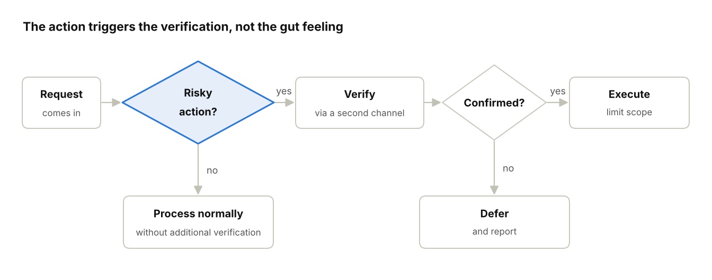

*Figure 7: Quick procedure according to Section 9.3 · two decisions, three outcomes*

The first decision asks only about the type of action. How trustworthy the sender appears plays no role at this point.

### 9.4 The five guiding questions for decisions without time pressure

| Question | Aim of inquiry | Model variable |
| --- | --- | --- |
| What exactly am I supposed to believe or allow? | specific action and context | x, c |
| Who gains what from it? | incentives and conflicts of interest | motivation |
| What could go wrong? | loss and reversibility | L |
| What independent evidence exists? | robustness | D, q, u |
| What is the smallest justifiable next step? | limiting the scope | P |

The questions are a synthesis of premortem, Lateral Reading and Least Privilege, not a new invention.

### 9.5 Check questions against false distrust

- What harmless explanation is there?
- Which observation would refute my suspicion?
- Would I evaluate the same cues in the same way for a likeable person?
- Do I know the claim from several independent sources, or have I just heard it often?
- Which of my beliefs colors this assessment?

### 9.6 Design principles for training

1. **Few triggers, fixed response.** If-then rules instead of general vigilance.
2. **Make verification cheap.** The verification rule from 6.3 only applies when the cost K is small. A call-back must be possible in under a minute and be socially accepted.
3. **Practice symmetrically.** Exercises contain legitimate and malicious cases, with feedback on both types of error.
4. **Measure discrimination.** The measure of success is discriminability, not the rejection rate.
5. **Structure before vigilance.** Where an error is expensive, a technical or organizational control protects, not a person's attention.
6. **Limit friction.** Every rule consumes compliance budget (Beautement, Sasse & Wonham 2008). Too many rules produce circumvention and security fatigue (Stanton et al. 2016).
7. **Role and norm instead of appeal.** Every action class has a named verification role, and the team's verification rate is visible. Without both, verification remains a public good that nobody provides (7.3, 7.5).

These principles are derived from the model and the literature. Their effectiveness as a package is untested (hypothesis H12).

### 9.7 Metrics

| Metric | Meaning |
| --- | --- |
| Discriminability d′ | distinguishing legitimate from malicious requests |
| Criterion c | general tendency to reject |
| Reporting rate and reporting time | share and speed of reported attacks |
| Verification rate per action class | share of triggered cases with actual verification |
| Time spent per verification | friction |
| Calibration (Brier score) | agreement between confidence and hit rate |
| Verification coverage C per action class | share of cases with at least one independent verification, measured per team (7.3) |
| Assumed detection rate τ_I | how strongly employees leave verification to the institution (7.4) |

### 9.8 Decision logs

For rare, consequential decisions, a short log helps.

- **Before:** expectation, available evidence, own confidence in percent, possible beliefs.
- **At the decision:** rights granted, risk accepted.
- **After:** actual course of events, relevant cues, false assumptions, truly independent information.
- **Learning:** Was the decision methodologically sound, regardless of the outcome? Did repetition influence the assessment?

The log should also track declined cases in order to avoid the learning trap from 5.4. **A good decision can turn out badly. A good outcome does not prove a good decision.**

## 10. Application B: Human-agent and machine-machine trust

The same model applies to technical nodes. The difference: **With machines, evidence, temporal decay and permission can be implemented explicitly instead of only described.** This chapter is a derivation from the model and has not yet been empirically tested.

### 10.1 Three directions

| Direction | Core problem | Main risk |
| --- | --- | --- |
| Human trusts agent | Calibration | Overtrust in fluent outputs, undertrust after individual errors |
| Agent trusts human or content | Authority of an instruction | injected instructions in content read, forged principals |
| Machine trusts machine | Identity, delegation, chains | overly broad rights, transitive chains, correlated verifiers |

### 10.2 Establishing trust

Trust in a technical entity arises in six steps:

1. Verify identity independently, cryptographically rather than via self-disclosure.
2. Attribute credentials unambiguously.
3. Prove current possession or control.
4. Document provenance and state: which model, which version, which tools, which configuration.
5. Initially restrict permissions narrowly.
6. Adjust trust on the basis of verified behavior.

Steps 1 to 4 set only the base rate a. Evidence r arises only from verified results. **A correctly identified agent starts with u = 1.**

### 10.3 Mapping the model variables to technical mechanisms

| Model variable | Technical counterpart (examples) |
| --- | --- |
| Edge attribution (identity) | mutual authentication, workload identities, signed requests |
| Base rate a | attestation of provider, model and runtime environment |
| Evidence accounts r, s | logged, verified task results per task type |
| Diagnosticity q | hard-to-forge evidence: signatures, reproducible results, passed tests |
| Forgetting factor λ | validity period of credentials, interval of re-attestation |
| Context c | task type and data class; evidence does not apply across contexts |
| Permission P | narrowly scoped, short-lived tokens and capabilities |
| Threshold θ | approval policy per action class |
| Source dependence D | diversity of verifiers: different model, different provider, human |
| Discounting in chains | delegation may only narrow rights, never extend them |

The principles correspond to Least Privilege (Saltzer & Schroeder 1975) and Zero Trust (NIST SP 800-207). What is new is the coupling to an evidence account with temporal decay.

### 10.4 Verifying recurrently

Without new evidence, uncertainty grows. If an edge has the amount of evidence n₀ = r + s at the time of the last verification, the following holds afterwards:

```math
u(t) = \frac{W}{W + n_0\,\lambda^{t}}
```

If an action class tolerates at most uncertainty u_max, the latest re-verification interval follows:

```math
t^{*} = \frac{\ln\!\left(\dfrac{W\,(1-u_{\max})}{u_{\max}\,n_0}\right)}{\ln \lambda}
```

The formula applies for 0 < λ < 1, n₀ > 0 and an edge that is still within the limit at the last verification, u(0) = W / (W + n₀) < u_max. If u(0) ≥ u_max, including a new edge with n₀ = 0, the formula gives no positive interval or none at all: verification is due immediately (t* = 0). Without forgetting (λ = 1), uncertainty stays at u(0); an edge within the limit then never crosses it through decay alone.

Worked example with illustrative values W = 2, n₀ = 40, λ = 0.9 per day:

| Action class | u_max | Re-verification interval t* |
| --- | --- | --- |
| low risk | 0.2 | about 15 days |
| high risk | 0.1 | about 8 days |

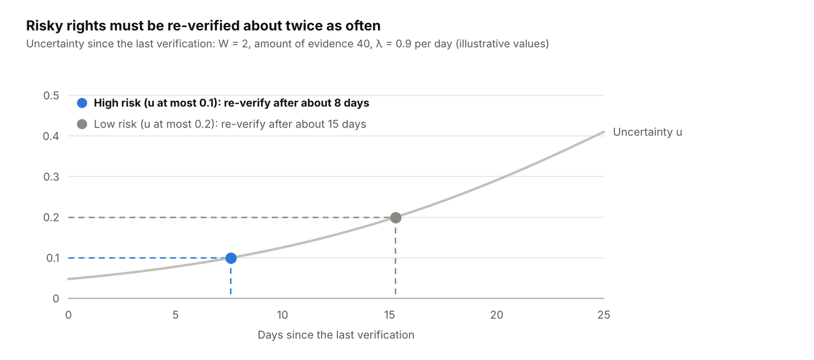

*Figure 8: Re-verification interval according to Section 10.4 · illustrative parameters, two risk classes*

The curve shows how uncertainty grows without new evidence. Each risk class intersects it at a different point; that is where the next verification is due.

Three rules follow:

- **Riskier permissions need shorter re-verification intervals.**
- More verified evidence lengthens the interval, but only logarithmically.
- A change of version or configuration turns the agent into a partly new node. The old evidence is to be devalued until new evidence is available.

### 10.5 Human trusts agent

People use automation too much or too little (Parasuraman & Riley 1997). Even with reliable systems, monitoring declines (Parasuraman & Manzey 2010). Appropriate trust needs information about the performance, process and purpose of the system (Lee & See 2004).

Fluent, confident wording costs a language model nothing. **It has a diagnosticity q close to 0 and must not justify trust.** For design, this means:

- Keep trust per task type, not per agent.
- Form evidence only from verified results.
- Make uncertainty and evidence visible: sources, tests, intermediate steps.
- Stagger approvals by size of the loss: reversible actions with small L autonomously, irreversible ones with large L only with human approval.

### 10.6 Agent trusts human or content

For an agent, every web page, email or file it reads is a source with unknown intent. The separation from 6.1 applies strictly:

- **Identity:** Instructions are valid only from the authenticated principal via the designated channel.
- **Authorization:** **Content from tools is data and carries no authority to instruct.**
- **Correctness:** Even an authorized instruction is checked against action class and threshold.

In the model, an injected instruction is an impersonation according to 8.4: The content claims the principal's edge.

### 10.7 Machine trusts machine

- **No transitivity.** If A trusts service B, this does not apply to B's subcontractor C. The discounting operator from 4.6 makes uncertainty grow with each link in the chain. In practice, this limits the permissible delegation depth.
- **Narrowing delegation.** Rights passed on are at most as broad as one's own and shorter in time.
- **Independent verifiers.** Two instances of the same model are correlated sources with D close to 1. A cross-check counts as second evidence only with a different model, a different data basis or a human verifier. The same applies to human verifiers (7.3).
- **Sybil resistance.** Many agreeing agents of the same origin count as one source (Douceur 2002).
- **Revocation.** Negative evidence on integrity withdraws permissions immediately and across contexts.
- **Evidence provenance.** Every entry in the evidence account carries source and type of verification, so that the account itself remains verifiable.

### 10.8 Agents as critical co-thinkers

An agent can keep the normative account for people: count independent origins, recognize action classes, apply the verification rule. **In doing so, it assesses the evidential situation of a request, not the worth of a person.** This boundary is also legally required (Section 15.4).

## 11. Core assumptions and hypotheses

After the literature review, four statements are considered established and are core assumptions. Eleven hypotheses concern the model itself, eight the two application problems, information security and the organization.

### 11.1 Core assumptions

| ID | Core assumption | Reference in the model | Key evidence |
| --- | --- | --- | --- |
| G1 | The loss from an abuse of trust depends on the scope of action granted and the vulnerability, not on the level of trust. | Sections 6.2 and 8.1 | Mayer et al. 1995; Saltzer & Schroeder 1975; ACFE 2024 |
| G2 | Trust information propagates through social relationships, distrust more strongly than trust. | Section 4.6 | Burt & Knez 1995; Sommerfeld et al. 2007 |
| G3 | Repetition increases the perceived truth of statements without new evidence. | Section 4.7 | Hasher et al. 1977; Ye et al. 2026 |
| G4 | In groups, evidence intake, interpretation and verification behavior are formed socially: Visible judgments of others shift one's own judgments, decisions of others are adopted as evidence, and the willingness to act decreases with the number of possible actors. | Chapter 7 | Asch 1951; Bond & Smith 1996; Bikhchandani et al. 1992; Darley & Latané 1968; Fischer et al. 2011 |

### 11.2 Hypotheses on the model

**H1 – Diagnosticity and provenance evidence.** If the cost of producing a convincing result falls, features of the result lose their informative value for trustworthiness. Provenance and process evidence gain weight only if they are expensive for deceivers and understandable for recipients. Blanket AI labeling also lowers the credibility of true content.

**H2 – Groups as a weak prior.** Group membership determines the base rate of a new trust edge. Its influence decreases with each individual observation and predicts the behavior of individuals only weakly. This concerns the assessment; on evidence intake and verification behavior, groups have a strong effect (G4, Chapter 7).

**H4 – Discounted propagation.** Along a referral chain, justified trust decreases and uncertainty grows. People discount referrals less strongly than the dependence of the sources requires.

- **H4a – In-group.** Discounting is lowest when the referrer belongs to the in-group. Compromised colleague accounts and internal forwards are therefore hardly verified.

**H5 – Experience acts on priors and learning parameters.** Formative experiences change context-specific priors and learning parameters more strongly than the generalized propensity to trust. Environments experienced as unpredictable increase the learning rate.

**H5a – Conditional asymmetry.** Negative evidence weighs more heavily than positive evidence in integrity violations, especially with deception. This does not apply to competence errors. Extensive positive prior evidence buffers individual negative events.

**H6 – Separate verifications.** Anyone who verifies identity, authorization and factual correctness separately and ties permissions to the size of the loss instead of to trust in the person makes fewer risky wrong decisions at a justifiable additional effort.

**H7 – Action-bound adversarial thinking.** Structured adversarial thinking bound to action classes improves discriminability in risky decisions. Generally increased skepticism only shifts the response bias and increases false distrust.

**H8 – Trainability under conditions.** Trust competence is trainable if the training conveys explicit rules, gives prompt feedback on both types of error and is repeated realistically. Without these conditions, effects remain small and short-lived. Additional condition: The group norm supports verification (7.5); against the norm, individual training remains ineffective.

**H9 – Transfer of familiarity to entities.** Repeated encounters with a source, organization or agent increase its subjective trust rating without new independent evidence. The effect grows with diminishing returns as frequency increases, decreases with accuracy focus and reverses with oversaturation.

**H10 – Beliefs as prior and interpretive filter.** Beliefs determine base rate and prior strength and color the interpretation of ambiguous events. With unambiguous events, people with different beliefs update in the same direction, but to different degrees.

**H11 – Asymmetric feedback loop.** Distrust stabilizes itself because it prevents corrective experiences. Trust is corrected more easily because disappointments are observed. Edges change faster than context priors, these faster than beliefs. The feedback loop also applies collectively: Groups that discredit outside sources stabilize their distrust as a whole (7.8).

### 11.3 Hypotheses on the applications

**H12 – Trigger-based training.** Training with only a few action triggers and a fixed, low-effort verification response lowers the success rate of social engineering attacks more than feature-based awareness training, without increasing the rejection of legitimate requests. The effect occurs only in combination with assigned verification roles and a visible team norm; as purely individual training it remains small (Chapter 7).

**H13 – Temporal decay and re-verification.** Trust without new evidence returns to the base rate while uncertainty grows. Systems that couple permissions to aged evidence and re-verify staggered by risk limit losses better than systems with one-time granting of trust.

**H14 – Calibrated agent trust.** People calibrate their trust in agents better when evidence per task type from verified results is visible than when they see only the output. Cross-checking by correlated agents hardly improves error detection.

**H15 – Trust dimensions and security objectives.** The four trust dimensions and the security objectives of information security describe the same risk from two sides: The dimensions are properties of actor B and determine the probability of occurrence, the security objectives are properties of the asset and determine the type of loss. They form a matrix, not a mapping onto each other.

- **H15a – Three pairs, one gap.** Benevolence and confidentiality, integrity and data integrity, and predictability and availability are strong mappings. Competence has a weak effect on all three but has no counterpart in the CIA triad.
- **H15b – Authenticity as anchor.** Authenticity is not a counterpart to a dimension but the condition under which the trust profile is attributed to B. Impersonation invalidates the attribution of all rows of the matrix at once; whether a loss results still depends on scope of action P and loss L (G1).
- **H15c – Utility for agents.** For AI agents, utility becomes an independent risk dimension because reaching the target state is probabilistic. Unusable but available and unaltered results also exist in classical IT; there they are treated as a quality or project risk before going into operation. With agents they occur per execution, more frequently and harder to detect, and thus become an operational risk that can be mapped neither to availability nor to data integrity.

**H16 – Protection delegation.** The higher the perceived detection rate τ_I of the security institution, the less often employees carry out verification themselves, regardless of their knowledge of attack features. The calibration gap on the edge to the institution predicts click rates in phishing simulations better than results of awareness tests.

**H17 – Diffusion of responsibility in verifications.** Verification coverage C per action class decreases with the number of possible verifiers, provided no role is assigned. One named verification role achieves higher coverage than two unnamed ones.

H16 and H17 are two instances of one structure, perceived coverage by other nodes (7.9). The decrease of coverage with n and its dependence on the loss L are derived there from the verification rule; that people presume coverage at all is imported (G4).

**H18 – Norms before knowledge.** The descriptive norm in the team (perceived verification rate of colleagues) predicts one's own verification behavior better than individual knowledge and than the prescribed rule.

**H19 – Visible gap instead of appeal.** If the security institution makes its error rate visible, τ_I decreases, and the verification rate rises more than after general awareness communication.

### 11.4 Evidence status

| ID | Status | Supporting sources | Limiting sources |
| --- | --- | --- | --- |
| H1 | partly supported | Chesney & Citron 2019; Schiff et al. 2025; Nightingale & Farid 2022; Spence 1973 | Altay & Gilardi 2024; Wang et al. 2026; lack of user studies on Content Credentials |
| H2 | well supported | Balliet et al. 2014; Foddy et al. 2009; Kunda & Thagard 1996 | Jussim 2012 |
| H4 | normatively grounded, descriptively partly supported | Jøsang 2016; Enke & Zimmermann 2019 | Christianson & Harbison 1997 |
| H5 | partly supported | Dohmen et al. 2012; Behrens et al. 2007; Reimann et al. 2017 | Cesarini et al. 2008; Uslaner 2002; Bauer 2015 |
| H5a | partly supported | Kim et al. 2004; Schweitzer et al. 2006; Skowronski & Carlston 1989 | Gal & Rucker 2018 |
| H6 | conceptually strong, untested at the individual level | Lee & See 2004; ACFE 2024; FBI IC3 2024 | Beautement et al. 2008; Parasuraman & Manzey 2010 |
| H7 | contested | Mitchell et al. 1989; Lord et al. 1984 | Modirrousta-Galian & Higham 2023; Hoes et al. 2024; Levine 2014 |
| H8 | partly supported | Morewedge et al. 2015; Mellers et al. 2014; Fetchenhauer & Dunning 2010 | Hauch et al. 2016; Hogarth 2001; Ho et al. 2025 |
| H9 | first preregistered evidence | Mattavelli et al. 2025; Montoya et al. 2017 | Brashier et al. 2020; Koch & Zerback 2013 |
| H10 | partly supported | Lord, Ross & Lepper 1979; Delgado et al. 2005; Haselhuhn et al. 2010 | Wood & Porter 2019; Coppock 2022 |
| H11 | partly supported | Denrell 2005; Fetchenhauer & Dunning 2010; Paxton & Glanville 2015 | Uslaner 2002; Bauer 2015; Mewes et al. 2021 |
| H12 | untested | derived from H6 to H8 | Ho et al. 2025 shows low effect of previous trainings |
| H13 | untested | derived from Section 4.3; NIST SP 800-207 | cost of frequent verification |
| H14 | untested | Lee & See 2004; Glikson & Woolley 2020 | automation complacency |
| H15 | conceptually grounded, untested | Mayer et al. 1995; Parker 1998; NIST AI 100-1 2023; OWASP 2025 | utility not established outside Parker; distinction from data integrity empirically blurred |
| H16 | untested; transfer; first clause partly supported | Peltzman 1975; Wilde 1982; Herley 2009; Zhang, Reithel & Li 2009 | τ_I measured only as perceived technical protection and intended compliance (Zhang et al. 2009), not per edge; the comparison with awareness tests is untested |
| H17 | mechanism well supported; n- and L-dependence derived (7.9); transfer to verification coverage untested | Darley & Latané 1968; Fischer et al. 2011; Diekmann 1985; Brink, Eller & Gan 2015; Paravastu, Simmers & Anandarajan 2018 | security measurements concern reporting and intentions, not verification coverage; the danger moderator (Fischer et al. 2011) is consistent with V28 but manipulates danger, not the loss L of the model |
| H18 | mechanism well supported, transfer untested | Cialdini et al. 1990; Beautement et al. 2008 | norm effects are context-dependent |
| H19 | untested | derived from H16 and ΔE = u·Δa | risk of tipping into undertrust (V22) |

### 11.5 Operationalization

For each hypothesis, the following must be specified before testing: independent and dependent variables, confounders, measurement methods, expected direction and criteria for confirmation or refutation. Psychological hypotheses (H2, H5, H9 to H11) and effectiveness hypotheses (H6 to H8, H12 to H14) need different designs. H15 is a structural hypothesis: It is tested by coding real incidents by dimension and security objective, not by an experiment. H16 to H19 are field hypotheses at team level; the dependent variable is verification coverage C, never the behavior of individuals. Effectiveness is always measured separately via discriminability and response bias.

## 12. What the model predicts

Yes: **Testable statements on distrust, contexts, course over time and global events follow from the evidence model.** All statements in this chapter are derivations from the equations in Chapters 4 and 6. They are predictions, not findings. Where the literature already fits, this is noted.

### 12.1 Trust and distrust

| No. | Prediction | Derivation | Testable by |
| --- | --- | --- | --- |
| V1 | Young relationships react strongly to individual events, old ones hardly at all. | learning rate g / (n + g) decreases with amount of evidence | trust game with varied history |
| V2 | Ambivalent relationships are stable, unknown ones volatile, although both have E close to 0.5. | same E, different u | separate scales for trust and distrust |
| V3 | A misstep costs more in absolute terms at high trust than at medium trust. | ΔE− is proportional to E | consistent with the asymmetry principle (Slovic 1993) |
| V4 | Distrust recovers more slowly than trust falls, even with equal weights. | below the interaction threshold no evidence arrives; only temporal decay acts | symmetric vs. asymmetric feedback (Fetchenhauer & Dunning 2010) |
| V5 | Many small positive experiences produce subjectively high trust that normatively does not support risky actions. | descriptively every event counts, normatively q weights evidence by stakes | simulation of long trust building |

V5 describes the pattern of investment fraud and romance scams: a long phase of cheap confirmations, then a request with high loss.

### 12.2 Contexts

| No. | Prediction | Derivation | Testable by |
| --- | --- | --- | --- |
| V6 | A discovered deception lowers trust in all contexts, a competence error only in its domain. | integrity evidence transfers broadly, competence evidence narrowly | vignette study with context variation |
| V7 | Attacks succeed preferentially in contexts with little evidence but a familiar relationship. | u is context-specific, familiarity is not | analysis of real incidents by context switch |
| V8 | Group and status signals dominate first contacts and lose influence with evidence. | influence of the base rate on E is a·u | supported for categories (Kunda & Thagard 1996) |
| V9 | In one-off contacts, for example on platforms, category and platform signals remain permanently decisive. | u stays close to 1 because individual evidence never arises | field experiments on marketplaces |

### 12.3 Loss over time

| No. | Prediction | Derivation | Testable by |
| --- | --- | --- | --- |
| V10 | Without contact, trust does not fall to zero but returns to the base rate. | r and s shrink, E tends towards a | longitudinal study of dormant relationships |
| V11 | After a long break, a relationship feels intact but does not support risky actions. | E close to a with a high base rate, but u high | comparison of assessment and willingness to act |
| V12 | Infrequent contact permanently limits the achievable certainty. | u_min depends on the evidence rate g | simulation with varied contact frequency |
| V13 | A breach fades with the half-life of the evidence, provided nothing recalls it. | s decays with λ | reminder cues as an experimental condition |
| V14 | Competence evidence ages faster than integrity evidence in rapidly changing domains. | additional assumption: λ is dimension-dependent | open; to be tested as an assumption |

### 12.4 News and global effects

A news item about a category, for example banks, authorities, strangers online or AI content, shifts the base rate a of that category. The effect on an individual edge is:

```math
\Delta E = u \cdot \Delta a
```

**Global events therefore hit edges with little evidence fully and well-evidenced edges hardly at all.**

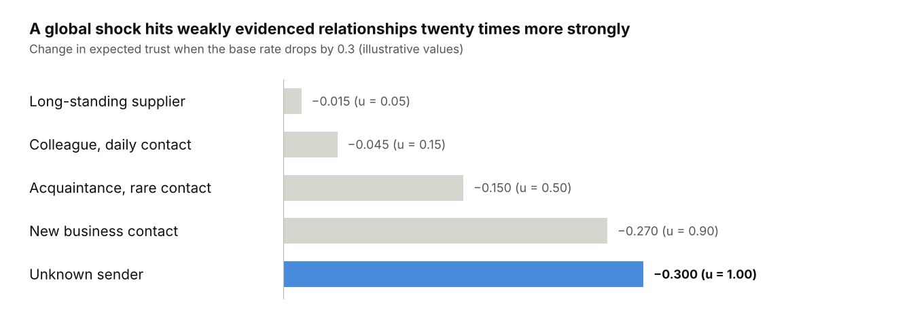

*Figure 9: Effect of a base rate shift according to Section 12.4 · five example edges, illustrative values*

The same news item has effects of different strength depending on the evidential situation. Well-evidenced relationships remain almost unaffected.

| No. | Prediction | Derivation | Testable by |
| --- | --- | --- | --- |
| V15 | Scandals and waves of fraud lower trust in strangers and institutions more than in acquaintances. | ΔE = u·Δa | panel data before and after events |
| V16 | After shocks, people withdraw to known relationships. | only edges with small u remain above the threshold | change in the radius of trust (Delhey et al. 2011) |
| V17 | Intensive reporting on a single event decouples perceived from actual risk. | the descriptive account grows with ln(1 + R); normatively, n_eff stays 1 | media intensity against event frequency |
| V18 | Public distrust persists as long as reporting continues and then decays with the half-life. | repetition offsets temporal decay | time series after the end of reporting |
| V19 | If the base rate for the authenticity of content falls, everyone accumulates evidence more slowly, and verified channels gain value. | q decreases for content evidence; u remains high throughout the graph | use of verified channels over time |
| V20 | Groups with shared, mutually dependent sources overestimate their certainty. | high dependence D is read as independence | source overlap against confidence of judgment |
| V21 | At network level, trust recovers more slowly after a shock than it fell. | distrust propagates more strongly (G2) and stabilizes itself (H11) | agent-based simulation, comparison with survey series |

V15 and V19 fit existing findings: Blanket AI labeling also lowers the credibility of true headlines (Altay & Gilardi 2024), and pointing to possible forgery benefits the accused (Schiff et al. 2025).

### 12.5 Groups and organization

| No. | Prediction | Derivation | Testable by |
| --- | --- | --- | --- |
| V22 | After the first visible security incident, trust in IT tips from overtrust into undertrust, without an intermediate state. | u on A→I high, ΔE = u·Δa (7.4) | survey on τ_I before and after incidents |
| V23 | Teams with high source dependence report attacks less often, although more people see them. | cascade: “If it were dangerous, someone would have reported it” | reporting rate against team size and source overlap |
| V24 | Four-eyes approvals with the same level of information hardly lower the error rate compared with a single approval. | D of the verifiers close to 1 (7.3) | comparison of correlated and independent second approvals |
| V25 | New project and supplier relationships are overrepresented in incident data. | Swift Trust, V9 | incidents by relationship age |
| V26 | Contact with outside sources improves calibration in bubbles and worsens it in echo chambers. | u against d (7.8) | separate measurement of u and d towards outside sources before contact |
| V27 | Awareness training without changes in roles and norms changes test results, not verification rates. | H12, H18 | test scores against measured verification coverage |
| V28 | Diffusion of responsibility is strongest for action classes with a low visible loss and weakest for a high visible loss: the drop in coverage from n = 1 to n = 4 is larger for routine mails than for large payments. | c_n = 1 − ρ^(1/(n−1)), ρ falls with L (7.9) | coverage by n, crossed with action class |
| V29 | The effects of trust in the security institution and of the number of unassigned verifiers multiply: teams with a high τ_I and several unnamed verifiers show lower coverage than either factor alone predicts. | 1 − τ̂_O = (1 − τ_I)(1 − ĉ)^(n−1) (7.9) | survey on τ_I crossed with role assignment, coverage per team |

### 12.6 Limits of the predictions

The predictions are qualitative. Quantitative statements need estimated parameters λ, W, w± and φ per population and context. The formula ΔE = u·Δa assumes that news items only shift the base rate. If a news item concerns a specific entity, it is evidence on that entity's edge.

## 13. Trust dimensions and the security objectives of information security

Only partly: **The four trust dimensions do not cover the security objectives confidentiality, integrity and availability; they complement them.** Both models decompose the same risk, but at different points: the dimensions describe the actor B, the security objectives describe the asset. Three dimensions nevertheless have a close counterpart. Competence has none, and precisely this gap becomes practically relevant with AI agents. This chapter is a derivation from the model and has not yet been empirically tested (hypothesis H15).

### 13.1 Security objectives as types of loss

Information security describes protection requirements through three classic security objectives. ISO/IEC 27000:2018 defines confidentiality as the property that information is not made available or disclosed to unauthorized individuals, entities or processes, integrity as accuracy and completeness, and availability as being accessible and usable on demand by an authorized entity. FIPS 199 and the BSI IT-Grundschutz Compendium use the same three basic values. All three sources allow further security objectives: ISO/IEC 27000 names authenticity, accountability, non-repudiation and reliability; the BSI groups authenticity and non-repudiation under *Verbindlichkeit* and assigns information on author and time of creation to integrity. FIPS 199 goes furthest: there, authenticity and non-repudiation count as part of integrity. **Whether authenticity is a security objective in its own right is not answered consistently by the standards** (Section 13.5).

Parker (1998) considered the triad incomplete and extended it to six elements: confidentiality and possession, integrity and authenticity, availability and utility. His example for utility: data are encrypted, and afterwards the key is lost. The data are present, unchanged and confidential, but unusable. Integrity, he argued, does not mean validity, and availability does not mean usefulness.

What matters for the comparison is where security objectives sit within the concept of risk. Risk is the combination of probability of occurrence and size of the loss. FIPS 199 explicitly categorizes by the expected loss if a security objective is lost, not by the probability of an attack. The protection requirements assessment of IT-Grundschutz likewise asks about the loss. **Security objectives describe the loss side.** The probability side, that is, who attacks, with what intent and what capability, lies in threat modeling. That is where intent is located, not in the security objectives.

### 13.2 Two axes instead of one coverage

This yields the categorical difference. The trust dimensions from Section 2.4 are characteristics of B. They determine how likely B is to meet an expectation, and thus lie on the actor side of risk. The security objectives are characteristics of an asset. They say nothing about B; they name the respects in which the asset can be damaged. The vulnerability that Rousseau et al. (1998) and Mayer et al. (1995) describe as the core of trust is recorded in asset management not as willingness but as loss L.

The model already contains this separation. Core assumption G1 ties the loss to scope of action P and vulnerability L, not to the level of trust. Section 8.1 puts it this way: a vulnerability arises when a positive expectation meets an exploitable scope of action. The expectation is the dimension axis; the scope of action with its loss is the security-objective axis. The vulnerability type “informational” in context c (Section 3.2) can thus be differentiated by security objective.

Both models together span a matrix. The rows are the dimensions k, the columns the security objectives z. A cell holds the risk that B fails in dimension k and that security objective z is violated as a result:

```math
\text{Risk}_{k,z} \approx \left(1 - E^{\text{norm}}_{k}\right)\cdot \mu_{k,z}\cdot L_{z}(P)
```

E is the expected trust in dimension k, μ(k,z) the mapping strength from Section 13.7, and L(P) the maximum loss to security objective z that B can cause with the granted scope of action P. **Without scope of action, L(P) = 0, and the risk vanishes, no matter how low the trust.** This is G1 in cell form: the loss depends on P and L; trust only determines how likely it is to occur. **“B is benevolent but incompetent in handling keys” is a different cell from “B is competent but not benevolent, and passes data on.”** Both violate confidentiality, but they require different countermeasures. The formula has the same structure as the verification rule in 6.3, broken down by dimension and security objective.

### 13.3 The pairs and their limits

**Benevolence and confidentiality (strong).** Benevolence asks whether B wishes me well. In the information context this mainly means: B does not use my information against me. Confidentiality is the loss side of the same expectation.

**Integrity and data integrity (strong).** The dimension integrity, with its individual characteristics honesty, responsibility and openness, corresponds to the security objective integrity: B falsifies nothing, tells the truth about the state of the asset and is accountable. Accountability links the pair to the extended security objectives *Verbindlichkeit* (BSI) and non-repudiation.

**Predictability and availability (strong).** Reliability means the service is there when it is needed. FIPS 199 itself uses the word “reliable” for availability.

**Integrity and confidentiality (weak).** Secrecy can be a commitment. Whoever keeps commitments also keeps this one. The link only applies, however, where confidentiality has been agreed, and it is weaker than the link via benevolence.

**Competence and all three (weak), without a counterpart of its own.** An incompetent B leaks by accident, corrupts through errors, causes outages. But competence has no column of its own in the triad. **CIA presupposes that the system does the right thing and only measures whether it remains undisturbed while doing so.** This gap is the most important finding of the comparison (Section 13.4).

Three observations sharpen the mapping.

*False friend.* Both models use the word integrity for different things. As a dimension it means a person's adherence to principles; as a security objective it means that data remain unaltered. An actor with high personal integrity can violate data integrity through an error; an actor without any adherence to principles can leave data unaltered and still misuse them. This chapter therefore speaks of integrity (dimension) and data integrity (security objective).

*Intent and error.* Competence and predictability mainly explain unintended losses: error, fluctuation, outage. They are close to safety, which considers losses without an attacker. Benevolence and integrity explain intended losses: attack, deception, rule-breaking. They are close to security and threat modeling. This is consistent with the conditional asymmetry in 4.4 and with S17: competence errors and deception are different events because they lie on different rows of the matrix.

*Openness and confidentiality.* Openness is an individual characteristic of integrity; confidentiality demands discretion. The two are compatible when it is clear towards whom B is open (A) and towards whom discreet (third parties). A B that appears particularly open can be a confidentiality risk.

### 13.4 Competence without a counterpart: utility

If competence has no security objective, the question arises which one would correspond to it. The answer is Parker's utility: the result is present, unchanged and confidential, but unusable. That is the typical damage of missing competence.

In ISO/IEC 27000 and in IT-Grundschutz, utility is not a security objective. There it is a given value: an asset is considered because it is economically meaningful, and the protection requirement follows from this value. **Utility is an input to the protection requirements assessment, not an object of protection.**

In practice, an attack on utility is usually represented through availability. Ransomware makes data unusable by making them inaccessible. A lost key acts like an outage, an incompatible format like a lack of availability in usable form. For losses that arise later during operation, this mapping is usually sufficient.

It breaks down where the result is available and unchanged but inadequate from the start: wrong advice, a plausible but incorrect agent output, a correctly implemented but wrong specification. Such cases end up, as a makeshift, under data integrity, although nothing was falsified. There never was a correct state that could have been altered.

This yields a demarcation criterion. **Security models presuppose a target state and protect it against deviation. Competence concerns whether the target state is reached at all.** Utility is the point at which the trust model reaches beyond security risk into performance risk. This explains why competence is the only dimension without a counterpart in the triad: it is not the trust model that is imprecise; the security model ends at this boundary.

Utility is already built into the model. The third verification in 6.1, factual correctness, asks exactly this: is the request or the result correct? And Chen's goal G in the four-place relation (Section 2.5) is the purpose the action is meant to serve. Utility means that φ actually serves G.

### 13.5 Authenticity as an anchor

In extended models authenticity is a security objective in its own right (Parker 1998; ISO/IEC 27000:2018); in others it is part of integrity (FIPS 199; BSI 2023). For the trust model a third reading is more fruitful: **authenticity is not the counterpart of one dimension but the anchor beneath the entire trust profile.** Before A asks whether B is able, wishes well, keeps rules and acts consistently, one thing must be settled: is B really B?

The demarcation from data integrity is precise. Data integrity concerns the content (unchanged?), authenticity the origin (from whom?). Origin, however, is not a question of what is damaged but of whom A trusts. Authenticity therefore belongs on the actor axis.

In the model, this is the edge attribution from 6.1 and 8.4. There, impersonation is the attack in which an attacker inherits the evidence r of another node. In the language of this chapter: **whoever takes over the identity takes over not one dimension but the whole profile.** In CEO fraud, the attacker borrows the competence, benevolence, integrity and reliability that A attributes to the real executive. No security objective is violated by this alone. What becomes invalid is the attribution: all cells of the matrix then rest on evidence that does not belong to the counterpart. Whether a loss occurs is decided only by the requested action with its scope P and loss L. This is why the threshold rule in 6.2 starts from the action and not from the person. Steps 1 to 4 in 10.2 and the Zero Trust requirement to re-verify identity before every session (NIST SP 800-207) secure this anchor, not an individual cell.

### 13.6 Utility as a dimension in its own right for agents

The utility risk is not new. Classic software, too, can be available and unchanged and still fail to deliver what is needed, for example with a correctly implemented but wrong specification (13.4). There, however, it is dealt with before going live: through requirements analysis, testing and acceptance. After that, a deterministic system behaves the same for the same input, and the competence question counts as answered. The risk lies in the project, not in operation, and therefore drops out of the protection requirements assessment.

With AI agents, reaching the target state is itself probabilistic and situation-dependent. The difference is one of degree, but consequential: the risk arises anew with each execution, more frequently and harder to detect, and thereby moves from the project into operation. **An agent can be available, preserve confidentiality and be free of manipulation and still deliver unusable results**: through hallucination, plausible erroneous output or misinterpretation of the task. Fluent wording has a diagnosticity q close to 0 here (Section 10.5). A fixed reference against which data integrity could measure deviations is often missing; the NIST AI RMF notes that for AI systems a ground truth sometimes does not exist or is not available.

That the security models end here is shown by the AI frameworks themselves, which introduce the missing property separately. The NIST AI RMF 1.0 names seven characteristics of trustworthy AI and presents “valid and reliable” as a necessary condition and the basis of the others, while “secure and resilient” is defined separately via confidentiality, integrity and availability (NIST AI 100-1). Utility and CIA stand side by side there, not one within the other. The framework explicitly calls inaccurate but secure, privacy-enhanced and transparent systems undesirable and requires mechanisms to deactivate systems whose outputs are inconsistent with their intended use. The EU AI Act, in Art. 15, lists accuracy, robustness and cybersecurity as separate requirements for high-risk systems.

The security community confirms the shift as well. The OWASP Top 10 for LLM applications list Misinformation (LLM09:2025) as a risk in its own right: false but credible-seeming content, caused by hallucination and amplified by users' unverified trust (OWASP 2025). Next to it stands Excessive Agency (LLM06:2025), that is, too much functionality, permission and autonomy, whose consequences OWASP describes across confidentiality, integrity and availability. Together, the two show the pattern of the matrix: **Excessive Agency enlarges P and thus the loss in the CIA columns; Misinformation is a loss in the utility column without any CIA violation.**

Trust research supplies the matching conceptual axis. In Lee & See (2004), performance corresponds to competence, process to predictability and integrity, purpose to benevolence. Jacovi et al. (2021) conceive of human-AI trust as contractual: it refers to a contract about expected behavior and is warranted only if it is caused by actual trustworthiness. In this language, utility is the subject matter of the contract itself. The agent owes not only that it reveals nothing, falsifies nothing and is reachable, but that its result is fit for the purpose. Over- and undertrust (Parasuraman & Riley 1997) are thus utility risks on A's side.

**Conclusion:** With agents, mapping utility onto availability or data integrity is no longer sufficient. An unusable but available and unchanged result is not an edge case but the characteristic failure pattern. Utility turns from a tacitly given input into a risk dimension that must be assessed, measured and monitored per task type. This supports the rules in 10.5 and hypothesis H14 from the loss side and explains why competence evidence is kept per task type there.

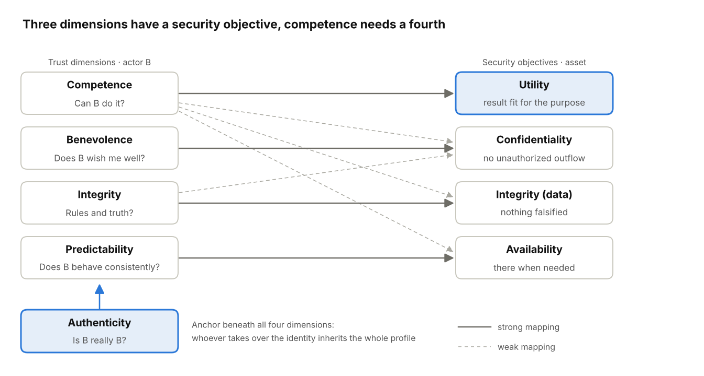

*Figure 10: Trust dimensions and security objectives according to Sections 13.3 to 13.6 · strong and weak mappings, authenticity as an anchor*

The four strong mappings lie on the diagonal. Competence additionally has a weak effect on all other security objectives. Authenticity is not a fifth row but the condition that all four rows are actually attributed to B.

### 13.7 The matrix

| Dimension | Confidentiality | Data integrity | Availability | Utility |
| --- | --- | --- | --- | --- |
| **Competence** – Can B do it? | Can B protect secrets technically? · leak through misconfiguration | Can B process without errors? · data damaged by errors | Can B keep operations running? · outage through incapacity | Can B produce the right result? · plausible but wrong |
| **Benevolence** – Does B wish me well? | Will B refrain from using my information against me? · disclosure, blackmail | Does B want to give me what is true? · targeted manipulation | Does B want to be there for me? · withholding, lock-in | Does B work towards my goal? · result serves B or third parties |
| **Integrity** – Rules and truth? | Does B keep secrecy commitments? · broken confidentiality | Does B falsify nothing and stand by it? · forgery, cover-up | Does B deliver the promised service? · concealed outages | Does B say honestly where its limits lie? · feigned competence |
| **Predictability** – Consistent? | Does B always treat information the same way? · situational leaks | Does B deliver reproducible results? · fluctuating data states | Is the service there when needed? · peak-load outage | Is the quality stable? · sometimes usable, sometimes not; drift |

*Table 13.1: Guiding question and typical damage per cell*

| Dimension | Confidentiality | Data integrity | Availability | Utility | Type of loss |
| --- | --- | --- | --- | --- | --- |
| Competence | weak | weak | weak | **strong** | error |
| Benevolence | **strong** | weak | weak | weak | intent |
| Integrity | weak | **strong** | weak | weak | intent |
| Predictability | weak | weak | **strong** | weak | fluctuation |
| Authenticity | – | – | – | – | anchor beneath all rows |

*Table 13.2: Mapping strength μ(k,z) · ratings are reasoned assumptions, not measured values*

Measured against the triad alone, there are three strong pairs in a 4×3 matrix, while the competence row is only weakly populated. That is the partial coverage. Only the utility column closes the gap.

### 13.8 Implications

**For the model.** Trust dimensions and security objectives are not translated into one another but combined. A risk assessment that considers only security objectives tacitly presupposes competence and authenticity. A trust assessment without security objectives remains unclear about what is at stake. For agents this means: utility is kept as a fourth column in protection requirements and risk assessments and backed by validation and monitoring evidence (rule S19 in 14.1).

**Control and trust.** Security objectives are enforced through controls: encryption, rights, redundancy. Trust is needed where control is missing; Mayer et al. (1995) define it as vulnerability irrespective of the ability to monitor B. The matrix shows where this is the case. For the utility column of agents there are hardly any technical controls that reliably prevent a wrong but plausible result. What remains there is only calibrated trust, based on verified results per task type and human acceptance when L is high.

**For training.** The quick procedure in 9.3 begins with identity, and this chapter supplies the reason: whoever takes over the identity takes over the whole profile. The first verification question is therefore always “Is B really B?” via an independent channel, before any dimension is assessed.

**For human-agent trust.** Users of agents need the reverse training. An agent can be authentic, available and confidential and still not be competent for the specific task. The verification question here is “Is this result fit for my purpose?”, and it must be asked per result, not once per system. This verification, too, is subject to diffusion of responsibility: if several people share the acceptance of agent results, it needs a named role (7.3).

### 13.9 Limitations

- **Utility is hardly established outside Parker.** Neither ISO/IEC 27000 nor IT-Grundschutz lists it as a security objective. The thesis rests on the parallel to “valid and reliable” in the AI RMF, not on a change to the standards.
- **Demarcation from data integrity and availability.** Whether a result was never correct or was altered later is not always observable, for example with poisoned training data. There, cells overlap.
- **Mapping strengths rest on argument, not measurement.** Table 13.2 is an assumption. An empirical test, for example by coding real incidents by row and column, is still pending.
- **Inconsistent standards on authenticity.** The reading as an anchor is a proposal; FIPS 199 and the BSI assign it to integrity, Parker and ISO/IEC 27000 list it separately.
- **Agent as B or as B's tool.** It remains open whether an agent is itself a trustee or a tool of its operator (2.5). This determines to whom benevolence and integrity are attributed.

## 14. Practical statements on information security

Yes: twenty-four concrete rules follow from the model. Many are known as good practice, such as Zero Trust, least privilege and separation of duties. **The model's contribution is a common justification, a ranking by size of the loss and a calculation rule for re-verification intervals.** The rules are derivations and, as a package, have not been empirically tested.

### 14.1 Permission and decision

| No. | Rule | Follows from | Implementation (examples) |
| --- | --- | --- | --- |
| S1 | Permissions depend on the action, not on the person. | threshold θ is independent of the person | approval levels per action class and amount |
| S2 | Identity, authorization and correctness are verified separately. | three separate evidence questions (6.1) | payment approval checks sender, signing authority and invoice separately |
| S3 | High standing and long membership do not replace control. | loss grows with P and L, not with trust (G1) | four-eyes principle for management too |
| S4 | For actions with a very high loss, personal trust is never sufficient. | θ close to 1 cannot be reached with u_min > 0 | second independent approval, technical limits |
| S19 | With agents, the result is checked for utility per task, not just the system for availability and integrity. | competence has no counterpart in the CIA triad (13.4, 13.6) | acceptance criteria per task type, samples of re-checked results, utility as a fourth column of the protection requirements assessment |

S2 hits the core of business email compromise: in 2024, losses of about USD 2.77 billion from it were reported to the FBI (FBI IC3 2024). The attack exploits the equation of trusted sender with authorized payment.

### 14.2 Evidence and channels

| No. | Rule | Follows from | Implementation (examples) |
| --- | --- | --- | --- |
| S5 | A confirmation via the same channel is not a second piece of evidence. | D = 1 yields n_eff = 1 | call-back via a self-chosen number, never via details from the request |
| S6 | A majority counts only if independent. | n_eff is bounded by 1 / D | de-duplicate ratings, reports and agent votes by origin |
| S7 | Content features no longer serve as proof of authenticity. | diagnosticity q tends to 0 as generation costs do | training on action triggers instead of typos or the sound of a voice |
| S8 | Only costly signals count as proof. | q measures forgery costs | signatures, proofs of possession, pre-agreed code words |
| S9 | The evidence account itself is an object of protection. | manipulation of the model (8.4) | tamper-proof logs with provenance per entry |

### 14.3 Time and context

| No. | Rule | Follows from | Implementation (examples) |
| --- | --- | --- | --- |
| S10 | Trust ages and must be renewed. | temporal decay λ, re-verification interval t* | short-lived credentials, recertification of rights, locking of dormant accounts |
| S11 | Riskier rights are verified more often. | t* decreases with smaller u_max | staggered intervals per risk class |
| S12 | Trust from one domain does not justify rights in another. | evidence is context-specific | role separation; raising the verification level on a change of context |
| S13 | Trust is not transitive; chains are limited. | discounting operator (4.6) | verify suppliers and subcontractors individually, limit delegation depth |

### 14.4 People and organization

| No. | Rule | Follows from | Implementation (examples) |
| --- | --- | --- | --- |
| S14 | Verifications must be cheap, otherwise they do not happen. | verification rule K < τ·(1 − E)·L | call-back directory, report button, fixed point of contact |
| S15 | Structure beats vigilance. | low effect of awareness training (Ho et al. 2025) | technical locks and approvals for high-risk actions |
| S16 | False distrust is measured as a cost factor. | Γ < 0 is an error just like Γ > 0 | rate of rejected legitimate requests, time spent per verification |
| S17 | Errors and deception are treated differently. | conditional asymmetry (4.4) | mis-clicks lead to support, not sanctions; deception leads to immediate, broad withdrawal |
| S18 | After an attack wave, thresholds are raised selectively for weakly evidenced edges. | ΔE = u·Δa | stricter verification for new contacts and changed master data instead of for everyone |

S17 has a practical reason: whoever is punished for a mis-click does not report it. The organization then loses evidence. This justification is an assumption and is to be checked.

### 14.5 Groups and organization

| No. | Rule | Follows from | Implementation (examples) |
| --- | --- | --- | --- |
| S20 | Every action class has a named verification role, no “someone checks”. | diffusion of responsibility, verification coverage C (7.3) | verifier named in the approval process; deputy rule |
| S21 | Second verifiers verify independently: different channel, own information, own responsibility. | D of the verifiers (7.3) | second approval sees the request, not the justification of the first approval |
| S22 | The security institution makes visible what it does not catch. | protection delegation, τ_I (7.4) | quarterly figure of attacks that got through; notice on filtered mails: “Filtered does not mean verified” |
| S23 | Verification rates are measured per team and communicated as a norm, never per person. | descriptive norm (7.5); performance monitoring (15.4) | team dashboard; no individual evaluation |
| S24 | New relationships get higher thresholds until individual evidence is available. | swift trust, u close to 1 (7.6, V9) | second approval for first payments to new suppliers and for master data changes |

S22 carries a risk: if the error rate is communicated without context, τ_I tips into undertrust (V22). The figure therefore belongs next to the verification rule for the individual, not on its own.

### 14.6 The four most important rules

If only four rules can be introduced:

1. **S1 with S5:** For a short list of risky actions, a verification via a second, self-chosen channel always applies.
2. **S10:** Every permission has an expiry date, staggered by risk.
3. **S14:** The verification takes less than a minute and is explicitly welcome.
4. **S20:** A named person verifies. Without this rule the other three come to nothing, because the verification is provided for but carried out by no one.

This selection follows from the ratio of size of the loss to effort in the model. It is a recommendation, not a finding.

## 15. Research plan, limitations and open questions

### 15.1 Phases

| Phase | Goal | Result |
| --- | --- | --- |
| 1 Concepts and literature | cross-check marked references; establish the link to Rousseau, Mayer, Lewicki, Jøsang, Lee & See | consistent conceptual model with supported and hypothetical assumptions kept separate |
| 2 Formal specification | fully define the evidence model, context transfer, discounting and both accounts | mathematically consistent specification |
| 3 Minimal simulation | small graph with normative and descriptive account | visible calibration gap Γ per scenario |
| 4 Heuristics and training | trigger list, quick procedure, practice cases with both types of error | testable training concept (H12) |
| 5 Agent prototype | evidence account with temporal decay and approval thresholds for an agent | testable implementation (H13, H14) |
| 6 Evaluation | preregistered studies with discriminability, response bias, time spent | confirmation or refutation per hypothesis |

The technical verification of a simulation is not an empirical validation of the psychological model.

### 15.2 Simulation scenarios

1. Building a new professional relationship.
2. A single serious breach after a short and after a long history (V1, V3).
3. Deception versus competence error at equal event strength (H5a, V6).
4. Long trust-building with cheap events, then a high-risk request (V5).
5. A hundred repetitions of a claim at D = 1, 0.5 and 0 (V17).
6. A dormant relationship over several half-lives (V10 to V12).
7. Global news with a shift in the base rate (V15, V16).
8. Distrust below the interaction threshold with and without enforced feedback (V4).
9. Referral chain with three links (H4).
10. Agent with a version change and renewed attestation (H13).
11. Cross-check by correlated and independent agents (H14).
12. Payment request under time pressure with and without a trigger rule (H12).
13. Agent delivers available, unchanged but unusable results; comparison of detection with and without a utility check per task type (H15c).
14. Team with n = 1, 2 and 4 possible verifiers, role assigned and not assigned, crossed with the loss L and with τ_I (H17, V24, V28, V29).
15. Protection delegation: τ_I assumed 0.99 versus actually 0.9, with and without a visible error rate (H16, H19, V22).
16. Two groups with the same E towards outside sources, one u-dominated (bubble), one d-dominated (chamber), under outside contact (V26).

### 15.3 Limitations and methodological risks

- **Quantification.** Even a triple of b, d and u is an abstraction. It has not been shown that human trust can be represented this completely.
- **Subjectivity.** The model must separate observable facts from subjective assessments.
- **Causality.** An observed change in trust does not show which factor caused it.
- **Abundance of parameters.** λ, W, w±, φ, D and q are numerous. Without hierarchical estimation and model comparison, the model risks becoming unfalsifiable.
- **Identifiability.** Base rate and prior strength can be separated from behavior only with suitable designs.
- **Normative standard.** The normative account presupposes that D and q can be determined. In everyday life they can often only be estimated.
- **Psychological simplification.** Disposition, formative experiences, trauma and beliefs are complex concepts. Individual parameters are deliberate simplifications.
- **Manipulation of the model.** A system that computes trust itself becomes a target of attack (8.4, S9).
- **Meso parameters.** τ_I, c_n and the descriptive norm can only be estimated in field studies. The findings on conformity, cascades and diffusion of responsibility mostly do not come from security contexts (7.10).
- **Trust or reliance.** The model does not represent normative expectations separately. In Chen's (2021) distinction, it mainly describes calibrated reliance (2.5).

### 15.4 Ethics and law

The model serves self-reflection, training, simulation and the assessment of technical systems. **It does not serve the assessment of persons for decisions by third parties.**

- **EU AI Act, Art. 5(1)(c).** Prohibited are AI systems that evaluate persons over a period of time based on their social behavior or personal characteristics, where this leads to detrimental treatment in unrelated contexts or to disproportionate detrimental treatment. A graph that transfers group trust and carries it forward across contexts would come close to this prohibited practice.
- **GDPR Art. 22.** According to CJEU judgment C-634/21 (SCHUFA, 7 December 2023), the very creation of a score can be an automated decision.
- **GDPR Art. 9.** Recorded beliefs can be data on philosophical beliefs or health.
- **Discrimination.** Group priors can confirm themselves. They must never carry a decision on their own (3.3).
- **Performance monitoring.** Verification rates and reporting rates per person constitute behavior and performance monitoring and in Germany are subject to works-council co-determination (German Works Constitution Act (BetrVG) § 87(1) no. 6). The metrics from Chapter 7 are therefore collected per team and action class (S23).

The legal classification is an initial assessment and does not replace a legal review.

### 15.5 Open questions

**Theoretical**

- Are trust and distrust two dimensions or two readings of the same evidence?
- How do trust, credibility and reputation differ in the model?
- What role do emotion and intuition play beyond activation H?
- Does the model need a quantity of its own for normative expectations in order to distinguish trust from mere reliance (Chen 2021)?
- Is utility a security objective alongside confidentiality, integrity and availability, or a quantity outside security (13.4)? Can the boundary between “never correct” and “altered later” be drawn empirically?

**Mathematical**

- How are D and q estimated in everyday life?
- Does the forgetting factor differ by dimension and context (V14)?
- What form does the saturation of the familiarity term take?
- How is context transfer r(e,c) parameterized without counting evidence twice?
- How do beliefs change formally: as a slow prior over priors?

**Psychological**

- Do familiarity effects transfer to organizations and agents (H9)?
- Under what conditions are beliefs revised?
- How do stress and time pressure affect verification effort and accuracy focus?

**Practical**

- Which trigger list is short enough to be followed and broad enough to protect?
- How much independent evidence is needed for which action class?
- How are λ and u_max set on a justified basis for agent systems?
- How does a person recognize that their assessment rests on familiarity rather than evidence?
- How can τ_I be measured without the question itself triggering undertrust in the institution?
- Which team size and which role assignment maximize verification coverage C with acceptable friction?

### 15.6 Next development steps

- [ ] Cross-check the marked references in the bibliography.
- [ ] Write the evidence model from Chapter 4 as an executable specification.
- [ ] Build a minimal simulation with scenarios 2, 4, 5, 7 and 15.
- [ ] Design a trigger list and practice cases for a pilot training (H12).
- [ ] Design a prototype of an agent evidence account with re-verification interval t* (H13).
- [ ] Prepare the preregistration for the first study on H6 or H12.
- [ ] Design a coding scheme for real incidents by dimension × security objective and test it on a sample (for example FBI IC3, ACFE) (H15).

### 15.7 Preliminary synthesis

Artificially generated content devalues the features from which people have so far read trustworthiness. The appropriate response is neither blind trust nor blanket distrust.

**The model describes trust as an evidential situation with three components: trust, distrust and ignorance.** It separates the subjective assessment from the evidence-based one and makes their difference measurable. Attacks, training and technical controls can be described as interventions in the same quantities.

Trust is engineered: not because human trust could be reduced to an algorithm, but because decisions that rest on trust can be structured, verified and improved.

The result is not a machine that determines whom we should trust. It is a model that explains why we trust, when we are wrong and which action is justifiable under uncertainty.

## 16. References

The references come from a literature review for this concept. Entries marked “to be checked” must be checked against the original before publication. Most of the remaining references have not been verified against the full text. Since October 2026, entries are being checked one by one: “verified YYYY-MM-DD” means that the bibliographic details and the cited claim were checked against the full text; “secondary citation” means that the bibliographic details have been checked, but the claim only via the abstract or secondary literature.

### Concept of trust and models

- Castelfranchi, C. & Falcone, R. (2010). Trust Theory. Wiley.
- Chen, M. (2021). Trust and Trust-Engineering in Artificial Intelligence Research: Theory and Praxis. Philosophy & Technology, 34, 1429–1447. https://doi.org/10.1007/s13347-021-00465-4 (checked against full text)
- Colquitt, J. A., Scott, B. A. & LePine, J. A. (2007). Journal of Applied Psychology, 92(4), 909–927.
- Hardin, R. (2002). Trust and Trustworthiness. Russell Sage Foundation.
- Lewicki, R. J. & Bunker, B. B. (1996). In Kramer & Tyler (Eds.), Trust in Organizations. Sage. (to be checked)
- Lewicki, R. J., McAllister, D. J. & Bies, R. J. (1998). Academy of Management Review, 23(3), 438–458.
- Mayer, R. C., Davis, J. H. & Schoorman, F. D. (1995). An Integrative Model of Organizational Trust. Academy of Management Review, 20(3), 709–734.
- McKnight, D. H., Choudhury, V. & Kacmar, C. (2002). Information Systems Research, 13(3), 334–359.
- McKnight, D. H., Cummings, L. L. & Chervany, N. L. (1998). Academy of Management Review, 23(3), 473–490.
- O'Neill, O. (2002). A Question of Trust. Cambridge University Press.
- Rousseau, D. M., Sitkin, S. B., Burt, R. S. & Camerer, C. (1998). Not so different after all. Academy of Management Review, 23(3), 393–404.

### Formal and computational models

- Christianson, B. & Harbison, W. S. (1997). Why isn't trust transitive? Security Protocols Workshop, LNCS 1189, 171–176.
- Douceur, J. R. (2002). The Sybil Attack. IPTPS, LNCS 2429.
- Enke, B. & Zimmermann, F. (2019). Review of Economic Studies, 86(1), 313–332.
- Friedkin, N. E. & Johnsen, E. C. (1990). Journal of Mathematical Sociology, 15(3–4), 193–206.
- Jøsang, A. (2016). Subjective Logic. Springer.
- Jøsang, A. & Ismail, R. (2002). The Beta Reputation System. 15th Bled eConference.
- Marsh, S. (1994). Formalising Trust as a Computational Concept. PhD thesis, University of Stirling.

### Asymmetry, violation and repair

- Baumeister, R. F., Bratslavsky, E., Finkenauer, C. & Vohs, K. D. (2001). Review of General Psychology, 5(4), 323–370.
- Cvetkovich, G. et al. (2002). Risk Analysis, 22(2), 359–367.
- Gal, D. & Rucker, D. D. (2018). Journal of Consumer Psychology, 28(3), 497–516.
- Kim, P. H., Ferrin, D. L., Cooper, C. D. & Dirks, K. T. (2004). Journal of Applied Psychology, 89(1), 104–118.
- Reeder, G. D. & Brewer, M. B. (1979). Psychological Review, 86(1), 61–79.
- Schweitzer, M. E., Hershey, J. C. & Bradlow, E. T. (2006). Promises and lies. Organizational Behavior and Human Decision Processes, 101(1), 1–19.
- Skowronski, J. J. & Carlston, D. E. (1989). Psychological Bulletin, 105(1), 131–142.
- Slovic, P. (1993). Perceived risk, trust, and democracy. Risk Analysis, 13(6), 675–682.
- White, M. P. et al. (2003). Risk Analysis, 23(4), 717–726.

### Groups, disposition and experience

- Alesina, A. & La Ferrara, E. (2002). Journal of Public Economics, 85(2), 207–234.
- Balliet, D., Wu, J. & De Dreu, C. K. W. (2014). Psychological Bulletin, 140(6), 1556–1581.
- Bauer, P. C. (2015). European Sociological Review, 31(4), 397–417.
- Behrens, T. E. J. et al. (2007). Nature Neuroscience, 10(9), 1214–1221.
- Bonanno, G. A. (2004). American Psychologist, 59(1), 20–28.
- Browning, M. et al. (2015). Nature Neuroscience, 18(4), 590–596.
- Burt, R. S. & Knez, M. (1995). Rationality and Society, 7(3), 255–292.
- Cesarini, D. et al. (2008). PNAS, 105(10), 3721–3726.
- Delhey, J., Newton, K. & Welzel, C. (2011). American Sociological Review, 76(5), 786–807.
- Dohmen, T., Falk, A., Huffman, D. & Sunde, U. (2012). Review of Economic Studies, 79(2), 645–677.
- Foddy, M., Platow, M. J. & Yamagishi, T. (2009). Psychological Science, 20(4), 419–422.
- Freitag, M. & Bauer, P. C. (2013). Public Opinion Quarterly, 77, 24–44.
- Jussim, L. (2012). Social Perception and Social Reality. Oxford University Press.
- Kunda, Z. & Thagard, P. (1996). Psychological Review, 103(2), 284–308.
- Mewes, J., Fairbrother, M., Giordano, G. N., Wu, C. & Wilkes, R. (2021). Social Science Research, 95, 102537.
- Paxton, P. & Glanville, J. L. (2015). Is trust rigid or malleable? Social Psychology Quarterly, 78(2), 194–204.
- Reimann, M., Schilke, O. & Cook, K. S. (2017). Trust is heritable, whereas distrust is not. PNAS, 114(27), 7007–7012.
- Sommerfeld, R. D., Krambeck, H.-J., Semmann, D. & Milinski, M. (2007). PNAS, 104(44), 17435–17440.
- Uslaner, E. M. (2002). The Moral Foundations of Trust. Cambridge University Press.
- Van Lange, P. A. M., Vinkhuyzen, A. A. E. & Posthuma, D. (2014). PLoS ONE, 9(4), e93880.

### Groups and organization

- Allport, G. W. (1954). The Nature of Prejudice. Addison-Wesley. (to be checked)
- Asch, S. E. (1951). Effects of group pressure upon the modification and distortion of judgments. In Guetzkow (Eds.), Groups, Leadership and Men. Carnegie Press. (to be checked)
- Bikhchandani, S., Hirshleifer, D. & Welch, I. (1992). A Theory of Fads, Fashion, Custom, and Cultural Change as Informational Cascades. Journal of Political Economy, 100(5), 992–1026. (to be checked)
- Bond, R. & Smith, P. B. (1996). Culture and conformity: A meta-analysis of studies using Asch's line judgment task. Psychological Bulletin, 119(1), 111–137. (to be checked)
- Brink, A., Eller, C. K. & Gan, H. (2015). Reporting fraud: An examination of the bystander effect and evidence strength. Advances in Accounting Behavioral Research, 125–154. https://doi.org/10.1108/S1475-148820150000018004 (secondary citation)
- Cialdini, R. B., Reno, R. R. & Kallgren, C. A. (1990). A focus theory of normative conduct. Journal of Personality and Social Psychology, 58(6), 1015–1026. (to be checked)
- Darley, J. M. & Latané, B. (1968). Bystander intervention in emergencies: Diffusion of responsibility. Journal of Personality and Social Psychology, 8(4), 377–383. (to be checked)
- Diekmann, A. (1985). Volunteer's Dilemma. Journal of Conflict Resolution, 29(4), 605–610. https://doi.org/10.1177/0022002785029004003 (to be checked)
- Edmondson, A. (1999). Psychological safety and learning behavior in work teams. Administrative Science Quarterly, 44(2), 350–383. (to be checked)
- Fischer, P. et al. (2011). The bystander-effect: A meta-analytic review on bystander intervention in dangerous and non-dangerous emergencies. Psychological Bulletin, 137(4), 517–537. (to be checked)
- Grossklags, J., Christin, N. & Chuang, J. (2008). Secure or insure? A game-theoretic analysis of information security games. WWW '08, 209–218. https://doi.org/10.1145/1367497.1367526 (secondary citation)
- Herley, C. (2009). So Long, and No Thanks for the Externalities: The Rational Rejection of Security Advice by Users. NSPW, 133–144. (to be checked)
- Janis, I. L. (1972). Victims of Groupthink. Houghton Mifflin. (to be checked)
- Karau, S. J. & Williams, K. D. (1993). Social loafing: A meta-analytic review and theoretical integration. Journal of Personality and Social Psychology, 65(4), 681–706. https://doi.org/10.1037/0022-3514.65.4.681 (to be checked)
- Latané, B. & Darley, J. M. (1970). The Unresponsive Bystander: Why Doesn't He Help? Appleton-Century-Crofts. (to be checked)
- Levine, M. & Crowther, S. (2008). The responsive bystander: How social group membership and group size can encourage as well as inhibit bystander intervention. Journal of Personality and Social Psychology, 95(6), 1429–1439. (to be checked)
- Lorenz, J., Rauhut, H., Schweitzer, F. & Helbing, D. (2011). How social influence can undermine the wisdom of crowd effect. PNAS, 108(22), 9020–9025. (to be checked)
- Marques, J. M., Yzerbyt, V. Y. & Leyens, J.-P. (1988). The “black sheep effect”. European Journal of Social Psychology, 18(1), 1–16. (to be checked)
- Meyerson, D., Weick, K. E. & Kramer, R. M. (1996). Swift trust and temporary groups. In Kramer & Tyler (Eds.), Trust in Organizations. Sage. (to be checked)
- Nguyen, C. T. (2020). Echo Chambers and Epistemic Bubbles. Episteme, 17(2), 141–161. (to be checked)
- Paravastu, N., Simmers, C. A. & Anandarajan, M. (2018). Non-compliant mobile device usage and information systems security: A bystander theory perspective. International Journal of Information Systems and Social Change, 9(1), 1–25. https://doi.org/10.4018/IJISSC.2018010101 (secondary citation)
- Peltzman, S. (1975). The Effects of Automobile Safety Regulation. Journal of Political Economy, 83(4), 677–725. (to be checked)
- Pettigrew, T. F. & Tropp, L. R. (2006). A meta-analytic test of intergroup contact theory. Journal of Personality and Social Psychology, 90(5), 751–783. https://doi.org/10.1037/0022-3514.90.5.751 (secondary citation)
- Sagan, S. D. (2004). The problem of redundancy problem: Why more nuclear security forces may produce less nuclear security. Risk Analysis, 24(4), 935–946. https://doi.org/10.1111/j.0272-4332.2004.00495.x (to be checked)
- Varian, H. (2004). System reliability and free riding. In Camp & Lewis (Eds.), Economics of Information Security, 1–15. Springer. https://doi.org/10.1007/1-4020-8090-5_1 (secondary citation)
- Wilde, G. J. S. (1982). The theory of risk homeostasis: Implications for safety and health. Risk Analysis, 2(4), 209–225. https://doi.org/10.1111/j.1539-6924.1982.tb01384.x (secondary citation)
- Zhang, J., Reithel, B. J. & Li, H. (2009). Impact of perceived technical protection on security behaviors. Information Management & Computer Security, 17(4), 330–340. https://doi.org/10.1108/09685220910993980 (secondary citation)

### Beliefs and feedback loops

- Clifton, J. D. W. et al. (2019). Primal world beliefs. Psychological Assessment, 31(1), 82–101.
- Coppock, A. (2022). Persuasion in Parallel. University of Chicago Press.
- Crick, N. R. & Dodge, K. A. (1994). Psychological Bulletin, 115(1), 74–101.
- Delgado, M. R., Frank, R. H. & Phelps, E. A. (2005). Nature Neuroscience, 8(11), 1611–1618.
- Denrell, J. (2005). Psychological Review, 112(4), 951–978.
- Fetchenhauer, D. & Dunning, D. (2010). Why so cynical? Psychological Science, 21(2), 189–193.
- Haselhuhn, M. P., Schweitzer, M. E. & Wood, A. M. (2010). Psychological Science, 21(2), 181–183.
- Kelley, H. H. & Stahelski, A. J. (1970). Journal of Personality and Social Psychology, 16(1), 66–91.
- Lord, C. G., Ross, L. & Lepper, M. R. (1979). Journal of Personality and Social Psychology, 37(11), 2098–2109.
- Wood, T. & Porter, E. (2019). The elusive backfire effect. Political Behavior, 41(1), 135–163.

### Repetition and familiarity

- Brashier, N. M., Eliseev, E. D. & Marsh, E. J. (2020). Cognition, 194, 104054.
- Fazio, L. K., Brashier, N. M., Payne, B. K. & Marsh, E. J. (2015). Knowledge Does Not Protect Against Illusory Truth. Journal of Experimental Psychology: General, 144(5), 993–1002. To be cited as “knowledge does not reliably protect”; cf. Shechter & Klauer (2025), Personality and Social Psychology Bulletin.
- Hasher, L., Goldstein, D. & Toppino, T. (1977). Frequency and the Conference of Referential Validity. Journal of Verbal Learning and Verbal Behavior, 16(1), 107–112.
- Hassan, A. & Barber, S. J. (2021). Cognitive Research: Principles and Implications, 6, 38.
- Koch, T. & Zerback, T. (2013). Journal of Communication, 63(6), 993–1010.
- Mattavelli, S., Brambilla, M. & Unkelbach, C. (2025). Repeating statements increases source credibility. Personality and Social Psychology Bulletin, 52(9), 2724–2737.
- Montoya, R. M. et al. (2017). Psychological Bulletin, 143(5), 459–498.
- Ye et al. (2026). Nature Communications, 17, 3270. (author list to be checked)
- Yousif, S. R., Aboody, R. & Keil, F. C. (2019). The illusion of consensus. Psychological Science, 30(8), 1195–1204.

### AI, provenance and automation

- Altay, S. & Gilardi, F. (2024). PNAS Nexus, 3(10), pgae403.
- Chesney, R. & Citron, D. (2019). Deep Fakes: A Looming Challenge. California Law Review, 107, 1753–1820.
- Glikson, E. & Woolley, A. W. (2020). Academy of Management Annals, 14(2), 627–660.
- Jacovi, A., Marasović, A., Miller, T. & Goldberg, Y. (2021). Formalizing Trust in Artificial Intelligence: Prerequisites, Causes and Goals of Human Trust in AI. FAccT '21, 624–635. https://doi.org/10.1145/3442188.3445923
- Lee, J. D. & See, K. A. (2004). Human Factors, 46(1), 50–80.
- Nightingale, S. J. & Farid, H. (2022). PNAS, 119(8), e2120481119.
- NIST (2023). Artificial Intelligence Risk Management Framework (AI RMF 1.0). NIST AI 100-1. https://doi.org/10.6028/NIST.AI.100-1
- OWASP (2025). OWASP Top 10 for LLM Applications 2025 (LLM06 Excessive Agency, LLM09 Misinformation). OWASP Foundation.
- Parasuraman, R. & Manzey, D. H. (2010). Human Factors, 52(3), 381–410.
- Parasuraman, R. & Riley, V. (1997). Human Factors, 39(2), 230–253.
- Schiff, K. J., Schiff, D. S. & Bueno, N. S. (2025). The Liar's Dividend. American Political Science Review, 119(1), 71–90.
- Spence, M. (1973). Job Market Signaling. Quarterly Journal of Economics, 87(3), 355–374.
- Wang, Sturgis & de Kadt (2026). AI labeling reduces the perceived accuracy of online content but has limited broader effects. Telematics and Informatics, 107. (to be checked)

### Training, adversarial thinking and security

- ACFE (2024). Occupational Fraud 2024: A Report to the Nations.
- Beautement, A., Sasse, M. A. & Wonham, M. (2008). The compliance budget. NSPW, 47–58.
- Bond, C. F. & DePaulo, B. M. (2006). Personality and Social Psychology Review, 10(3), 214–234.
- Cressey, D. R. (1953). Other People's Money. Free Press.
- FBI Internet Crime Complaint Center (2024). Internet Crime Report 2024.
- Hauch, V., Sporer, S. L., Michael, S. W. & Meissner, C. A. (2016). Communication Research, 43(3), 283–343.
- Ho, G., Mirian, A., Luo, E. et al. (2025). Understanding the Efficacy of Phishing Training in Practice. IEEE Symposium on Security and Privacy.
- Hoes, E., Aitken, B., Zhang, J., Gackowski, T. & Wojcieszak, M. (2024). Nature Human Behaviour, 8, 1545–1553.
- Hogarth, R. M. (2001). Educating Intuition. University of Chicago Press.
- Levine, T. R. (2014). Journal of Language and Social Psychology, 33(4), 378–392.
- Lord, C. G., Lepper, M. R. & Preston, E. (1984). Journal of Personality and Social Psychology, 47(6), 1231–1243.
- Mellers, B. et al. (2014). Psychological Science, 25(5), 1106–1115.
- Mitchell, D. J., Russo, J. E. & Pennington, N. (1989). Journal of Behavioral Decision Making, 2(1), 25–38.
- Modirrousta-Galian, A. & Higham, P. A. (2023). Journal of Experimental Psychology: General, 152(9), 2411–2437.
- Morewedge, C. K. et al. (2015). Policy Insights from the Behavioral and Brain Sciences, 2(1), 129–140.
- Rose, S. et al. (2020). Zero Trust Architecture. NIST SP 800-207.
- Saltzer, J. H. & Schroeder, M. D. (1975). Proceedings of the IEEE, 63(9), 1278–1308.
- Sellier, A.-L., Scopelliti, I. & Morewedge, C. K. (2019). Psychological Science, 30(9), 1371–1379.
- Stanton, B. et al. (2016). Security fatigue. IT Professional, 18(5), 26–32.
- Wineburg, S. & McGrew, S. (2019). Teachers College Record, 121(11).

### Security objectives of information security

- BSI (2017). BSI-Standard 200-1: Managementsysteme für Informationssicherheit, Version 1.0. Bundesamt für Sicherheit in der Informationstechnik. (to be checked)
- BSI (2023). IT-Grundschutz-Kompendium, Edition 2023, Glossar. Bundesamt für Sicherheit in der Informationstechnik. (wording on authenticity and *Verbindlichkeit* to be checked)
- ISO/IEC 27000:2018. Information technology – Security techniques – Information security management systems – Overview and vocabulary. (definitions to be checked against the text of the standard)
- NIST (2004). FIPS PUB 199: Standards for Security Categorization of Federal Information and Information Systems.
- Parker, D. B. (1998). Fighting Computer Crime: A New Framework for Protecting Information. Wiley. (page number for utility to be checked)

### Law

- Regulation (EU) 2024/1689 (AI Act), Art. 5(1)(c); Art. 15 (accuracy, robustness and cybersecurity).
- Regulation (EU) 2016/679 (GDPR), Art. 9 and Art. 22.
- CJEU, judgment of 7 December 2023, C-634/21 (SCHUFA).
- German Works Constitution Act (Betriebsverfassungsgesetz, BetrVG), § 87(1) no. 6.
